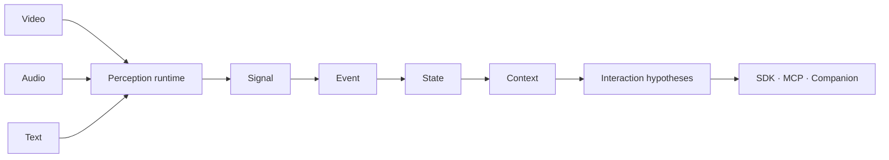

<div align="center">

# 👁️ HumanSense

### Human interaction context for AI agents — in real time.

Turn video, voice, and conversation into structured observations, interaction hypotheses, and context-aware responses.

**🐍 Python SDK · 🔌 MCP · 🏠 Local-first · ⚡ Event-driven · 🧩 Pluggable models**

[Agent setup](docs/agent-setup.md) · [Quick start](#-quick-start) · [Python SDK](#-python-sdk) · [MCP](#-mcp-for-ai-agents) · [Companion](#-context-aware-companion) · [Documentation](#-documentation)

</div>

---

HumanSense gives agents a shared layer for observing behavior, tracking changes, and adapting a conversation. It combines a versioned output contract, local temporal memory, optional perception backends, and agent integrations.

**Status: v0.1 alpha.** The SDK, MCP, and integration logic are tested. Live camera/microphone runs and optional model execution still need validation. Model weights are supplied separately; no trained emotion or intent model is bundled.

## ✨ What it provides

| Capability | Output | Available behavior |
| --- | --- | --- |
| 💬 **Conversational Intelligence** | Requests, repetition, response timing, interaction hypotheses | Korean/English clarification rules; optional evidence-citing model analysis |
| 📈 **Behavioral Intelligence** | Measurements, personal baselines, changes over time | Per-subject, model-version-aware numeric trends and change events |
| 🔎 **Statement Consistency** | Conflicting assertions and possible contradictions | Structured claim comparison; optional model candidates with exact source excerpts |
| 🧠 **Temporal Memory** | Current state, history, context | SQLite storage, configurable retention, evidence inspection |
| 🤝 **Agent Responses** | Suggested next action or generated reply | Context-aware Companion using a configured local or authorized remote provider |
| 🎥 **Perception Plugins** | Video/audio measurements and transcripts | OpenCV, MediaPipe, Silero VAD, faster-whisper adapters |

## 🚀 Quick start

Requires **Python 3.10+**. From this checkout:

```bash
python3 -m venv .venv
source .venv/bin/activate
python -m pip install -e .

# Synthetic inputs: inspect all three output domains.
python -m humansense demo

# Local dashboard.
python -m humansense dashboard
```

Open **http://127.0.0.1:8766**, give processing consent, and enter a message such as `설명이 어려워요. 다시 설명해 주세요.`

The core SDK and MCP have **no runtime dependencies**. The dashboard supports text input and browser audio-energy measurements without extras. For camera analysis and native camera/microphone capture:

```bash
python -m pip install -e '.[vision,audio]'
```

The distribution name is `humansense-sdk`; the Python import is `humansense`. Install from this repository or a built wheel. A PyPI release is not currently claimed.

## 🐍 Python SDK

```python
import asyncio
from humansense import HumanSense

async def main():
    async with HumanSense(
        consent=True,
        store="sqlite:///local.db",
        retention_hours=24,
    ) as human:
        result = await human.push_text(
            "다시 설명해 주세요.", subject_id="local-user"
        )

        print(result["predictions"]["conversation"])
        print(result["predictions"]["behavior"])
        print(result["predictions"]["consistency"])
        print(result["recommended_action"])

        state = await human.get_state()
        context = await human.get_context(window="1h")
        history = await human.get_history(hours=24)

asyncio.run(main())
```

Feed existing applications through `push_video`, `push_audio`, `push_text`, `push_signal`, or `push_claim`. Ingestion does not open devices. Register a perception plugin before pushing media; missing inputs remain `unavailable`.

Subscribe with `human.events()` for changes, `human.signals()` for measurements, or `human.observe()` for inferences. These async iterators deliver future records: start the consumer before producing input. Use history queries for retained records.

### 📦 One output contract



| Layer | Purpose | Example |
| --- | --- | --- |
| **Signal** | Measured or explicitly supplied input | `audio.rms`, `text.utterance` |
| **Event** | A meaningful change | `speech.started`, `interaction.clarification_requested` |
| **State** | Current observation snapshot | Latest signals and modality availability |
| **Context** | Evidence-backed temporal summary | Event counts and personal trends |

Every record carries a subject ID, timestamp, schema version, model provenance, quality, observation, and evidence. `human.inference` adds the three intelligence domains and a recommended action.

**Scores have distinct meanings:** `model_score` is a pattern score; `probability` requires a registered calibration artifact and held-out validation. Without that evidence, probabilities remain `null`. See the [output contract](docs/contract.md) and [prediction/feedback workflow](docs/predictions.md).

## 🔌 MCP for AI agents

**Start here:** [Agent setup: install → capture → inspect → stop](docs/agent-setup.md) covers dependencies, actual model paths, remote-client placement, realtime collection and model configuration.

Start the stdio server:

```bash
python -m humansense.mcp
# Installed entry point: humansense-mcp
```

Add it to your MCP client's server configuration, replacing the absolute paths:

```json
{
  "mcpServers": {
    "humansense": {
      "command": "/path/to/catch-your-mind/.venv/bin/python",
      "args": ["-m", "humansense.mcp"],
      "cwd": "/path/to/catch-your-mind"
    }
  }
}
```

| Tools | Purpose |
| --- | --- |
| `get_state`, `get_events`, `get_context`, `get_trends` | Read current and temporal observations |
| `inspect_interval` | Inspect retained evidence |
| `push_text`, `push_claim` | Supply conversation and structured assertions |
| `start_capture`, `stop_capture`, `get_capture_status` | Control local devices |
| `pause_capture`, `resume_capture`, `delete_data` | Control observation and retention |
| `analyze`, `chat`, `record_feedback` | Use a configured model and record observed outcomes |

Camera and microphone capture require explicit consent and installed extras. Example `start_capture` arguments:

```json
{"consent": true, "video": 0, "audio": true, "subject_id": "local-user"}
```

Use `video: null` for microphone-only capture. Optional local model paths are `face_model_path`, `vad_model_path`, `asr_model_path`, and one person detector path (`yolo_model_path` or `onnx_model_path`). Capture and queries share the same MCP runtime. Separately started MCP and dashboard processes do not share live capture.

## 🎥 Vision & voice

| Backend | Install extra | Measurements / requirements |
| --- | --- | --- |
| OpenCV | `vision` | HOG person boxes, counts, stream-local IoU tracks |
| YOLO / Ultralytics | `yolo` | Local trusted detection weights, boxes and stream-local tracks |
| ONNX Runtime | `onnx` | Contract-validated person detector or explicitly mapped feature scores |
| Image-model server | `vision` + configured endpoint | Rate-limited unverified visual descriptions and expression scores |
| MediaPipe Tasks | `mediapipe` | Face landmarks and blendshapes; local `.task` file |
| Audio level | None for supplied PCM; `audio` for native capture | RMS, dBFS, energy activity — not speech recognition |
| Silero VAD | `vad` | Speech activity and start/stop events; local JIT file |
| faster-whisper | `asr` | Transcripts and transcribed-word-rate measurements; local model directory |

```python
from humansense.plugins import AudioLevelPlugin, MediaPipeFacePlugin

human.register(AudioLevelPlugin())
human.register(MediaPipeFacePlugin("models/face_landmarker.task"))
# await human.push_video(decoded_bgr_frame)
# await human.push_audio(normalized_mono_pcm, sample_rate=16000)
```

No weights are bundled or automatically downloaded. Native capture uses `CaptureSession`; see [the capture example](examples/realtime_capture.py). HOG can miss seated webcam users. Track IDs represent geometry within a stream, not verified identity or audio-speaker ownership. SAM3 and biometric re-identification are not included. See [additional model configuration](docs/additional-models.md) for YOLO, ONNX and image-model adapters.

## 🤝 Context-aware Companion

Configure an actual chat-completions server and installed model:

```bash
export HUMANSENSE_COMPANION_URL=http://127.0.0.1:11434/v1/chat/completions
export HUMANSENSE_COMPANION_MODEL=YOUR_INSTALLED_MODEL_NAME
python -m humansense dashboard
```

Choose **Companion에게 보내기** in the dashboard, or call the MCP `chat` tool. The Companion uses conversation history, observation context, and the suggested strategy to generate a reply. Without a configured backend it reports an error instead of producing a fake model response.

For evidence-citing semantic analysis, configure `HUMANSENSE_REASONING_URL` and `HUMANSENSE_REASONING_MODEL`, then call `analyze`. Remote providers require explicit permission to transmit text and measurements. See [Companion setup](docs/companion.md) and [reasoning configuration](docs/reasoning.md).

## 🌐 WebSocket & integrations

```bash
python -m pip install -e '.[websocket]'
python -m humansense.server --port 8765 --origin http://localhost:3000
```

The loopback WebSocket service exposes the same tool calls. Events are the default stream; the `humansense/subscribe` extension selects events, signals, and inferences.

- **JavaScript / TypeScript:** [Promise-based client](integrations/typescript/README.md) with subscriptions, timeouts, and response matching.
- **LiveKit / Pipecat:** [Decoded-media bridges](docs/integrations.md) with explicit participant attribution, media-clock mapping, and mono/16kHz conversion. Native framework compatibility still needs validation.
- **Custom models:** implement `PerceptionPlugin.process(frame)` to supply signals with model IDs and versions. The output contract remains independent of the backend.

## 🔒 Evidence & privacy

- Obtain participant consent before setting `consent=True` or starting capture.
- Raw camera frames and microphone audio are never persisted by the built-in store.
- SQLite defaults to memory; disk persistence is opt-in and retention is configurable.
- `pause()` and `delete_data()` invalidate pending processing; late model results cannot restore deleted observations.
- Keep observations separate from hypotheses. Expression scores do not establish inner emotions, diagnoses, deception, or hidden intentions.
- Third-party packages and model weights retain their own licenses. No REA or closed-source implementation is bundled; see [third-party notes](docs/third-party.md).

## 🧪 Development & validation

```bash
python -m unittest discover -s tests -v
node integrations/typescript/client.test.mjs
python -m humansense demo
python -m benchmarks.runtime --samples 200
python -m benchmarks.stdio --samples 100
```

Verified locally: **153 Python tests**, **3 JavaScript client tests**, wheel installation, and actual MCP stdio subprocess communication. Optional backends use mock fixtures; real device/model execution is deferred. The [synthetic benchmark](docs/runtime-benchmark.md) and [latency reports](docs/latency.md) include actual SDK/MCP processing measurements. `get_metrics` exposes runtime/plugin p50/p95/p99; capture status includes audio queue wait. VAD stop decisions can finalize residual ASR through `flush_audio`; timing distinguishes decision-to-transcript from acoustic speech-end delay. These are not claims of camera/model performance. FPS targets, model accuracy, and an eight-hour soak are not yet validated.

## 📚 Documentation

| Guide | Contents |
| --- | --- |
| [Agent setup](docs/agent-setup.md) | End-to-end installation, MCP capture and model configuration |
| [Additional models](docs/additional-models.md) | YOLO, ONNX and image-model configuration |
| [Latency measurements](docs/latency.md) | Actual MCP results, telemetry and model/live benchmarks |
| [Output contract](docs/contract.md) | Layers, evidence, scores, timestamps |
| [Predictions & feedback](docs/predictions.md) | Target registration, outcomes, held-out calibration |
| [Model reasoning](docs/reasoning.md) | Local/provider analysis and citation validation |
| [Companion](docs/companion.md) | Context-aware conversations |
| [Tracking](docs/tracking.md) | Stream-local association and ambiguity |
| [Media bridges](docs/integrations.md) | External streams, clocks, PCM conversion |
| [Evaluation](docs/evaluation.md) | Hardware checks and evaluation gates |
| [Completion audit](docs/completion-audit.md) | Implemented, missing, and unverified requirements |
| [GitHub publishing](docs/github-push.md) | Publish the delivery bundle from a connected host |

## 📄 License

Original code is licensed under **Apache-2.0**. See [LICENSE](LICENSE). Review each dependency and model-weight license before redistribution.
