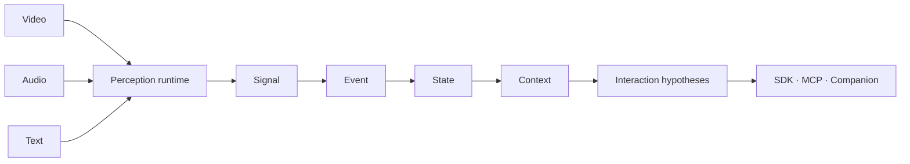

<div align="center">


### Continuous multimodal observation and decision context for agents.

Turn high-frequency vision, sound, physical, environmental, and spatial streams into time-aligned state, semantic episodes, and bounded decisions for your existing AI agent. GAMST keeps observing continuously, fuses evidence across time, and invokes an expensive VLM or LLM only when the world changes or the evidence is insufficient.

**🐍 Python SDK · 🔌 MCP · 🏠 Local-first · ⚡ Event-driven · 🧩 Pluggable models**

[Rotation](#rotation) · [Quick start](#-quick-start) · [Python SDK](#-python-sdk) · [MCP](#-mcp-for-ai-agents) · [Companion](#-context-aware-companion) · [Documentation](#-documentation)

⭐ If GAMST is useful to you, a [GitHub star](https://github.com/NomaDamas/Gamst) helps the project a lot.

</div>

---

GAMST gives agents a shared layer for observing a changing world, tracking physical and semantic state, and adapting an action. The product's core is continuous observation and decision context; Companion replies are optional.

**Status: v0.6 alpha.** Adds executable recipes (`gamst recipe setup | check | run`): `coin-flip` and `rotation` (fans, wheels, turntables), each installing only its own parts and checking the camera's frame rate against the sampling limit first. Also: generic [object rotation](docs/halo-coin.md) (`gamst demo rotation`), role-based agentic setup built into GAMST (`gamst setup`, `gamst.crew`; profiles run with `--profile`), and builds on bounded background ASR/VLM workers, live context streaming, a shared-session MCP bridge, and the GAMST Playground (browser + local). Benchmark/billing code moved to the [archive](docs/archive/benchmarks-and-evaluation.md). No model establishes a person's inner emotions or intentions.

## 🗂️ Contents

- [🌱 Context layer](#overview)
- [✨ Capabilities](#capabilities)
- [🔄 Object rotation](#rotation)
- [🚀 Quick start](#quick-start)
- [🏠 Complete local stack](#local-stack)
- [🐍 Python SDK](#python-sdk)
- [🔌 Context MCP](#mcp)
- [🎥 Vision & voice](#perception)
- [🤝 Companion](#companion)
- [🌐 Integrations](#integrations)
- [🖥️ Playground](#dashboard-guide)
- [🗄️ Retention](#retention)
- [🧩 Optional providers](#providers)
- [🔬 Research & roadmap](#research)
- [🧭 Product direction](docs/product-direction.md)
- [📊 Benchmarking](#benchmarking)
- [🔒 Privacy](#privacy)
- [🧪 Validation](#validation)
- [📚 Documentation](#documentation)
- [📄 License](#license)

<a id="overview"></a>
## 🌱 A context layer for an ecosystem of tools

Connect high-frequency vision, sound, physical, environmental, and spatial
perception tools once; reuse their timestamped observations, cross-modal events,
semantic episodes, and bounded decisions in dashboards, LLM/VLM prompts, MCP
agents, realtime sessions, and streaming applications. Models, transports, and
consuming applications can evolve independently.

GAMST is not a raw-media relay and not a model that thinks about every frame.
It is a temporal observation runtime:

```text
camera 30–120 Hz · audio 16 kHz · IMU/force/tactile 100–1000 Hz
        ↓
high-frequency modality plugins
- tracking · geometry · physics · audio features · ASR · OCR
        ↓
GAMST signals + short-term semantic state chain
- current state · state transitions · episode memory · evidence IDs
        ↓
MCP Context requested by the application
        ↓
strong VLM/LLM fuses selected frames, audio/text and state chain
        ↓
agent answer or action
```

Application-owned rules may choose when to request Context or call the strong
model. GAMST does not run a hidden trigger model and does not replace the
strong VLM/LLM's semantic understanding.

The central promise is **continuous observation, temporal sensor fusion,
event-driven Context, evidence-backed state, and semantic episode construction**.
High-frequency input is preserved; the runtime converts it into low-token Context
that an agent can use without repeatedly asking a VLM to re-understand the same
scene. The selected small streaming-video profile is the official StreamingVLM
implementation (MIT, pinned upstream revision); its checkpoint must be hosted
explicitly by the operator. GAMST does not bundle weights or pretend a generic
chat endpoint is streaming-KV inference.

**Application examples:** AI companions; travel assistants describing surroundings;
interview or interrogation-session transcription and timeline review; health and
wellness observation; accessibility; robotics; user research. These are possible
integrations, not built-in claims of diagnosis, emotion accuracy or lie detection.
Application-specific analysis belongs to the selected model and consuming app.

**Current extension architecture:** independent bounded audio/video lanes; shared
PCM/JPEG transport validation; explicit package-entry-point plugins; optional local
Hugging Face classifiers; Ollama token streaming; SDK/WebSocket/MCP context output.
The browser demos show gauges, category bars/donuts, leading score categories and
rolling time series. Classification categories come from the connected model;
the bundled face model outputs facial movements.

The design adapts ideas from [Pipecat's frame processing](https://docs.pipecat.ai/pipecat/learn/pipeline),
[Hugging Face's task pipelines](https://huggingface.co/docs/transformers/main_classes/pipelines)
and [Ollama's streaming API](https://docs.ollama.com/api/streaming). It is original
implementation, not a fork or endorsement of those projects.

**[Streaming protocols, plugin authoring, provider setup and examples →](docs/streaming-and-plugins.md)**

<a id="capabilities"></a>
## ✨ What it provides

| Capability | Output | Available behavior |
| --- | --- | --- |
| 💬 **Conversational Intelligence** | Requests, repetition, response timing, interaction hypotheses | Korean/English clarification rules; optional evidence-citing model analysis |
| 📈 **Behavioral Intelligence** | Measurements, personal baselines, changes over time | Per-subject, model-version-aware numeric trends and change events |
| 🔎 **Statement Consistency** | Conflicting assertions and possible contradictions | Structured claim comparison; optional model candidates with exact source excerpts |
| 🧠 **Temporal Memory** | Current state, history, context | SQLite storage, configurable retention, evidence inspection |
| 🤝 **Agent Responses** | Suggested next action or generated reply | Context-aware Companion using a configured local or authorized remote provider |
| 🧭 **Temporal Fusion & State Chain** | Time-aligned state, semantic episodes, evidence and bounded context | Freshness watermarks, physical-state precomputation, deterministic rules, optional multimodal observation plugin |
| 🎥 **Perception Plugins** | High-frequency vision/audio/physical measurements and semantic windows | OpenCV, MediaPipe, Silero VAD, faster-whisper, depth, tracking and pluggable workers |
| 🔄 **Rotation Counting (Experimental)** | Turn counts and `undersampled` status | High-frame-rate ellipse-ratio fitting; live 240 fps iPhone HUD and per-take replay |

### Why GAMST exists

Realtime APIs provide a low-latency, bidirectional interaction channel. Media
pipelines move bytes, robotics stacks run control loops, and strong VLMs/LLMs
interpret selected evidence. GAMST sits between those layers and the agent: it
aligns multirate streams, computes state and physical relations, preserves
evidence, and builds a short-term semantic state chain. An MCP client or
application requests that Context and owns the heavy-model prompt and trigger.
GAMST itself does not secretly invoke a strong model.

GAMST is for teams whose systems observe continuously, combine several
asynchronous modalities, care about short-lived events, and must change an
agent's action from that evidence. A single-image caption, one-shot transcript,
or ordinary chatbot is intentionally outside this target.

#### Why not let an LLM watch the video?

A coding agent that can read images can count from a video: it cuts frames into timestamped contact sheets,
looks at them, and zooms into doubtful moments. It did so on the two test-bed clips
([docs/measurements/testbed-2026-11-26.md](docs/measurements/testbed-2026-11-26.md)), but it found *where* to look
from what perception modules had measured (impact sounds, wrist heights, transcripts, voice scores), and it cannot hear.

| | An LLM looks at frames | GAMST |
| --- | --- | --- |
| **Delay** | tens of seconds to minutes per question | per frame; measured: pose 31 ms/frame on a Mac CPU (keeps up with 30 fps, not with 60 fps: the 11.9 s 60 fps clip took 28.5 s) |
| **One hour of video** | 108,000 frames at 30 fps; at 20 fps in sheets of 48, about 1,500 images, millions of input tokens (estimate) | on the device, no API cost |
| **Always on** | not practical | what it is for |
| **Same answer twice** | may differ between looks | same input, same count (three reruns gave the same 15) |
| **Time resolution** | the spacing of the frames looked at (0.05 s) | every frame; sound onsets every 0.01 s |
| **Privacy** | the frames are sent to the model provider | stays on the device unless a cloud module is chosen |
| **Sound** | cannot hear | hears |

The two work together: GAMST counts everything, continuously; an LLM looks only at the few events GAMST marks as
doubtful, through bounded evidence.

The reusable boundary is the common temporal contract, not a list of sensors:

```text
Signal → Observation → Track/State → Event → Episode → Decision → Action context
```

Vision and sound are both high-frequency streams. Their useful submodalities
include tracking, optical flow, pose, gaze, depth, segmentation, OCR, VAD,
partial ASR, sound events, speaker activity, direction, prosody, vibration and
cross-modal timing. Additional physical, environmental, and spatial modalities
include IMU, force/torque, tactile, vibration, radar/CSI, thermal, pressure,
flow, temperature, gas, calibration, and mapped coordinates. GAMST combines
these only where their timing and evidence explain a state or event that a
single modality cannot establish.

The product claim is measurable rather than absolute: on a declared task and
sensor set, compare VLM-only, always-on small streaming VLM, and GAMST hybrid
routing on event recall, miss rate, detection latency, p95 answer-ready latency,
VLM tokens/cost, drops, and task quality. GAMST must preserve critical-event
quality while reducing unnecessary semantic inference.

The first Halo is [generic object rotation](docs/halo-coin.md): measure how
many times tracked objects turn from camera frames, a task a frame-sampling
VLM cannot do. A coin, wheel or fan is only a detector label, not a code path.
The next Halo is a high-frequency, multimodal game or sports episode,
such as a table-tennis rally: ball and racket trajectories, impact timing,
player pose, sound onsets, spatial relations, and a semantic rally summary.
Fast state estimation and action timing run below the semantic layer. A bounded
semantic state chain keeps current state, episode transitions and evidence IDs;
application-owned rules decide when an MCP client asks an LLM/VLM for deeper
interpretation. This demonstrates continuous physical observation, semantic
understanding over time, selective reasoning, and an agent-visible action
without claiming that a language model is the motor controller.

The first practical customers are teams building embodied agents, interactive
robotics, sports and game agents, multimodal field systems, and perception
infrastructure. GAMST is valuable when each team would otherwise rebuild clock
alignment, bounded queues, gap handling, cross-modal events, episode memory,
evidence provenance, model routing, replay, and latency/cost/quality evaluation.

<a id="rotation"></a>
## 🔄 Object rotation

https://github.com/user-attachments/assets/419dba58-2668-43c7-b8a9-20a7088b1b9d

An iPhone at 240 fps streams a coin toss to GAMST. GAMST follows the coin
through the flight, counts its flips and hands the count to an agent as
timestamped context. Gemini Live takes video at 1 fps; on the same toss it
answered "Zero." Korean and vertical cuts:
[issue #355](https://github.com/NomaDamas/Gamst/issues/355#issuecomment-7125967905).
Recipe: `gamst recipe run coin-flip` ([`skills/gamst-coin-flip`](skills/gamst-coin-flip/SKILL.md)).

`vision.rotation` is a generic fast-lane capability. It measures in-plane turns
and out-of-plane flips for every tracked region, with rev/s, `counting`,
`undersampled` or `idle` status, and `rotation.started` / `rotation.ended`
events. Regions come from any object-detection observations already in GAMST
(RF-DETR, optional YOLOE or a fine-tuned detector), an explicit ROI, or
detector-free motion. Labels are optional; coin, wheel and fan are examples,
not separate implementations.

```python
from gamst.providers.rotation import RotationPlugin

plugin = RotationPlugin(human, expected_max_rev_s=8, targets=["coin", "wheel"])
human.register(plugin)                 # also consumes detector records in the Store
await human.push_video(frame)          # one vision.rotation observation per capture
```

For capture-timed/high-fps sources, use the same `RotationProvider` in a
SensorStreams lane or the `vision.rotation` ProcessProvider profile (ROI/motion
regions in the isolated worker). The demo only pushes frames and renders
committed records and Watch alarms:

```bash
pip install "gamst-sdk[rotation,yoloe]" "git+https://github.com/ultralytics/CLIP.git@7ffa84b3bfa40c42ecc1c77147a855e69cb2dd40"
gamst demo rotation --fetch-models   # optional pinned weights, into ~/.cache/gamst/models/<model>/
gamst demo rotation --camera 0 --targets coin,wheel,fan --expected-max-rev-s 8
gamst demo rotation --video spin.mp4 --detector motion  # no detector required
```

**Sports** (branch `feat/sports-recipes`, not yet measured on real footage): six recipes on generic parts — `racket-rally`,
`team-field`, `body-reps`, `swing`, `body-rotation`, `billiards` — each with model stacks `ultralytics`, `roboflow` and
`sota`, for realtime or post (`gamst recipe stacks racket-rally`; [docs/sports.md](docs/sports.md),
[`skills/gamst-sports`](skills/gamst-sports/SKILL.md)).

For fans, wheels and turntables, the `rotation` recipe counts in-plane turns by polar registration: it correlates,
in angle around the axis, what moved between frames, so static grills cancel and repeating blades still count. Pass the
number of identical blades or spokes as `--symmetry`. A camera counts only below `fps / (2 × symmetry)` rev/s, and
`check` says whether yours does. Measured on synthetic fan videos and two real stock clips: a record turned 0.7% less
than frame-rotation matching found, and a 30 fps ceiling fan sat at the limit and is refused at a realistic speed
([`skills/gamst-rotation`](skills/gamst-rotation/SKILL.md)).

```bash
gamst recipe check rotation --symmetry 3 --max-rpm 1500 --fps 240
gamst recipe run rotation --camera 0 --roi .3,.2,.4,.6 --symmetry 3 --max-rpm 1500
```

Setup is part of GAMST (`gamst.crew`, formerly the separate GamstCrew package; nothing else to
install). There is one setup path: `gamst setup plan --goals rotation,speech --json` and
`gamst setup apply PLAN.json`, MCP `plan_setup` / `apply_setup`, and `gamst recipe setup <recipe>`
all run the same plan/apply over one role registry (`gamst/crew/registry.py`), which is the only
place that names a weight URL and its SHA256. Apply installs the planned packages, downloads only
pinned weights and verifies them, and writes `~/.config/gamst/profile.json`;
`await ProfileRuntime.open(human)` from `gamst.profile` then runs every selected role as one
Pipeline (isolated workers in bounded lanes, model-free roles such as `vision.rotation`
in-process). Start `gamst mcp --profile` or `gamst dashboard --profile` to run the profile behind
MCP capture or the dashboard; `push_video` feeds the same Pipeline. See [docs/crew.md](docs/crew.md).

### Rotation counting (experimental)

For a followed flat object, GAMST measures each frame's ellipse (minor/major
axis ratio) and fits the periodic `r^2` signal in 250 ms windows to integrate
turns, without a learned counting model. Counting a flip needs at least four
frames per turn, so 240 fps counts up to 60 rev/s. Below the rate a throw needs,
GAMST reports `undersampled` instead of an aliased count.

An iPhone can supply 240 fps (iOS 15+; tested on iPhone 13 mini and iPhone SE
2nd gen) using `apps/ios-highspeed-camera`, which streams capture-timestamped
frames over Wi-Fi. The Mac HUD is a camera monitor with REC/camera/zoom
controls. Dragging a box makes the phone stream a native-resolution strip
around it, which keeps 240 fps when Wi-Fi cannot carry full frames. Each take
saves `raw.gmst`, `hud.mp4` and `summary.json`.

Throws are counted after the take. A per-frame tracker cheap enough for 240 fps
lost glinting coins, so the HUD shows no live count. With `--refine LABEL`:

- YOLOE, given a text prompt such as `"metal coin"`, finds the object in
  native-resolution tiles.
- EfficientTAM follows that one object through each throw.
- Only the parabolic flight is counted. A throw whose object was lost for a
  large part of the flight is reported as `partial` (a lower bound).

Each throw becomes a timestamped `vision.rotation.refined` observation
(flips, turns, rev/s, flight start and end) that agents read from GAMST context.
The named object is kept in `ObjectMemory`. `refined.json` and `refined.mp4`
(each throw at 8× slow motion with the running count) are written next to the
take.

The `coin-flip` recipe runs this pipeline. `setup` installs only its parts through `gamst setup`'s apply: their packages, the SHA256-pinned YOLOE and
EfficientTAM tiny weights, and EfficientTAM at its pinned revision. `check` tells whether a camera's frame rate can
count the recipe's speed.

```bash
gamst recipe setup coin-flip
gamst recipe check coin-flip --fps 240
gamst recipe run coin-flip --iphone 9123
gamst recipe run coin-flip --take take-20261124-140345
```

On one 240 fps take with 7 hand tosses, GAMST matched a person's
frame-by-frame flip count within one flip on 6 tosses; it missed the
remaining toss by 6 flips. Accuracy is not guaranteed. Use even lighting, keep
the whole flight in frame and fix the phone on a stand.
[Details, measurements and limits](docs/halo-coin.md).

<a id="quick-start"></a>
## 🚀 Quick start

Requires **Python 3.10+**. From this checkout:

```bash
python3 -m venv .venv
source .venv/bin/activate
python -m pip install -e .

# Synthetic inputs: inspect all three output domains.
python -m gamst demo

# Local dashboard.
python -m gamst dashboard
```

Open **http://127.0.0.1:8766**, give processing consent, and enter a message such as `I am having trouble understanding. Please explain again.`

The core SDK and MCP have **no runtime dependencies**. The dashboard supports text input and browser audio-energy measurements without extras. For camera analysis and native camera/microphone capture:

```bash
python -m pip install -e '.[vision,audio]'
```

The project is **GAMST**, hosted at [NomaDamas/Gamst](https://github.com/NomaDamas/Gamst). The distribution is `gamst-sdk`, the Python package is `gamst`, and the SDK class is `Gamst`.

<details>
<summary>🧩 Additional sensor and model integrations</summary>

[EfficientTAM streaming mask context](docs/efficienttam-stream.md) adds an explicit local worker and RF-DETR seed pipeline with bounded temporal state, capture-bound prompts and MCP-compatible observations. Trained-model quality and live performance acceptance remain pending; startup never downloads weights.

[OpenEB event-camera context](docs/openeb-context.md) converts bounded EventCD slices into numerical activity and polarity grids through an isolated context worker. [Owned capture supervision](docs/openeb-process.md) bounds source reads and reaps stalled children; actual SDK/device acceptance remains pending.
[Visual Microphone numerical engine](docs/visual-microphone.md) reconstructs an unvalidated waveform from explicit high-speed ROI windows. [Timed-window Context integration](docs/visual-microphone-context.md) validates capture provenance and delivers numeric observations through an owned worker/MCP. Processing remains offline; actual synchronized-video acceptance is pending.

[EfficientPhys face-window context](docs/efficientphys-context.md) connects capture-bound face crops to an isolated local model and MCP observations. Spectral candidates are explicitly unvalidated; actual pulse measurements remain unavailable pending reference acceptance.

[BME688/BSEC2 environment context](docs/bsec2-context.md) separates sensor measurements, algorithm estimates and available trained gas-pattern candidates through a bounded firmware callback bridge. Actual hardware and trained-pattern acceptance remain pending.

</details>

After installing, use `gamst`, `gamst-serve`, `gamst-mcp`, `gamst-mcp-live`, or `gamst-dashboard`. `gamst demo` and `python -m gamst demo` run the same CLI. Releases are published to PyPI as `gamst-sdk` (`pip install gamst-sdk`) by the tag-triggered trusted-publishing workflow.

The first interactive `gamst demo|install|run` asks once whether to star the repository with your own GitHub CLI account; nothing happens without an explicit yes (`gamst star` asks again, `GAMST_NO_STAR_PROMPT=1` turns it off). AI agents installing GAMST follow [AGENTS.md](AGENTS.md) and ask you first.

<a id="local-stack"></a>
## 🏠 Run the complete local stack

On Apple Silicon with Python 3.10+:

```bash
sh scripts/setup_local.sh
.venv/bin/python scripts/run_local.py --language ko
```

Open **http://127.0.0.1:8766**, choose camera/microphone inputs, consent, and start. Omit `--language ko` for automatic speech language detection, or use `--language en`. Pinning a language improves short-window transcription stability.

The explicit installer downloads Whisper small, Silero VAD, MediaPipe Face Landmarker, Qwen3-VL 2B and a local llama.cpp runner into **`.local-models/`**. It does not configure global agent settings or start device capture. The local launcher connects Companion to the same local VLM; existing agents can consume context without using Companion.

```bash
# Live context from the SAME session (4 Hz delivery, inference has its own latency)
.venv/bin/python examples/live_context.py

# MCP stdio bridge to that running session
.venv/bin/python -m gamst.mcp_live

# Stop this checkout's stack, then remove installer-owned models
.venv/bin/python scripts/run_local.py --stop
.venv/bin/python scripts/local_models.py remove --yes
```

[Setup, agent integration and removal](docs/local-setup.md) · [Realtime behavior](docs/realtime.md) · [Public browser preview](https://blog.nomadamas.org/Gamst/)

<a id="python-sdk"></a>
## 🐍 Python SDK

```python
import asyncio
from gamst import Gamst

async def main():
    async with Gamst(
        consent=True,
        store="sqlite:///local.db",
        retention_hours=24,
    ) as human:
        result = await human.push_text(
            "Please explain again.", subject_id="local-user"
        )

        print(result["predictions"]["conversation"])
        print(result["predictions"]["behavior"])
        print(result["predictions"]["consistency"])
        print(result["recommended_action"])

        state = await human.get_state()
        context = await human.get_context(window="1h")
        history = await human.get_history(hours=24)

asyncio.run(main())
```

Feed existing applications through `push_video`, `push_audio`, `push_text`, `push_signal`, or `push_claim`. Ingestion does not open devices. Register a perception plugin before pushing media; missing inputs remain `unavailable`.

Subscribe with `human.events()` for changes, `human.signals()` for measurements, or `human.observe()` for inferences. These async iterators deliver future records: start the consumer before producing input. Use history queries for retained records.

### 📦 One output contract



| Layer | Purpose | Example |
| --- | --- | --- |
| **Signal** | Measured or explicitly supplied input | `audio.rms`, `text.utterance` |
| **Event** | A meaningful change | `speech.started`, `interaction.clarification_requested` |
| **State** | Current observation snapshot | Latest signals and modality availability |
| **Context** | Evidence-backed temporal summary | Event counts and personal trends |

Every record carries a subject ID, timestamp, schema version, model provenance, quality, observation, and evidence. `human.inference` adds the three intelligence domains and a recommended action.

**Scores have distinct meanings:** `model_score` is a pattern score; `probability` requires a registered calibration artifact and held-out validation. Without that evidence, probabilities remain `null`. See the [output contract](docs/contract.md) and [prediction/feedback workflow](docs/predictions.md).

### Playground workspace

The browser preview and the local dashboard share one Playground. The left rail
holds presets, input switches (camera, microphone, text) and overlays; the center
shows the camera with face/body overlays, live gauges with sparklines and a shared
speech/frame timeline; the right inspector has Response, Context, JSON and Metrics
tabs. The top bar reports packet rate, packet bytes, end-to-end age and drops,
computed from the context packet actually sent.

In the browser, MediaPipe runs locally and responses stream from an
OpenAI-compatible endpoint you configure (bring your own key; stored in
sessionStorage unless you opt in). Only the question and bounded sensor text are
sent, as untrusted user-role `<sensor_context>`; raw camera/audio never leaves the
page. Without a configured model the Response tab shows setup, never a fabricated
answer. Served locally, the same UI uses the full stack (ASR, VLM, Companion).

For a local-only MyProxy shortcut, copy
[`site/local-config.example.js`](site/local-config.example.js) to
`site/local-config.js`, then fill `baseUrl`, `model`, and `apiKey` locally. The
actual file is ignored by git; the example pins `https://proxy.nomadamas.org/v1`,
`gpt-6.1-terra`, and `reasoningEffort: "low"`. Reload the Playground and use
**Use local MyProxy** in Model settings; it fills the current page and keeps the
key in session storage only. No endpoint, model, or key is committed by this
repository.

Optional voice emotion: run `sh scripts/setup_voice.sh`, then restart the local
launcher while capture is stopped. It adds SUPERB Wav2Vec2 with 3-second windows
and a 1-second hop; scores flow into Observability, category graphs and MCP.
See [voice installation, removal and measured QA](docs/voice-analysis.md).

### Live dashboard and temporal VLM

The local dashboard shows the transmitted context as a live table, with circular
expression, audio-level and speech-activity gauges. Start capture with the input
checkboxes; VLM can be toggled independently. Configure its analysis interval
(1–60 seconds), observation window (1–30 seconds), and sampling rate (0.2–4 FPS).
The buffer holds at most 8 frames; the displayed sampling cap is
`min(requested_fps, 8 / window_seconds)`. Actual frame count, span and FPS are
reported separately, including partial windows during startup.

Each local VLM request includes timestamped frames and up to six corresponding
numeric/face observations per frame. The output context contains
`scene.description` and `scene.window` (time range, sampling settings and
`measurements_series` with evidence IDs), never image bytes. The local launcher
allocates 16,384 context tokens across two llama.cpp slots for temporal input.
Run `PYTHONPATH=. .venv/bin/python scripts/qa_temporal.py` to verify the
8-frame VLM → MCP path with the local portrait fixture (no device access).
Changing settings or stopping capture clears the buffer and invalidates queued
results. Already-running HTTP inference may finish, but its output is discarded.

Agents connected to the same runtime through `gamst.mcp_live` can use:

```json
{"name":"configure_vlm","arguments":{"enabled":true,"interval":3,"window_seconds":4,"sample_fps":2}}
```

`get_vlm_status` returns applied settings; `get_context` and the WebSocket context
subscription include the temporal result. Settings do not start camera capture.

<a id="mcp"></a>
## 🔌 MCP for AI agents

Start the stdio server:

```bash
python -m gamst.mcp
# Installed entry point: gamst-mcp
```

Add it to your MCP client's server configuration, replacing the absolute paths:

```json
{
  "mcpServers": {
    "gamst": {
      "command": "/path/to/Gamst/.venv/bin/python",
      "args": ["-m", "gamst.mcp"],
      "cwd": "/path/to/Gamst"
    }
  }
}
```

| Tools | Purpose |
| --- | --- |
| `get_state`, `get_events`, `get_context`, `get_trends` | Read current and temporal observations |
| `inspect_interval` | Inspect retained evidence |
| `get_timeline` | Values of all modules at the same capture time, with what is pending, lost or off, and what changed since the last read ([docs](docs/aligned-timeline.md)) |
| `push_text`, `push_claim` | Supply conversation and structured assertions |
| `start_capture`, `stop_capture`, `get_capture_status` | Control local devices |
| `pause_capture`, `resume_capture`, `delete_data` | Control observation and retention |
| `analyze`, `chat`, `record_feedback` | Use a configured model and record observed outcomes |

Camera and microphone capture require explicit consent and installed extras. Example `start_capture` arguments:

```json
{"consent": true, "video": 0, "audio": true, "subject_id": "local-user"}
```

Use `video: null` for microphone-only capture. Optional local model paths are `face_model_path`, `vad_model_path`, and `asr_model_path`. Capture and queries share the same MCP runtime. Separately started MCP and dashboard processes do not share live capture.

<a id="perception"></a>
## 🎥 Vision & voice

| Backend | Install extra | Measurements / requirements |
| --- | --- | --- |
| OpenCV | `vision` | HOG person boxes, counts, stream-local IoU tracks |
| MediaPipe Tasks | `mediapipe` | Face landmarks and blendshapes; local `.task` file |
| Audio level | None for supplied PCM; `audio` for native capture | RMS, dBFS, energy activity — not speech recognition |
| Silero VAD | `vad` | Speech activity and start/stop events; local JIT file |
| faster-whisper | `asr` | Transcripts and transcribed-word-rate measurements; local model directory |

```python
from gamst.plugins import AudioLevelPlugin, MediaPipeFacePlugin

human.register(AudioLevelPlugin())
human.register(MediaPipeFacePlugin("models/face_landmarker.task"))
# await human.push_video(decoded_bgr_frame)
# await human.push_audio(normalized_mono_pcm, sample_rate=16000)
```

No weights are bundled or automatically downloaded. Native capture uses `CaptureSession`; see [the capture example](examples/realtime_capture.py). HOG can miss seated webcam users. Track IDs represent geometry within a stream, not verified identity or audio-speaker ownership. SAM3 is an optional gated-model provider; biometric re-identification is not included.

<a id="companion"></a>
## 🤝 Context-aware Companion (example consumer)

GAMST delivers context; replying to a person is the consumer's job. The
Companion is therefore an example application in `examples/companion/` (source
checkout), not a core, MCP or dashboard feature. It reads GAMST context and asks
a configured chat model for a reply:

```python
from gamst import Gamst
from examples.companion import Companion, companion_backend_from_env

async with Gamst(consent=True) as human:   # GAMST_COMPANION_URL / _MODEL or a Gemini preset
    reply = await Companion(human, companion_backend_from_env()).reply("What changed?")
```

Gemini Flash / Live presets: [docs/gemini-providers.md](docs/gemini-providers.md). Without a configured backend it reports an error instead of producing a fake model response.

For evidence-citing semantic analysis (expression and interaction hypotheses delivered as context), configure `GAMST_REASONING_URL` and `GAMST_REASONING_MODEL`, then call `analyze`. Remote providers require explicit permission to transmit text and measurements. See [Companion setup](docs/companion.md) and [reasoning configuration](docs/reasoning.md).

<a id="integrations"></a>
## 🌐 WebSocket & integrations

```bash
python -m pip install -e '.[websocket]'
python -m gamst.server --port 8765 --origin http://localhost:3000
```

The loopback WebSocket service exposes the same tool calls. Events are the default stream; the `gamst/subscribe` extension selects events, signals, and inferences.

Every connection needs the per-launch token. The server writes it to `~/.gamst/websocket-token` (mode 0600; override with `GAMST_WS_TOKEN_FILE`). Python clients use `gamst.ws_auth.connect_local()`; other clients send `Authorization: Bearer <token>` or, for browsers, `?token=<token>`. Media streams take capture ownership: the runtime returns to its prior paused state when the last consenting client stops or disconnects.

- **JavaScript / TypeScript:** [Promise-based client](integrations/typescript/README.md) with subscriptions, timeouts, and response matching.
- **LiveKit / Pipecat:** [Decoded-media bridges](docs/integrations.md) with explicit participant attribution, media-clock mapping, and mono/16kHz conversion. Native framework compatibility still needs validation.
- **Custom models:** implement `PerceptionPlugin.process(frame)` to supply signals with model IDs and versions. The output contract remains independent of the backend.

<a id="dashboard-guide"></a>
## 🖥️ Local demo settings and visual guides
Open `http://127.0.0.1:8766`. Camera controls include English/Chinese/Korean/auto
speech recognition and independent face-point/person-region overlays. Start,
Stop and Clear are grouped together. Model switches in Settings stop actual
inference; pause capture before changing them. Chart labels use readable names
while MCP observation keys stay stable.

Settings → **Actual model test** sends a synthetic blue-square image to the configured
local VLM and reports its response and latency without using camera or microphone.
Settings → **Advanced · MCP** lists the running service's tool schemas, models,
observation keys and WebSocket address. `get_features` / `configure_feature` share
model switches with the dashboard. The text/Companion switch gates dashboard and
MCP text requests; ASR remains independently controlled.

The dashboard includes switches for gauges, category charts and guides. Historical
observations are retained when a model is disabled. See [tracking boundaries and
extension plan](docs/tracking.md) for full-body/face handling, multiple people,
SAM integration and emotion tracking. Body pose is now installed through MediaPipe (33 landmarks, up to four poses,
geometric wrist-height indicators). Optional [SAM3 installation](docs/sam3.md) adds
text-prompt object outlines through an isolated local worker. Trained gesture
classification, speaker separation and face-to-speaker identity association are
**not** installed features.

[Settings QA](docs/qa-settings.md) · [One-page feature overview](docs/promo/one-page.html)


The local demo defaults to English. Its interface language selector supports
English, Korean and Chinese independently of the speech recognition language.
Public browser preview controls have the same three language choices. User text,
model descriptions and MCP JSON are preserved in their original form.

Install body pose alone with `.venv/bin/python scripts/local_models.py install-pose`;
the launcher automatically loads it. To remove only these weights, stop the local
stack and run `.venv/bin/python scripts/local_models.py remove-pose --yes`.


The camera guide renderer receives full display geometry separately from compact
agent context. Body context includes bounding boxes, landmark counts and geometric
wrist-height flags; the display channel retains the 33 points needed to draw bones.
**Test guides** runs installed face/body models on the local public sample
`.local-run/qa/pose.jpg` while capture is paused. The image is clearly labeled as a
sample; this does not open devices or add observations to user history.

The launcher automatically detects `.local-models/sam3/ready.json` after installation.
Settings distinguishes downloaded/configured SAM3 from a model that has actually
completed inference. SAM3 object boundaries are not body joints or emotions.

<a id="retention"></a>
## 🗄️ Bounded live data retention
Raw camera/audio buffers are not stored in the record database. Capture queues,
model windows and subscriber queues are bounded; older pending input is replaced
when processing or consumers fall behind. Sending context is not an instruction
to delete it: concurrent consumers and change analysis need a short shared window.

The local dashboard uses an in-memory store with a 10-minute retention window.
The SDK default is 24 hours. Both now also enforce **5,000 records** and **32 MiB of
serialized UTF-8 record payload**, whichever limit is reached first. Oldest inserted
records are evicted; a single oversized record can be streamed but is not retained.
These limits bound retained payload, not total process RAM or model weight memory.
They are configurable via `Gamst(max_records=..., max_payload_bytes=...)`.
Age expiry is applied on ingestion and reads. Storage counters are exposed in
`get_state().storage`; summaries describe retained evidence, not an unlimited archive.

Agent context contains latest observations, bounded event examples/counts, and
numeric means / baseline-relative changes where enough retained samples exist.
There is no automatic permanent memory or long-term summary archive. Text
transcripts and derived observations remain subject to the same storage limits.
Disk-backed SQLite may retain allocated free pages for reuse after expiry; payload
limits are not a physical database-file-size guarantee. Downstream agents and LLM
providers control their own retention independently.

<a id="providers"></a>
## 🧩 Optional providers and controller integrations

These are opt-in integrations with individual validation boundaries. Expand a category to inspect the original setup and acceptance notes.

<details>
<summary><strong>👁️ Vision, geometry and perception</strong></summary>

Optional [local gaze context](docs/gaze-context.md) connects L2CS gaze heads to bounded MediaPipe face crops through the `l2cs.gaze` worker profile. Actual checkpoint accuracy and calibrated camera conventions remain pending; model files are supplied explicitly.

Optional [relative depth context](docs/depth-context.md) uses local Depth Anything V2 Small weights to emit a bounded frame-relative grid through `depth_anything_v2.small`. Values are dimensionless; actual model quality and sustained runtime validation remain pending.

Optional [local OCR context](docs/ocr-context.md) exposes bounded text regions through `ppocr.mobile`, with explicit local detector/recognizer files and no automatic downloads. Actual multilingual model quality and sustained runtime validation remain pending.

Optional [visual appearance history](docs/visual-retrieval.md) uses `dinov3.retrieval` to compare current frames with a bounded gallery of earlier frame descriptors. Results are historical similarity candidates, not object identities or current locations; actual model validation remains pending.

[Object appearance memory](docs/object-appearance-memory.md) connects separate RF-DETR and DINOv3 workers on the exact same capture, with bounded crop-history candidates and explicit ingestion into last-seen object memory. Similarity does not establish identity or current location.

[Playback-reference duplex audio](docs/duplex-audio.md) adds an optional WebRTC AEC3 transform with separate preserved ambient and cleaned-speech lanes. Missing reference is explicit; actual acoustic and live duplex acceptance remains pending.

[Observed image trajectories](docs/image-trajectories.md).
[RF-DETR pixel-to-trajectory streaming Context](docs/rfdetr-trajectories.md).
[Opt-in ROI, finite-line and direction-reversal event candidates](docs/image-events.md).
[Cursor replay for slower Context consumers](docs/observation-pages.md).
[Admitted text-only Context calls through an async LLM client](docs/text-context-calls.md).
[Evidence-bound small/strong VLM calls with retained PNG frames](docs/visual-context-calls.md).

[Metric track motion context: velocity, acceleration and approach](docs/metric-kinematics.md).

[Calibrated planar particle-flow context (OpenPIV)](docs/piv-flow.md).

[Calibrated container level and volume context](docs/calibrated-fill.md).

</details>

<details>
<summary><strong>🎙️ Voice and audiovisual context</strong></summary>

[Windowed vocal-expression model context](docs/vocal-expression.md).
[English/Korean transcript-interval rate estimates](docs/speaking-rate.md)
reuse accepted ASR revisions without another model call, with units and unavailable
cases explicit; acoustic speech-rate validation remains open.
An explicit [local emotion2vec preparation command](docs/vocal-expression.md#local-preparation-command)
verifies source files and requires synthetic export parity before emitting a ready
graph/head pair; actual trained-model acceptance remains open.

[Native streaming speaker-activity context](docs/diarization.md) adds an explicit
local Nemotron-3 worker with bounded speaker cache and capture-timed overlapping
activity intervals. Speaker slots are not identities; actual model acceptance
and audiovisual active-speaker association remain open.

[Same-clock face/audio window preparation](docs/audiovisual-windows.md) provides
bounded local worker inputs for the [windowed TalkNet provider](docs/talknet-context.md).
The local worker emits capture-timed audiovisual activity scores through SDK/MCP;
actual trained-model, synchronization and quality acceptance remain in#118.

</details>

<details>
<summary><strong>📡 Physical sensor and task-specific providers</strong></summary>

[Classic ESP32 CSI channel-variation context](docs/esp32-csi.md) decodes an explicit
20MHz receiver profile and exposes bounded amplitude/phase/temporal features
through SDK/MCP. Real hardware validation remains open; channel variation does
not establish human presence, range or through-wall objects.

[TI xWR6843 radar context](docs/ti-radar.md) frames UART bytes and exposes bounded
metric tracks, range/Doppler summaries and firmware presence through SDK/MCP.
The wire profile is explicit; real board, clock and accuracy acceptance remains
required in#123. Track IDs are not verified identities or through-wall detections.

[YOLOE text/exemplar context](docs/yoloe-context.md) provides an explicit local
worker for prompted boxes and compact mask coverage. It avoids default text-model
downloads; native checkpoint and held-out quality acceptance remains required
in#125. Synthetic pipeline tests do not establish model inference or FPS.

[Food segmentation Context](docs/food-context.md) supports an explicit local task-trained SegFormer-B0 head, bounded semantic masks and provenance. Real target-cuisine accuracy and unknown-food acceptance remain pending; mass/calories are not inferred.

[Small semantic model engine](docs/smolvlm-native.md): explicit local SmolVLM2-500M multi-image inference. [Capture-window Context integration](docs/smolvlm-context.md) connects an owned worker to SensorStreams/MCP. Actual trained-model acceptance remains pending.

</details>

<details>
<summary><strong>🧠 Model calls, budgets and evaluation records</strong></summary>

[Optional call recommendations](docs/call-policy.md): evidence-bound periodic, change, novelty and task-conflict rules. Context delivery stays independent; recommendations do not execute models or authorize spending.

[Optional call budget ledger](docs/call-budget.md): bounded atomic reservations, explicit unknown liabilities and verified-charge settlement. Controller/API integration remains separate.

[Explicit call controller](docs/call-controller.md): source-owned history, bounded evidence-preserving requests and separate result/billing acknowledgements. Applications explicitly perform admitted calls; Gamst/MCP lifecycle integration remains required.

[Gamst/MCP controller integration](docs/call-integration.md): explicit registration, consent/pause/delete/close handling, bounded read-only status and an executable synthetic application example.

[Call admission diagnostics](docs/call-admission.md): desired/reserved/dispatched routes, bounded denial outcomes, provider provenance and unresolved semantic coverage.

[Controller lifecycle replay](docs/controller-replay.md): isolated synthetic policy/accounting traces and frozen paired-collector integration; not model-quality or cost evidence.

[Itemized cost evaluation](docs/itemized-costs.md): frozen multi-provider rates, cache/media/local charges and trace-bound quantities for full-pipeline cost comparisons.

[Evaluation attempt recorder](docs/call-attempts.md): explicit async call/error/cancellation records, late receipts and frozen itemized-cost reduction.

[On-demand small VLM](docs/smolvlm-calls.md): admitted single-frame requests invoke the owned local SmolVLM worker and publish capture-bound context to Gamst/MCP.

</details>

<a id="research"></a>
## 🔬 Research basis & roadmap

The product boundary, Halo direction, customer fit, competitive position and
code roadmap are recorded in [Product direction](docs/product-direction.md).

Defaults stay lightweight and local; higher-accuracy models are opt-in extras with pinned revisions and licenses. The full per-modality comparison, evidence links and Jev-style decision-model notes are in **[research basis and roadmap](docs/research-roadmap.md)**.

| Area | Default | Optional (implemented adapter) | Basis |
|---|---|---|---|
| Multimodal decision | Deterministic rules | Intern-Decision-2B / 4B | Jev-style typed decisions, 84.7% / 90.0% seven-suite mean ([arXiv 2610.22131](https://arxiv.org/abs/2610.22131)) |
| Tracking | IoU | OC-SORT | Observation-centric SORT, CVPR 2023 |
| Video masks | EfficientTAM tiny512 | SAM3.1 video | Object Multiplex, ~7× at 128 objects (H100) |
| Temporal depth | DAV2-Small per frame | Video Depth Anything Small | CVPR 2025, Apache-2.0 |
| ASR / VAD / tagging | Qwen3-ASR, Silero, YAMNet | Moonshine v2, TEN-VAD, CED-Tiny (GPL, opt-in) | Edge latency, noisy-speech PR, AudioSet mAP |
| Physics | — | Deterministic physical state (kinematics, trajectory envelopes, contacts, cross-modal impacts) | Precompute before learned world models |


**How fusion works today.** Each specialist emits timestamped typed observations; GAMST aligns fresh evidence, computes deterministic state/physics where supported, and updates a bounded semantic state chain. An optional `decision.multimodal` plugin structures retained observations but does not invoke a strong model. An MCP client or application requests Context and owns any LLM/VLM trigger and prompt. This is modular, missing-modality tolerant and auditable, but it can lose fine cross-modal timing and geometry before learned fusion.

1. Calibrate the learned decision provider on GAMST traces (coverage-risk, abstention precision) — [#285](https://github.com/NomaDamas/Gamst/issues/285).
2. Event-gated hybrid streaming with heartbeat fallback ([StreamMind, ICCV 2025](https://openaccess.thecvf.com/content/ICCV2025/html/Ding_StreamMind_Unlocking_Full_Frame_Rate_Streaming_Video_Dialogue_through_Event-Gated_ICCV_2025_paper.html); [Dispider, CVPR 2025](https://openaccess.thecvf.com/content/CVPR2025/html/Qian_Dispider_Enabling_Video_LLMs_with_Active_Real-Time_Interaction_via_Disentangled_CVPR_2025_paper.html)).
3. Shared retrieval embeddings without replacing typed evidence ([ImageBind, CVPR 2023](https://openaccess.thecvf.com/content/CVPR2023/html/Girdhar_ImageBind_One_Embedding_Space_To_Bind_Them_All_CVPR_2023_paper.html); [LanguageBind, ICLR 2024](https://proceedings.iclr.cc/paper_files/paper/2024/hash/2862ccf01e3843c81623b246895bcc45-Abstract-Conference.html)).
4. Bounded intermediate-fusion AV specialists ([MBT, NeurIPS 2021](https://proceedings.neurips.cc/paper/2021/hash/76ba9f564ebbc35b1014ac498fafadd0-Abstract.html)) and latent compression ([Perceiver IO, ICLR 2022](https://iclr.cc/virtual/2022/poster/6269)).
5. Streaming-VLM comparison as bench arm E ([StreamingVLM, ICLR 2026](https://arxiv.org/abs/2510.09608); [StreamingLLM, ICLR 2024](https://iclr.cc/virtual/2024/poster/NG7sS51zVF)) and response-timing metrics ([OVO-Bench, CVPR 2025](https://openaccess.thecvf.com/content/CVPR2025/html/Niu_OVO-Bench_How_Far_is_Your_Video-LLMs_from_Real-World_Online_Video_CVPR_2025_paper.html); [VideoLLM-online, CVPR 2024](https://openaccess.thecvf.com/content/CVPR2024/html/Chen_VideoLLM-online_Online_Video_Large_Language_Model_for_Streaming_Video_CVPR_2024_paper.html)).
6. Latent-prediction novelty gates ([V-JEPA, ICLR 2025](https://www.iclr.cc/virtual/2025/poster/31477)) and physics world models as labeled synthetic tests only ([Cosmos](https://arxiv.org/abs/2501.03575); [Genie, ICML 2024](https://proceedings.mlr.press/v235/bruce24a.html)).
7. Goal-level handoff to embodied policies ([RT-2, Science Robotics 2023](https://www.science.org/doi/10.1126/scirobotics.adi9579); [OpenVLA, CoRL 2024](https://proceedings.mlr.press/v270/kim25c.html); [π0, RSS 2025](https://www.roboticsproceedings.org/rss21/p010.html)).

Issues: event gating [#286](https://github.com/NomaDamas/Gamst/issues/286) · retrieval embeddings [#287](https://github.com/NomaDamas/Gamst/issues/287) · intermediate fusion [#288](https://github.com/NomaDamas/Gamst/issues/288) · streaming arm E [#289](https://github.com/NomaDamas/Gamst/issues/289) · physics/world models [#290](https://github.com/NomaDamas/Gamst/issues/290) · embodied handoff [#291](https://github.com/NomaDamas/Gamst/issues/291) · optional-provider acceptance [#292](https://github.com/NomaDamas/Gamst/issues/292). None of these papers has been reproduced here; each issue states its acceptance test.

<a id="benchmarking"></a>
## 📊 Benchmarking with Gamst Bench

[Gamst Bench](https://github.com/NomaDamas/Gamst-bench) evaluates whether this context layer preserves useful evidence while reducing full-system cost and response latency. [Dashboard](https://gamst-bench.jinminseong.com/#benchmarks) · [Evaluation MCP](https://github.com/NomaDamas/Gamst-bench/blob/main/docs/MCP.md) · [Matched comparisons](https://github.com/NomaDamas/Gamst-bench/blob/main/docs/COMPARISONS.md).

**Two MCP roles:** this repository's MCP delivers live perception/context to an agent. Gamst Bench's MCP orchestrates dataset preparation, native evaluation, scoring commands and run artifacts on GCP. They are separate servers.

- **Core:** FastBench (brief events), SPOT Detection (timely response/silence), OVO (past/current/future reasoning), OmniPro (AV proactive understanding), StreamArena (continuous agent sessions).
- **Supporting:** StreamingBench (understanding regression), Inf-Streams-Eval (long-session quality and resource behavior).
- **Matched systems:** full VLM, Gamst + LLM, Gamst + selective VLM + LLM, periodic VLM and native reference methods. Freeze checkpoint, consumer, hardware, prompts and input availability before comparing.
- **Evidence:** published numbers, directly reproduced official scores and modified Gamst tracks remain separate. A native runner's successful exit is not an independently validated score.

✅ Evaluation MCP, 10 recipe records (6 executable, 4 reference-only), dashboard and source-linked documentation are implemented in Gamst Bench.<br>
⏳ GCP setup, data access, Gamst-specific model adapters, actual native runs, independent scoring and full cost/event-latency evidence remain pending. No superiority or completed long-duration acceptance is claimed.

For this evaluation campaign, model execution and benchmark dataset downloads happen **on GCP only**. The local SDK/demo instructions elsewhere in this README describe product capabilities, not instructions to run the evaluation campaign locally.

<a id="privacy"></a>
## 🔒 Evidence & privacy

- Obtain participant consent before setting `consent=True` or starting capture.
- Raw camera frames and microphone audio are never persisted by the built-in store.
- SQLite defaults to memory; disk persistence is opt-in and retention is configurable.
- `pause()` and `delete_data()` invalidate pending processing; late model results cannot restore deleted observations.
- Keep observations separate from hypotheses. Expression scores do not establish inner emotions, diagnoses, deception, or hidden intentions.
- Third-party packages and model weights retain their own licenses. No REA or closed-source implementation is bundled; see [third-party notes](docs/third-party.md).

<a id="validation"></a>
## 🧪 Development & validation

```bash
python -m unittest discover -s tests -v
node integrations/typescript/client.test.mjs
python -m gamst demo
python -m benchmarks.runtime --samples 200
```

The streaming refactor is covered by **150 Python tests** plus dashboard/category-chart JavaScript checks. Earlier release QA also verified wheel installation, real local perception models and MCP communication. The Hugging Face voice adapter was exercised with real SUPERB weights and public audio fixtures; Ollama contracts use fixtures. Model accuracy is not established. See [measured refactor QA](docs/qa-streaming.md), [streaming validation scope](docs/streaming-and-plugins.md#validation-scope) and [v0.2 QA](docs/qa-v0.2.0.md). The [synthetic benchmark](docs/runtime-benchmark.md) reports actual core measurements, not camera/model performance. FPS targets, model accuracy, and an eight-hour soak are not yet validated.

<a id="documentation"></a>
## 📚 Documentation

| Guide | Contents |
| --- | --- |
| [Output contract](docs/contract.md) | Layers, evidence, scores, timestamps |
| [Product direction](docs/product-direction.md) | Product boundary, Halo, customers, competitive edge and code roadmap |
| [Positioning](docs/positioning.md) | Why GAMST exists, realtime/omni comparison and measurable Halo |
| [Multimodal decisions](docs/multimodal-decision.md) | Rules and Jev-style decision provider contract |
| [Predictions & feedback](docs/predictions.md) | Target registration, outcomes, held-out calibration |
| [Model reasoning](docs/reasoning.md) | Local/provider analysis and citation validation |
| [Companion](docs/companion.md) | Context-aware conversations |
| [Tracking](docs/tracking.md) | Stream-local association and ambiguity |
| [Media bridges](docs/integrations.md) | External streams, clocks, PCM conversion |
| [Evaluation](docs/evaluation.md) | Hardware checks and evaluation gates |
| [Product direction](docs/product-direction.md) | Product boundary, competitive edge, Halo, customers and code roadmap |
| [Completion audit](docs/completion-audit.md) | Implemented, missing, and unverified requirements |
| [GitHub publishing](docs/github-push.md) | Publish the delivery bundle from a connected host |

<a id="license"></a>
## 📄 License

Original code is licensed under **Apache-2.0**. See [LICENSE](LICENSE). Review each dependency and model-weight license before redistribution.
