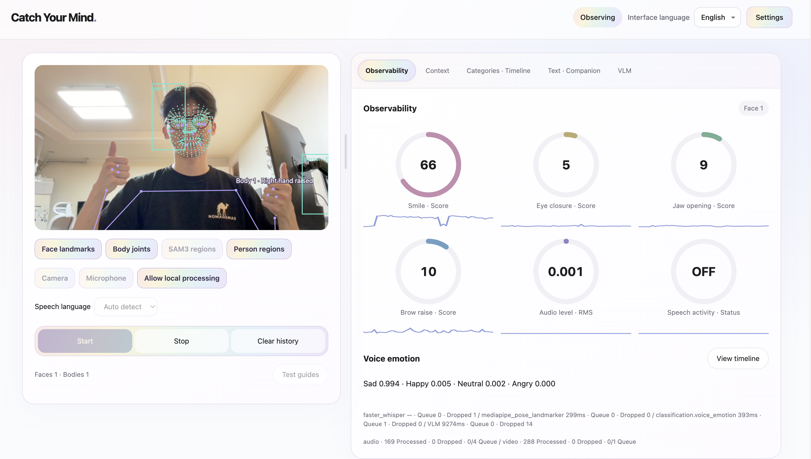
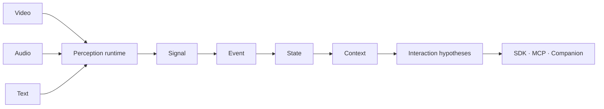

<div align="center">

# 👁️ gamst



### Real-time multimodal context for your LLM or VLM.

Turn speech, voice activity, facial movement, and surroundings into bounded, timestamped context for your existing AI agent.

**🐍 Python SDK · 🔌 MCP · 🏠 Local-first · ⚡ Event-driven · 🧩 Pluggable models**

[Quick start](#-quick-start) · [Python SDK](#-python-sdk) · [MCP](#-mcp-for-ai-agents) · [Companion](#-context-aware-companion) · [Documentation](#-documentation)

</div>

---

gamst gives agents a shared layer for observing behavior, tracking changes, and adapting a conversation. The Python import remains `humansense` for compatibility. The product's core is context delivery; Companion replies are optional.

**Status: v0.2 alpha.** Includes bounded background ASR/VLM workers, live context streaming, a shared-session MCP bridge, an explicit local model installer, and a browser preview. See [release QA](docs/qa-v0.2.0.md) for actual validation and limitations. No model establishes a person's inner emotions or intentions.

## A context layer for an ecosystem of tools

Connect vision, voice and other perception tools once; reuse their timestamped
observations in dashboards, LLM/VLM prompts, MCP agents and streaming applications.
Models, transports and consuming applications can evolve independently.

**Application examples:** AI companions; travel assistants describing surroundings;
interview or interrogation-session transcription and timeline review; health and
wellness observation; accessibility; robotics; user research. These are possible
integrations, not built-in claims of diagnosis, emotion accuracy or lie detection.
Application-specific analysis belongs to the selected model and consuming app.

**Current extension architecture:** independent bounded audio/video lanes; shared
PCM/JPEG transport validation; explicit package-entry-point plugins; optional local
Hugging Face classifiers; Ollama token streaming; SDK/WebSocket/MCP context output.
The browser demos show gauges, category bars/donuts, leading score categories and
rolling time series. Classification categories come from the connected model;
the bundled face model outputs facial movements.

The design adapts ideas from [Pipecat's frame processing](https://docs.pipecat.ai/pipecat/learn/pipeline),
[Hugging Face's task pipelines](https://huggingface.co/docs/transformers/main_classes/pipelines)
and [Ollama's streaming API](https://docs.ollama.com/api/streaming). It is original
implementation, not a fork or endorsement of those projects.

**[Streaming protocols, plugin authoring, provider setup and examples →](docs/streaming-and-plugins.md)**

## Run the complete local stack

On Apple Silicon with Python 3.10+:

```bash
sh scripts/setup_local.sh
.venv/bin/python scripts/run_local.py --language ko
```

Open **http://127.0.0.1:8766**, choose camera/microphone inputs, consent, and start. Omit `--language ko` for automatic speech language detection, or use `--language en`. Pinning a language improves short-window transcription stability.

The explicit installer downloads Whisper small, Silero VAD, MediaPipe Face Landmarker, Qwen3-VL 2B and a local llama.cpp runner into **`.local-models/`**. It does not configure global agent settings or start device capture. The local launcher connects Companion to the same local VLM; existing agents can consume context without using Companion.

```bash
# Live context from the SAME session (4 Hz delivery, inference has its own latency)
.venv/bin/python examples/live_context.py

# MCP stdio bridge to that running session
.venv/bin/python -m humansense.mcp_live

# Stop this checkout's stack, then remove installer-owned models
.venv/bin/python scripts/run_local.py --stop
.venv/bin/python scripts/local_models.py remove --yes
```

[Setup, agent integration and removal](docs/local-setup.md) · [Realtime behavior](docs/realtime.md) · [Public browser preview](https://blog.nomadamas.org/Gamst/)

## ✨ What it provides

| Capability | Output | Available behavior |
| --- | --- | --- |
| 💬 **Conversational Intelligence** | Requests, repetition, response timing, interaction hypotheses | Korean/English clarification rules; optional evidence-citing model analysis |
| 📈 **Behavioral Intelligence** | Measurements, personal baselines, changes over time | Per-subject, model-version-aware numeric trends and change events |
| 🔎 **Statement Consistency** | Conflicting assertions and possible contradictions | Structured claim comparison; optional model candidates with exact source excerpts |
| 🧠 **Temporal Memory** | Current state, history, context | SQLite storage, configurable retention, evidence inspection |
| 🤝 **Agent Responses** | Suggested next action or generated reply | Context-aware Companion using a configured local or authorized remote provider |
| 🎥 **Perception Plugins** | Video/audio measurements and transcripts | OpenCV, MediaPipe, Silero VAD, faster-whisper adapters |

## 🚀 Quick start

Requires **Python 3.10+**. From this checkout:

```bash
python3 -m venv .venv
source .venv/bin/activate
python -m pip install -e .

# Synthetic inputs: inspect all three output domains.
python -m humansense demo

# Local dashboard.
python -m humansense dashboard
```

Open **http://127.0.0.1:8766**, give processing consent, and enter a message such as `설명이 어려워요. 다시 설명해 주세요.`

The core SDK and MCP have **no runtime dependencies**. The dashboard supports text input and browser audio-energy measurements without extras. For camera analysis and native camera/microphone capture:

```bash
python -m pip install -e '.[vision,audio]'
```

The project is **gamst**, hosted at [NomaDamas/Gamst](https://github.com/NomaDamas/Gamst). For compatibility, the distribution remains `humansense-sdk`, the Python import remains `humansense`, and the SDK class remains `HumanSense`. Existing `humansense*` commands, plugin entry points and wire protocol names remain supported.

After installing, use `gamst`, `gamst-serve`, `gamst-mcp`, `gamst-mcp-live`, or `gamst-dashboard`; these are aliases of the existing commands. For example, `gamst demo` and `python -m humansense demo` run the same CLI. Install from this repository or a built wheel; a PyPI release under the new name is not claimed.

## 🐍 Python SDK

```python
import asyncio
from humansense import HumanSense

async def main():
    async with HumanSense(
        consent=True,
        store="sqlite:///local.db",
        retention_hours=24,
    ) as human:
        result = await human.push_text(
            "다시 설명해 주세요.", subject_id="local-user"
        )

        print(result["predictions"]["conversation"])
        print(result["predictions"]["behavior"])
        print(result["predictions"]["consistency"])
        print(result["recommended_action"])

        state = await human.get_state()
        context = await human.get_context(window="1h")
        history = await human.get_history(hours=24)

asyncio.run(main())
```

Feed existing applications through `push_video`, `push_audio`, `push_text`, `push_signal`, or `push_claim`. Ingestion does not open devices. Register a perception plugin before pushing media; missing inputs remain `unavailable`.

Subscribe with `human.events()` for changes, `human.signals()` for measurements, or `human.observe()` for inferences. These async iterators deliver future records: start the consumer before producing input. Use history queries for retained records.

### 📦 One output contract



| Layer | Purpose | Example |
| --- | --- | --- |
| **Signal** | Measured or explicitly supplied input | `audio.rms`, `text.utterance` |
| **Event** | A meaningful change | `speech.started`, `interaction.clarification_requested` |
| **State** | Current observation snapshot | Latest signals and modality availability |
| **Context** | Evidence-backed temporal summary | Event counts and personal trends |

Every record carries a subject ID, timestamp, schema version, model provenance, quality, observation, and evidence. `human.inference` adds the three intelligence domains and a recommended action.

**Scores have distinct meanings:** `model_score` is a pattern score; `probability` requires a registered calibration artifact and held-out validation. Without that evidence, probabilities remain `null`. See the [output contract](docs/contract.md) and [prediction/feedback workflow](docs/predictions.md).

### Dashboard workspace

Camera controls stay in the left panel. Drag the divider to resize camera and
analysis panels; arrow keys resize it when focused. On narrow screens they stack.
The right panel has Observability, Context, Categories/Time series, Text/Companion
and VLM tabs. Category plots have observation and individual-label subtabs.
Tab changes preserve live capture, context streaming and chart history. The
active observation state uses rainbow colors; stopped state is gray.

Optional voice emotion: run `sh scripts/setup_voice.sh`, then restart the local
launcher while capture is stopped. It adds SUPERB Wav2Vec2 with 3-second windows
and a 1-second hop; scores flow into Observability, category graphs and MCP.
See [voice installation, removal and measured QA](docs/voice-analysis.md).

### Live dashboard and temporal VLM

The local dashboard shows the transmitted context as a live table, with circular
expression, audio-level and speech-activity gauges. Start capture with the input
checkboxes; VLM can be toggled independently. Configure its analysis interval
(1–60 seconds), observation window (1–30 seconds), and sampling rate (0.2–4 FPS).
The buffer holds at most 8 frames; the displayed sampling cap is
`min(requested_fps, 8 / window_seconds)`. Actual frame count, span and FPS are
reported separately, including partial windows during startup.

Each local VLM request includes timestamped frames and up to six corresponding
numeric/face observations per frame. The output context contains
`scene.description` and `scene.window` (time range, sampling settings and
`measurements_series` with evidence IDs), never image bytes. The local launcher
allocates 16,384 context tokens across two llama.cpp slots for temporal input.
Run `PYTHONPATH=. .venv/bin/python scripts/qa_temporal.py` to verify the
8-frame VLM → MCP path with the local portrait fixture (no device access).
Changing settings or stopping capture clears the buffer and invalidates queued
results. Already-running HTTP inference may finish, but its output is discarded.

Agents connected to the same runtime through `humansense.mcp_live` can use:

```json
{"name":"configure_vlm","arguments":{"enabled":true,"interval":3,"window_seconds":4,"sample_fps":2}}
```

`get_vlm_status` returns applied settings; `get_context` and the WebSocket context
subscription include the temporal result. Settings do not start camera capture.

## 🔌 MCP for AI agents

Start the stdio server:

```bash
python -m humansense.mcp
# Installed entry point: humansense-mcp
```

Add it to your MCP client's server configuration, replacing the absolute paths:

```json
{
  "mcpServers": {
    "gamst": {
      "command": "/path/to/Gamst/.venv/bin/python",
      "args": ["-m", "humansense.mcp"],
      "cwd": "/path/to/Gamst"
    }
  }
}
```

| Tools | Purpose |
| --- | --- |
| `get_state`, `get_events`, `get_context`, `get_trends` | Read current and temporal observations |
| `inspect_interval` | Inspect retained evidence |
| `push_text`, `push_claim` | Supply conversation and structured assertions |
| `start_capture`, `stop_capture`, `get_capture_status` | Control local devices |
| `pause_capture`, `resume_capture`, `delete_data` | Control observation and retention |
| `analyze`, `chat`, `record_feedback` | Use a configured model and record observed outcomes |

Camera and microphone capture require explicit consent and installed extras. Example `start_capture` arguments:

```json
{"consent": true, "video": 0, "audio": true, "subject_id": "local-user"}
```

Use `video: null` for microphone-only capture. Optional local model paths are `face_model_path`, `vad_model_path`, and `asr_model_path`. Capture and queries share the same MCP runtime. Separately started MCP and dashboard processes do not share live capture.

## 🎥 Vision & voice

| Backend | Install extra | Measurements / requirements |
| --- | --- | --- |
| OpenCV | `vision` | HOG person boxes, counts, stream-local IoU tracks |
| MediaPipe Tasks | `mediapipe` | Face landmarks and blendshapes; local `.task` file |
| Audio level | None for supplied PCM; `audio` for native capture | RMS, dBFS, energy activity — not speech recognition |
| Silero VAD | `vad` | Speech activity and start/stop events; local JIT file |
| faster-whisper | `asr` | Transcripts and transcribed-word-rate measurements; local model directory |

```python
from humansense.plugins import AudioLevelPlugin, MediaPipeFacePlugin

human.register(AudioLevelPlugin())
human.register(MediaPipeFacePlugin("models/face_landmarker.task"))
# await human.push_video(decoded_bgr_frame)
# await human.push_audio(normalized_mono_pcm, sample_rate=16000)
```

No weights are bundled or automatically downloaded. Native capture uses `CaptureSession`; see [the capture example](examples/realtime_capture.py). HOG can miss seated webcam users. Track IDs represent geometry within a stream, not verified identity or audio-speaker ownership. SAM3 is an optional gated-model provider; biometric re-identification is not included.

## 🤝 Context-aware Companion

Configure an actual chat-completions server and installed model:

```bash
export HUMANSENSE_COMPANION_URL=http://127.0.0.1:11434/v1/chat/completions
export HUMANSENSE_COMPANION_MODEL=YOUR_INSTALLED_MODEL_NAME
python -m humansense dashboard
```

Choose **Companion에게 보내기** in the dashboard, or call the MCP `chat` tool. The Companion uses conversation history, observation context, and the suggested strategy to generate a reply. Without a configured backend it reports an error instead of producing a fake model response.

For evidence-citing semantic analysis, configure `HUMANSENSE_REASONING_URL` and `HUMANSENSE_REASONING_MODEL`, then call `analyze`. Remote providers require explicit permission to transmit text and measurements. See [Companion setup](docs/companion.md) and [reasoning configuration](docs/reasoning.md).

## 🌐 WebSocket & integrations

```bash
python -m pip install -e '.[websocket]'
python -m humansense.server --port 8765 --origin http://localhost:3000
```

The loopback WebSocket service exposes the same tool calls. Events are the default stream; the `humansense/subscribe` extension selects events, signals, and inferences.

- **JavaScript / TypeScript:** [Promise-based client](integrations/typescript/README.md) with subscriptions, timeouts, and response matching.
- **LiveKit / Pipecat:** [Decoded-media bridges](docs/integrations.md) with explicit participant attribution, media-clock mapping, and mono/16kHz conversion. Native framework compatibility still needs validation.
- **Custom models:** implement `PerceptionPlugin.process(frame)` to supply signals with model IDs and versions. The output contract remains independent of the backend.

## 🔒 Evidence & privacy

- Obtain participant consent before setting `consent=True` or starting capture.
- Raw camera frames and microphone audio are never persisted by the built-in store.
- SQLite defaults to memory; disk persistence is opt-in and retention is configurable.
- `pause()` and `delete_data()` invalidate pending processing; late model results cannot restore deleted observations.
- Keep observations separate from hypotheses. Expression scores do not establish inner emotions, diagnoses, deception, or hidden intentions.
- Third-party packages and model weights retain their own licenses. No REA or closed-source implementation is bundled; see [third-party notes](docs/third-party.md).

## 🧪 Development & validation

```bash
python -m unittest discover -s tests -v
node integrations/typescript/client.test.mjs
python -m humansense demo
python -m benchmarks.runtime --samples 200
```

The streaming refactor is covered by **150 Python tests** plus dashboard/category-chart JavaScript checks. Earlier release QA also verified wheel installation, real local perception models and MCP communication. The Hugging Face voice adapter was exercised with real SUPERB weights and public audio fixtures; Ollama contracts use fixtures. Model accuracy is not established. See [measured refactor QA](docs/qa-streaming.md), [streaming validation scope](docs/streaming-and-plugins.md#validation-scope) and [v0.2 QA](docs/qa-v0.2.0.md). The [synthetic benchmark](docs/runtime-benchmark.md) reports actual core measurements, not camera/model performance. FPS targets, model accuracy, and an eight-hour soak are not yet validated.

## 📚 Documentation

| Guide | Contents |
| --- | --- |
| [Output contract](docs/contract.md) | Layers, evidence, scores, timestamps |
| [Predictions & feedback](docs/predictions.md) | Target registration, outcomes, held-out calibration |
| [Model reasoning](docs/reasoning.md) | Local/provider analysis and citation validation |
| [Companion](docs/companion.md) | Context-aware conversations |
| [Tracking](docs/tracking.md) | Stream-local association and ambiguity |
| [Media bridges](docs/integrations.md) | External streams, clocks, PCM conversion |
| [Evaluation](docs/evaluation.md) | Hardware checks and evaluation gates |
| [Completion audit](docs/completion-audit.md) | Implemented, missing, and unverified requirements |
| [GitHub publishing](docs/github-push.md) | Publish the delivery bundle from a connected host |

## 📄 License

Original code is licensed under **Apache-2.0**. See [LICENSE](LICENSE). Review each dependency and model-weight license before redistribution.


### Local demo settings and visual guides

Open `http://127.0.0.1:8766`. Camera controls include English/Chinese/Korean/auto
speech recognition and independent face-point/person-region overlays. Start,
Stop and Clear are grouped together. Model switches in Settings stop actual
inference; pause capture before changing them. Chart labels use readable names
while MCP observation keys stay stable.

Settings → **실제 모델 테스트** sends a synthetic blue-square image to the configured
local VLM and reports its response and latency without using camera or microphone.
Settings → **Advanced · MCP** lists the running service's tool schemas, models,
observation keys and WebSocket address. `get_features` / `configure_feature` share
model switches with the dashboard. The text/Companion switch gates dashboard and
MCP text requests; ASR remains independently controlled.

The dashboard includes switches for gauges, category charts and guides. Historical
observations are retained when a model is disabled. See [tracking boundaries and
extension plan](docs/tracking.md) for full-body/face handling, multiple people,
SAM integration and emotion tracking. Body pose is now installed through MediaPipe (33 landmarks, up to four poses,
geometric wrist-height indicators). Optional [SAM3 installation](docs/sam3.md) adds
text-prompt object outlines through an isolated local worker. Trained gesture
classification, speaker separation and face-to-speaker identity association are
**not** installed features.

[Settings QA](docs/qa-settings.md) · [One-page feature overview](docs/promo/one-page.html)


The local demo defaults to English. Its interface language selector supports
English, Korean and Chinese independently of the speech recognition language.
Public browser preview controls have the same three language choices. User text,
model descriptions and MCP JSON are preserved in their original form.

Install body pose alone with `.venv/bin/python scripts/local_models.py install-pose`;
the launcher automatically loads it. To remove only these weights, stop the local
stack and run `.venv/bin/python scripts/local_models.py remove-pose --yes`.


The camera guide renderer receives full display geometry separately from compact
agent context. Body context includes bounding boxes, landmark counts and geometric
wrist-height flags; the display channel retains the 33 points needed to draw bones.
**Test guides** runs installed face/body models on the local public sample
`.local-run/qa/pose.jpg` while capture is paused. The image is clearly labeled as a
sample; this does not open devices or add observations to user history.

The launcher automatically detects `.local-models/sam3/ready.json` after installation.
Settings distinguishes downloaded/configured SAM3 from a model that has actually
completed inference. SAM3 object boundaries are not body joints or emotions.

### Bounded live data retention

Raw camera/audio buffers are not stored in the record database. Capture queues,
model windows and subscriber queues are bounded; older pending input is replaced
when processing or consumers fall behind. Sending context is not an instruction
to delete it: concurrent consumers and change analysis need a short shared window.

The local dashboard uses an in-memory store with a 10-minute retention window.
The SDK default is 24 hours. Both now also enforce **5,000 records** and **32 MiB of
serialized UTF-8 record payload**, whichever limit is reached first. Oldest inserted
records are evicted; a single oversized record can be streamed but is not retained.
These limits bound retained payload, not total process RAM or model weight memory.
They are configurable via `HumanSense(max_records=..., max_payload_bytes=...)`.
Age expiry is applied on ingestion and reads. Storage counters are exposed in
`get_state().storage`; summaries describe retained evidence, not an unlimited archive.

Agent context contains latest observations, bounded event examples/counts, and
numeric means / baseline-relative changes where enough retained samples exist.
There is no automatic permanent memory or long-term summary archive. Text
transcripts and derived observations remain subject to the same storage limits.
Disk-backed SQLite may retain allocated free pages for reuse after expiry; payload
limits are not a physical database-file-size guarantee. Downstream agents and LLM
providers control their own retention independently.

Optional [local gaze context](docs/gaze-context.md) connects L2CS gaze heads to bounded MediaPipe face crops through the `l2cs.gaze` worker profile. Actual checkpoint accuracy and calibrated camera conventions remain pending; model files are supplied explicitly.

Optional [relative depth context](docs/depth-context.md) uses local Depth Anything V2 Small weights to emit a bounded frame-relative grid through `depth_anything_v2.small`. Values are dimensionless; actual model quality and sustained runtime validation remain pending.

Optional [local OCR context](docs/ocr-context.md) exposes bounded text regions through `ppocr.mobile`, with explicit local detector/recognizer files and no automatic downloads. Actual multilingual model quality and sustained runtime validation remain pending.

Optional [visual appearance history](docs/visual-retrieval.md) uses `dinov3.retrieval` to compare current frames with a bounded gallery of earlier frame descriptors. Results are historical similarity candidates, not object identities or current locations; actual model validation remains pending.

[Object appearance memory](docs/object-appearance-memory.md) connects separate RF-DETR and DINOv3 workers on the exact same capture, with bounded crop-history candidates and explicit ingestion into last-seen object memory. Similarity does not establish identity or current location.

[Playback-reference duplex audio](docs/duplex-audio.md) adds an optional WebRTC AEC3 transform with separate preserved ambient and cleaned-speech lanes. Missing reference is explicit; actual acoustic and live duplex acceptance remains pending.
