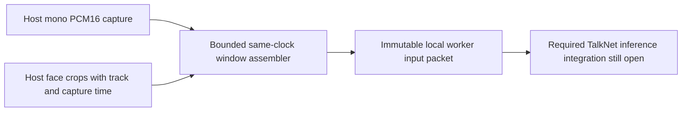

# Same-clock face/audio windows



`TalkNetWindows` aligns one face track and one microphone lane into bounded raw
worker inputs. It does not recognize speech, classify active speakers, detect or
track faces, calibrate clocks or publish an LLM observation. This is an executable
prerequisite of [required TalkNet child#118](https://github.com/NomaDamas/Gamst/issues/118),
not completion of the audiovisual capability. Native trained inference, face-crop
extraction from detections, MFCC computation and SDK/MCP classification delivery
remain required in that issue. Family#26 and the full SDK Goal remain open.

## Source and timing contract

The pinned [official demo](https://github.com/TaoRuijie/TalkNet-ASD/blob/6d6821479af485e251c4991487e40573b42181b4/demoTalkNet.py)
and [model](https://github.com/TaoRuijie/TalkNet-ASD/blob/6d6821479af485e251c4991487e40573b42181b4/model/talkNetModel.py)
use25fps112x112grayscale face frames and100Hz13-dimensional MFCCs. Cross/self
attention sees the whole supplied clip; repeated windows are not native recurrent
streaming. Official demo inference also combines several clip lengths; a future
single-window adapter cannot inherit that ensemble's reported quality.

For N video frames,4N audio feature windows of400samples at160sample hops require
`(4N-1)*160+400 = N*640+240` PCM samples: N*40ms plus15ms. This assembler retains
those extra240 real samples. It waits for two10ms blocks after the video interval
when needed, then trims the unused5ms from the packet. It never invents zeros or
resamples to make lengths fit. This establishes sample geometry only; actual
MFCC numeric parity remains a separate implementation/acceptance requirement.
The official demo can instead truncate to the available4:1feature/frame count.

Choose window_frames25,50,75,100,125or150 (one to six seconds); hop_frames is
1..window_frames, default5(200ms). Whole-window classification will have its own
window-dependent delay;15ms here is extra audio analysis context, not a claim of
15ms model latency. Waiting for host chunks adds capture batching latency.

## Host input responsibilities

Both lanes must use the same explicitly declared clock_id and timestamp epoch.
The string is an assertion by the host, not measured synchronization. For a
video frame covering[start,start+40), set timestamp_ms=start+40. Audio timestamps
are capture-end times. The assembler accepts only regular25fps face frames and
16kHz mono PCM16 blocks of10..1000ms in whole10ms increments. Audio and video
origins must fall on compatible10ms grids; fractional/jittered clocks need an
explicit upstream capture/resampling policy, which this module does not supply.
Even a matching grid cannot detect an incorrectly declared40ms clock offset.

Audio is little-endian PCM16 bytes or a plain native int16 one-dimensional NumPy
array, with one named sensor channel. Normalized floats, stereo and Nx1 layouts
are rejected. Preserving PCM16 magnitude matters for future MFCC energy terms.
Faces are plain uint8 arrays of shape112x112. They must already follow the
selected TalkNet preprocessing; blindly resizing a detector box is not validated
crop preparation. The official demo first resizes its tracked face crop to224x224
then takes the central112x112. Detection context, crop scale and tracking quality
remain external, explicit dependencies until the concrete bridge implements them.

```python
from humansense import TalkNetWindows, decode_talknet_window

windows = TalkNetWindows(clock_id='device-monotonic',
                        source_id='av-capture', sensor_id='face-1-mic',
                        window_frames=25, hop_frames=5)
# audio_frame: InputFrame with mono16kPCM16, capture-end timestamp, SensorMetadata.
# face_frame: InputFrame with112x112gray uint8 crop and40ms interval-end timestamp.
packets = windows.push_audio(audio_frame, clock_id='device-monotonic')
packets += windows.push_face(face_frame, track_id='track-1',
                            clock_id='device-monotonic')
for packet in packets:
    metadata, pcm16, faces = decode_talknet_window(packet.data)
    # Future concrete TalkNet worker consumes these media, not an LLM context API.
status = windows.status()
windows.close()
```

Feed both lanes continuously and consume packets returned by **both** push
methods; whichever input completes a window emits it. Use one assembler per
face-track/microphone pairing and a host limit on concurrent tracks. This does
not choose a speaker or map a face to a diarization speaker slot. Keep subject_id
consistent in both inputs; that grouping is also not a verified personal identity.

## Ownership, gaps and memory

Input arrays are copied; later caller mutation cannot affect retained media.
Each lane must increase its capture_sequence when supplied, otherwise sequence.
A repeated/reversed timestamp or sequence raises and clears both lanes. A gap in
either lane, changed source/sensor/epoch/channel/calibration/frame/sequence-kind,
or changed track_id clears both lanes and starts a new random session_id.
`push_face` with valid metadata and data=None explicitly reports face absence and
clears both lanes. It does not infer that the person stopped speaking.

At most window_ms+1000ms audio and window_frames+25 faces are retained. A producer
running beyond that bound without a matching lane causes a whole-session reset,
reported as buffer_overflow. There is no unlimited backlog or silent interpolation.
If the ordered audio lane starts after earlier video frames, those unsupported
prefix faces are discarded; status reports unsupported_prefix_face_frames.
Huge clock displacement is handled with bounded arithmetic, not a loop over the
missing duration. status also reports buffered counts, emitted count, reset count
and last reset reason. These are diagnostics, not sensory observations.

A push can emit at most26 overlapping windows, each at most2,100,000bytes;
caller-owned returned packets add bounded per-call transient memory beyond the
retained input buffers. The caller must also bound its downstream queue and
account for duplicate compute from overlapping windows. No trained-model compute
or memory bound follows from these raw-media limits. Methods are serialized with
a lock. reset discards pending tails; close clears media and permanently rejects
further input, including after reset. Incomplete final windows are never padded
or emitted; inspect status before close if tail diagnostics are needed.

## Local packet and evidence boundaries

Packets are InputFrame(modality='video') byte payloads for the existing local
worker transport. They are paired media, not ordinary image bytes. The explicit
GTAV001 header carries version, declared clock, source sensor metadata and input
sequence ranges for both lanes, track/session/subject, video interval and precise
audio end. The outer timestamp is the paired audio-end time; its stream_epoch
matches session_id. Binary PCM16 and ordered grayscale frames follow the bounded
JSON header. Metadata declares synchronization_verified=False and
identity_verified=False; consumers must not turn those into calibrated identity.

The decoder validates exact field sets, interval arithmetic, source contracts,
sequence ranges, duplicate JSON keys and exact payload length before creating
owned arrays. It rejects truncated or appended payloads. This is local protocol
validation, not cryptographic media authentication. A future worker must also
check outer InputFrame provenance against this inner metadata. Raw packets never
belong in context/MCP observation values; that existing boundary remains intact.

## Verification

```sh
python3 -m unittest discover -s tests -p test_audiovisual.py -v
```

Tests use deterministic known PCM ramps and face pixels across all six window
sizes and both lane arrival orders, irregular blocks, exact15ms real lookahead,
mutable-input ownership, existing wire round trips, clock errors, track/source/
sequence changes, face absence, bounded missing-lane behavior, huge skew and
packet tampering. Import stays standard-library-only; NumPy loads on use. No
model weights, packages or sensors were installed/started. These tests do not
establish active-speaker accuracy, real camera/microphone synchronization or
published TalkNet benchmark equivalence. Those requirements remain in#118.
