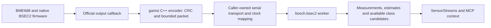

# BME688 environmental measurements and BSEC2 gas-pattern context

`bosch.bsec2` converts explicit Bosch firmware callback output into bounded LLM context. It separates sensor measurements from algorithm estimates and trained gas-pattern candidates. This is a concrete callback transport/decoder/worker path; **the host does not run BSEC, access I²C, train a classifier or activate hardware**. Actual board firmware, trained configuration quality and live measurements remain required under [#130](https://github.com/NomaDamas/Gamst/issues/130), child of [#34](https://github.com/NomaDamas/Gamst/issues/34).



The selected source is [Bosch-BSEC2-Library revision 4f559a6](https://github.com/boschsensortec/Bosch-BSEC2-Library/tree/4f559a6aa450f0ce436e602b42dc384f52128c66): wrapper 1.10.2610, BSEC algorithm 2.6.1.0. The bridge rejects other declared runtime versions. Its field units, IDs and prediction-availability rules follow the pinned [bsec_datatypes.h](https://github.com/boschsensortec/Bosch-BSEC2-Library/blob/4f559a6aa450f0ce436e602b42dc384f52128c66/src/inc/bsec_datatypes.h). Bosch firmware/binary/config licenses are separate from this Apache-2.0 adapter. No Bosch binary, trained configuration or model weights are bundled or downloaded. BME690 uses a different driver integration and is not advertised as supported by this BME688 path.

## Firmware integration

Use an explicitly configured BME688/BSEC2 firmware based on the pinned [native callback example](https://github.com/boschsensortec/Bosch-BSEC2-Library/blob/4f559a6aa450f0ce436e602b42dc384f52128c66/examples/generic_examples/basic/basic.ino). Add `examples/firmware/gamst_bsec2_packet.h` to that firmware, and call its encoder from the real callback:

```cpp
#include "gamst_bsec2_packet.h"
// Provide these 32 bytes from the SHA256 of the configuration actually loaded
// by this firmware. They are a declaration, not cryptographic attestation.
extern const uint8_t configured_bsec_sha256[32];
static uint32_t callback_sequence = 0;

void newDataCallback(const bme68xData data, const bsecOutputs outputs, const Bsec2 bsec) {
    if (!outputs.nOutputs) return;
    uint8_t packet[gamst::bsec2_packet_capacity];
    const size_t size = gamst::encode_bsec2(packet, sizeof(packet), outputs,
        bsec.version, callback_sequence++, configured_bsec_sha256);
    if (size) Serial.write(packet, size);
}
```

This snippet replaces callback output, not device setup. The firmware must explicitly succeed at `begin`, `setConfig` and `updateSubscription`, then call `run` frequently and handle native error statuses. The selected configuration determines heater/sample mode and class-channel order; subscribe to exactly the configured class channels. Do not silently fall back to another configuration. The pinned `setConfig` passes `BSEC_MAX_PROPERTY_BLOB_SIZE` (1943) to BSEC; supply the correct accessible buffer required by that API, not an undersized pointer. The actual board build/flash is not validated by the host tests.

The encoder accesses native `time_stamp`, `signal`, `sensor_id`, `accuracy`, `signal_dimensions` and version fields. It writes little-endian values explicitly, independent of C struct padding. It needs IEEE754 float32, performs no heap allocation and uses at most 398 output bytes. It emits no packet for zero/excess outputs, invalid dimensions, nonfinite signals or insufficient capacity. The output port should carry these packets; the SDK does not open it automatically.

## Transport and capture contract

One GBSC001 packet consists of an eight-byte `GBSC001\0` magic, four version bytes, output count byte, uint32 callback sequence, 32 configuration-hash bytes, one to 23 rows, and a CRC32. Each row is little-endian int64 nanoseconds, float32 signal, uint8 ID, uint8 accuracy and uint8 dimensions. CRC32 covers everything before its little-endian uint32 trailer. Exact size is `49 + 15*count + 4`. This is gamst's transport format around official callback fields, not a Bosch UART protocol.

`BSEC2Packets.feed(bytes)` assembles packets from arbitrary fragments of at most 4096 bytes, resynchronizes after garbage/CRC failures and retains fewer than 398 bytes between calls. A plausible incomplete header waits for more bytes; caller-owned transport timeouts/reconnect must call `reset`. CRC detects corruption, not authenticity. Feed a complete packet as `InputFrame(data=packet, modality="environment", ...)`.

Register `ProcessProvider.capability("bosch.bsec2", config)` and open a worker using that profile. It requires only the standard Python runtime. Example configuration:

```python
config = {
    "config_sha256": "<actual 64-character configuration SHA256>",
    "bsec_version": "2.6.1.0",
    "classes": ["background", "coffee"],  # exact trained channel22,23 order; [] for no classifier
    "calibration_id": "bme688.clock1",
    "sensor_origin_ns": "0",             # decimal int64 text, not a JSON float
    "capture_origin_ms": 1700000000000,    # example only: establish the real clock relationship
    "max_gap_ms": 120000,
}
```

Clock calibration is explicit: each native output timestamp maps to `capture_origin_ms + floor((sensor_ns - sensor_origin_ns)/1_000_000)`. Negative deltas/overflow are rejected. Outer frame time must equal the latest mapped output; its `SensorMetadata.calibration_id` must match. This is a declared mapping, not an automatically verified clock calibration. Power cycles require new epoch/origin/calibration as appropriate. Rows retain their own capture times and within-packet age; the SDK never fills missing channels from prior callbacks.

Capture time and original capture sequence must advance. Firmware callback sequence supports uint32 wrap; repeats/backwards movement are rejected. Missing callbacks, gaps, owner changes or reset create a new host state segment. **Host reset does not reset BSEC's embedded state**: `firmware_state_reset=False` states that boundary. No history of sensor values or predictions is retained by this bridge. User capture/delivery cadence remains independent of BSEC's physical sensor/algorithm cadence.

## Context meaning and limits

- `measurements`: sensor temperature in °C, pressure in **Pa**, relative humidity in percent, and gas resistance in ohms. Raw sensor temperature/humidity can be affected by heating. Engineering sanity bounds reject malformed data; they are not calibration or accuracy guarantees.
- `estimates`: IAQ/static IAQ, CO₂ and breath-VOC **equivalents**, heat-compensated temperature/humidity, vendor compensated-gas signal and filtered gas percentage. CO₂ equivalent is not a directly measured CO₂ concentration. The compensated-gas output has vendor log-scale semantics; it is not relabeled as a measured resistance. Regression channels27..30 are rejected because their trained target units are not established here.
- `classification`: no configured labels gives `unconfigured`; missing or extra channels, feature collection, or stale/mixed native timestamps produce no candidates. Candidates appear only for the exact configured two to four channels, all with accuracy3 and the latest identical native timestamp. Accuracy0 means BSEC is still collecting features. Scores are passed through without renormalization or invented unknown-class thresholds; they are not verified calibrated probabilities or universal odor recognition.
- `summary`: firmware/config declarations, native timestamp as decimal text, continuity/segment, current stabilization/run-in/heater-index statuses and explicit unverified calibration/physical/model-quality flags. Missing statuses remain missing. An authenticated connection and correct class mapping are the integrator's responsibility; matching a declared configuration hash alone does not attest what runs on the MCU.

SDK mode `native` means callback packets can be processed continuously without host batching/lookahead. It does not imply zero sensor response delay or establish the embedded classifier's window; `firmware_window_ms=None` is intentional. Freshness defaults to120 seconds for this slow sensor path and does not claim that observations are interchangeable throughout that interval. Live cadence, firmware integration time and exposure response require measurement under #130.

## Validation

`python3 -m unittest discover -s tests -p test_bsec2.py -v` covers C++ encoder/Python byte parity, CRC/fragments and retained-byte bounds, measurement/estimate units, classification availability, nanosecond precision, clock/sequence/gap/reset behavior, pure discovery and actual worker→SensorStreams→MCP publication. C++ uses a synthetic callback-shaped fixture; no hardware or BSEC binary inference is claimed. Actual firmware compilation, reference-instrument comparison, trained held-out gas exposures, drift and live timing remain required in #130. Halo demonstrations remain deferred.
