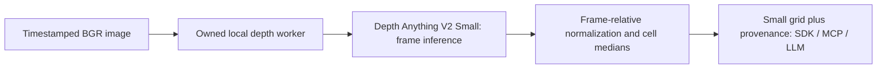

# Relative depth context



`DepthAnythingContext` owns one local CPU model and processes independent frames.
SensorStreams owns capture identity, freshness and publication. This adds relative
scene layout to an existing LLM without sending a dense depth image. It does not
produce metres, camera pose, SLAM, cross-frame scale, object tracks or collision
safety. Native inference has a deadline only when placed in `ProcessProvider`;
in-process close waits for active work rather than abandoning a native call.

The profile is `depth_anything_v2.small`, capability ID
`vision.depth_anything_v2.small`. Config accepts an absolute checkpoint `path`,
lowercase `sha256` and optional `grid_size` (1..8, default3). The file must be the
compatible HF Small `model.safetensors`, at most128MiB. SHA verification precedes
native imports. The exact verified byte buffer is decoded by safetensors and
loaded with strict state keys into a fixed Small model, on CPU float32 in eval
and inference mode. No Hub request, AutoClass, pickle, external configuration or
pretrained-backbone download is used. A matching state dictionary establishes
shape compatibility, not trained-checkpoint lineage or quality.

Configuration and DPT preprocessing are pinned to the
[HF Small revision5426e4f0](https://huggingface.co/depth-anything/Depth-Anything-V2-Small-hf/tree/5426e4f0f36572d16453bbda7a8389317b1bef99).
The DINOv2 backbone has384 hidden units,12layers,6heads and stage3/6/9/12 features.
The relative DPT head uses64fusion and32head channels. DPT preprocessing uses a
518target, aspect preservation, multiples of14, bicubic resizing,1/255 rescaling
and ImageNet normalization. This is the Transformers image path; numerical parity
with the original OpenCV pipeline is not claimed. Selected Small code/model card
license is Apache2.0; verify provenance/license of the actual supplied artifact.

## Meaning and bounds

The model returns relative inverse depth: larger means relatively nearer, as
[confirmed by the model author](https://github.com/DepthAnything/Depth-Anything-V2/issues/174).
For each frame, the adapter takes the5th and95th percentiles of the native map,
normalizes between them and clips to0..1. It publishes the median of each grid
cell in row-major order from the upper-left. Coordinates are normalized image
coordinates; the fixed grid spans the full image. `x_edges` and `y_edges` record
the actual normalized cell boundaries after integer pixel partitioning. Values can be compared **within
one frame only**. A difference between frames cannot establish approach speed or
distance. Confidence and calibration are explicitly unavailable.

A flat or nearly flat map emits `unavailable_low_spread` with null cells, not
invented zero distances. The cutoff is `p95-p05 > max(1e-6, abs(p95)*1e-6)`.
Median pooling and percentile clipping discard detail, including small objects
that occupy only a minority of a cell or less than5% of the image. A high cell
score is not an identified object or a calibrated obstacle claim. Users can
select up to8×8 cells; full maps and raw camera data stay out of LLM context.

Input must be uint8 BGR, at least32pixels per axis, at most1920×1080 pixels,
within3840×2160 dimensions and at most2:1 aspect ratio in either orientation.
Unsupported panoramic inputs are rejected rather than stretched. These bounds
keep the fixed preprocessing at no more than1036pixels per axis and518×1036
pixels total. The loader checks tensor bounds before model execution, divisibility
by14 and output alignment. Map values must be finite, nonnegative and at most1e6.
All such limits are resource/contract limits, not quality or confidence thresholds.
No depth map or previous frame is retained after a call.

## Explicit local execution

When installation resumes, use an isolated runtime and this checkout:

```sh
/path/to/runtime/bin/python -m pip install '.[depth]'
/path/to/runtime/bin/python -m pip freeze > depth-runtime-versions.txt
PYTHONPATH=. python examples/validate_depth.py \
  --python /path/to/runtime/bin/python \
  --checkpoint /absolute/model.safetensors --sha256 CHECKPOINT_SHA256 \
  --image /path/to/consented-image.jpg --output depth-smoke.json
```

The optional profile selects Torch2.8.0, Transformers4.57.6, compatible
Hugging Face Hub0.x, safetensors, NumPy and Pillow. No weights are included.
The example requires NumPy/Pillow in its parent runtime; it validates image header
bounds before decoding, preserves encoded pixel orientation without EXIF rotation,
and writes a new report without overwriting existing evidence. The report records
input/model hashes, selected interpreter, capability and startup/first process
timing. It is a single-image smoke test; sustained quality/resources/realtime
acceptance requires separate replay. The current task does not install models
or alter the global Python environment.

Register `ProcessProvider.capability('depth_anything_v2.small', config)` and an
async factory calling `ProcessProvider.open(python, 'depth_anything_v2.small', config)`
with `SensorStreams` for continuous timestamped frame delivery. Use the same
capability ID in MCP observation queries. Capture provenance is preserved by the
managed lane; delivery cadence remains user-controlled. This is repeated frame
inference, not a model with a native temporal encoder/cache.

## Evidence and remaining acceptance

`python3 -m unittest discover -s tests -p test_depth.py -v` covers spatial order,
RGB copy, positive affine invariance above the abstention cutoff, flat maps,
outliers, bounded invalid input/output, local artifact integrity, fixed loader
configuration, active-work close and managed MCP publication. Native dependencies
in the loader test are explicit doubles; these tests do not prove trained-model
execution. The current global environment has Transformers4.57.6 and
Hugging Face Hub1.33.0, which its dependency check rejects. No version checks were
bypassed or global packages changed to manufacture a pass.

[Actual depth validation #95](https://github.com/NomaDamas/Gamst/issues/95), a child
of [depth/flow/mapping #22](https://github.com/NomaDamas/Gamst/issues/22), remains
required: real checkpoint loading, pinned-reference parity, ordinal ground truth,
image/grid alignment, lost-detail measurements, clean runtime and sustained
capture-to-context latency/resource evidence. Existing optical flow does not
complete the still-required ORB-SLAM3 mapping path. No family completion, metric
claim, VLM efficiency gain or realtime throughput is established by this PR.
