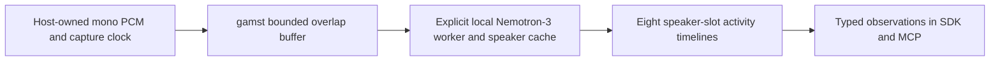

# Native streaming speaker-activity context



The host owns microphone capture and delivery cadence. The provider owns PCM
framing, recurrent speaker cache and capture-time activity intervals. This is
native stateful audio inference, not a VLM, ASR decoder, speaker identity system
or audiovisual association. TalkNet and ASR-to-speaker alignment remain separate.
The worker can run while other SDK lanes see, listen or speak; this adapter alone
does not establish end-to-end full-duplex acoustic performance.

## Selected source and local runtime

The [official Streaming Sortformer card](https://huggingface.co/nvidia/diar_streaming_sortformer_4spk-v2.1)
points to its successor [Nemotron-3-Diarization](https://huggingface.co/nvidia/Nemotron-3-Diarization/tree/52a432672732425e4c19765b9fec9b5810e6f4ba).
This concrete profile selects that eight-slot model, not an arbitrary backend
catalog placeholder. The declared weight license is OpenMDW-1.1; the SDK adapter
and Transformers code are Apache-2.0. Redistribution compatibility still needs
verification. No trained weight was downloaded during implementation.

Use a separately provisioned Python>=3.11 environment with the SDK's optional
`diarization` extra: Transformers5.23.0, Torch2.8.0, safetensors0.8.0 and NumPy.
These are selected candidate versions, not a tested real-model environment.
The current development Python3.10/Transformers4.57.6 cannot run this model.
`from_local` rejects other selected package versions; local build suffixes are
accepted. CPU and CUDA float32 are explicit; no automatic device fallback.

Supply exactly these files from revision
`52a432672732425e4c19765b9fec9b5810e6f4ba` in one local directory:

- `config.json`:1458bytes; SHA256 `dd795ec07ffa09acf18d231aa3fa8642aa5c521760953754e02559a7413b6873`.
- `processor_config.json`:623bytes; SHA256 `91726746788a024a2f0f2f699a6c3667f0d74e6a0e9288fc44fe3018e23af68e`.
- `model.safetensors`:396954592bytes; SHA256 `c074d86335b3b794f8fa5edc25594558f128bdb3914d27806a3a5a2e44963cb6`.

Every file is read into bounded hash-verified owned bytes before deserialization.
Direct model/processor classes and strict complete tensor keys/shapes/float32
finite checks prevent partial/random fallback. No AutoModel, hub load, remote
code, model download or package installation occurs. Native imports execute in
the selected worker; it is process isolation, not an OS/network sandbox.
Loading retains byte snapshots and model tensors temporarily, so the396.95MB
file size is not a peak-RAM estimate or a promise of a tiny model.

The framing contract was inspected in
[Transformers5.23.0 processor source](https://github.com/huggingface/transformers/blob/52b080b6416a7897e2af90febeb4dfad22b84d19/src/transformers/models/nemotron3_diarization/processing_nemotron3_diarization.py)
and its model/feature-extractor implementation. Native runtime framing properties
must match the adapter before accepting the provider.

## Input and output contract

Accept16kHz mono PCM with one explicitly named sensor channel: little-endian
PCM16 bytes or plain native int16/float32 NumPy arrays shaped N or Nx1.
Float samples must be finite in[-1,1]. Each block is10..1000ms, in whole10ms
increments. Timestamp is an integer capture-end millisecond in[duration,2**53-1].
There is no resampling, downmixing, implicit microphone access or wall-clock
retimestamping. The provider copies input and model chunks.

Three modes use80ms encoder frames and emit10ms activity scores:

- `ultra_low_latency`:240ms scored step plus80ms right context. First PCM chunk
  is5160samples(322.5ms); later chunks5520samples(345ms).
- `very_low_latency`:480ms step plus160ms right context. First10280samples
  (642.5ms); later10640samples(665ms).
- `low_latency`:720ms step plus320ms right context. First16680samples
  (1042.5ms); later17040samples(1065ms).

Those PCM sizes include STFT analysis overlap; they are not output stride or
measured end-to-end latency. Host block boundaries can add more waiting. All
available chunks are inferred in order. Lookahead is retained and scored only
when it becomes the next chunk's main region. `finish()` flushes the remaining
whole10ms frames once, including a short first-and-last chunk, then clears all
PCM/cache state. Calling process afterward requires reset; repeated finish
returns None. No synthetic padding is added by the adapter.

Capability `audio.nemotron3.diarization` emits `audio.speaker_activity` with one
`diarization` object. `chunks` contains ordered start/end capture milliseconds,
frame_ms10 and eight activity entries. Each entry has slot0..7, thresholded
half-open intervals_ms, mean_probability and max_probability. Scores use
independent sigmoid, not softmax: multiple slots may be active simultaneously.
The configurable threshold defaults to0.5 and is not calibrated confidence.
Empty intervals mean no above-threshold activity in that chunk, not proven
absence of a person. Chunk-edge intervals are not merged or final speaker turns.

A random session_id scopes slots; `identity_verified=False`,
`slot_continuity_verified=False`, `quality_verified=False`,
`turn_boundaries_final=False` are explicit. `final=True` means this input session
was flushed, not that diarization became ground truth. Source revision, expected
checkpoint hash, mode and lookahead accompany the output. Only a successful
strict local load sets `artifact_hashes_verified=True`; injected test backends
remain false. Source ownership and capture timestamp also live in the enclosing
SDK observation. Honor freshness and stream epoch when querying old results.

## State, lifecycle and limits

Contiguous capture uses capture_sequence when present, otherwise sensor.sequence.
Subject/source/sensor/epoch/channel/calibration/frame or sequence-mode changes
start a new session. Sequence gaps or capture gaps reset speaker cache; repeated
or reversed sequence/time raises and clears it. Invalid input/output also clears
state. No speaker identity is transferred across a reset.

Only bounded overlap/lookahead PCM is retained, plus native cache tensors:
embeds[1,264,512], fifo[1,264,512], probabilities[1,264,8], all float32. Their
combined1,089,792bytes exclude the model, native temporary tensors and library
workspace. Each cache and probability grid is validated. Worst-case interval
fragmentation stays inside the existing64KiB observation bound. Processing,
finish, reset and close are serialized; close releases the model reference.
Use the owned ProcessProvider for deadlines/termination. Native execution inside
a direct synchronous provider has no preemptive deadline; actual CPU/GPU peak
memory, real-time factor and sustained throughput remain unmeasured.

## SDK integration

```python
from humansense import ProcessProvider, SensorStreams

config = {'path': '/local/Nemotron-3-Diarization',
          'mode': 'ultra_low_latency', 'threshold': 0.5, 'device': 'cpu'}
spec = ProcessProvider.capability('nemotron3.diarization', config)
streams = SensorStreams(human)  # Existing consented HumanSense instance.

async def create():
    return await ProcessProvider.open('/explicit/python311/bin/python',
                                      'nemotron3.diarization', config)

streams.register(spec, create)
await streams.open('capture', 'mic', [spec.id])
# Submit InputFrames with SensorMetadata(source_id='capture', sensor_id='mic',
# sequence=..., channels=('mono',)) and the capture-end timestamp above.
# await streams.submit(frame)
# await streams.drain()
# await streams.finish('capture', 'mic')  # Flush before closing the session.
```

Observations reach existing Python/MCP `get_observations` and context queries;
context subscription cadence remains user-controlled. Querying does not advance
the model. The compatible Python import/class remains `humansense`/`HumanSense`;
the product is gamst. This profile does not install or open a sensor on discovery.

## Validation and remaining acceptance

```sh
python3 -m unittest discover -s tests -p test_diarization.py -v
```

Software tests cover all three modes against an independent absolute PCM slice
oracle, ten seconds of irregular blocks, cache continuity, exact final coverage,
normalization, short tails, ownership/gaps, malformed grids, output bounds,
hash snapshots and strict loader rejection. The native boundary uses real Torch
tensors with model/processor doubles; it does not execute trained Transformers.
An actual owned worker pipe/SensorStreams/MCP test uses a deterministic backend
and verifies flush and child reaping. NumPy stream tests run in optional CI;
Torch-specific boundary tests run only where Torch is already installed.

[Required acceptance#116](https://github.com/NomaDamas/Gamst/issues/116) covers the
actual model/runtime, annotated two-speaker and overlapping speech, slot drift,
parity, DER, latency, sustained memory, live delivery and licensing. Family#26
stays open, including TalkNet audiovisual association, off-screen speakers,
clock skew and face absence. No SOTA quality, lower VLM cost or faster task-answer
claim follows from these software tests.
