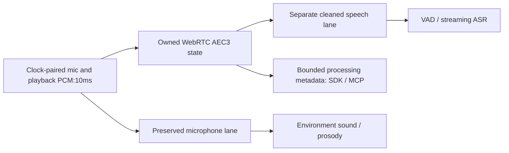

# Playback-reference echo cancellation



`WebRTCDuplex` adds native10ms echo processing with explicitly paired playback
reference. It does not synthesize speech, operate devices or implement a host's
barge-in/generation cancellation. Input sensing can continue during playback; actual
acoustic quality and full-duplex host behavior require separate validation.
`transform(frame)` returns `DuplexBlock(ambient, speech, context)` for an application's
explicit routing. `process(frame)` publishes only metadata and discards derived PCM.
Raw audio never enters context output.

The `webrtc.aec3` ProcessProvider profile uses `WebRTCDuplex.from_installed` and
exposes `audio.webrtc.aec3` / `audio.duplex`. The isolated profile is **context-only**:
its response cannot carry PCM. To feed VAD/ASR with cleaned samples, use `transform`
in an explicitly selected local audio runtime and send its returned InputFrame to
the downstream consumer (which may itself be a ProcessProvider). Select ambient
separately for sound-event analysis. Do not call process and transform on the same
block: each advances the native state once.

## Selected runtime and processing

The optional `duplex` extra pins `pywebrtc-audio==0.2.0`, available on PyPI, with
NumPy. The native package is not installed in the current task environment.
The [v0.2.0 binding source](https://github.com/strands-labs/pywebrtc-audio/blob/1bc860a2051c2b9b3c10b8c778770794b9321d84/bindings/webrtc_audio_bindings.cpp)
defines EchoCanceller at16/32/48kHz and the owned render-before-capture AEC3 path.
We use EchoCanceller directly, not the combined NS/AGC pipeline. Its high-pass filter
is always active during AEC. The wrapper is Apache2.0; preserve upstream and
vendored WebRTC/third-party notices and patent terms for redistribution. Package
version selection does not substitute for verifying actual wheel/source provenance.

Configuration: `sample_rate`16000/32000/48000 (default16000), `stream_delay_ms`0..500
(default0), and distinct `ambient_sensor_id` / `speech_sensor_id` (defaults ambient /
speech). Output IDs must differ from the input sensor. Delay is a caller-configured
buffer hint, not measured distance or verified echo alignment. Capability version
includes these parameters. Model weights are not required and no package is fetched
automatically. Native construction is lazy on the first valid referenced block.

Input has exactly rate/100 rows:160/320/480, and one or two columns. Dtype is native
int16 or float32. Float input must be finite and within[-1,1]; int16 is normalized
by32768 into owned float32 vectors. The binding's float path uses its own32767
internal scale; direct int16-call bit parity is not claimed. Both arrays passed to
the binding are contiguous independent copies because its native memcpy path does
not honor arbitrary array strides. No SDK accumulation or hidden partial-window
padding is used. Non10ms blocks are rejected: the upstream API would otherwise pad
its last partial block, changing state at every arbitrary chunk boundary.

## Reference and clock contract

With reference present, channels must be exactly `('microphone','render')`. Column0
is capture; column1 is the actual pre-speaker playback reference. A `calibration_id`
records the application's declared pairing setup; the SDK does not verify hardware
synchronization. The timestamp is this paired block's **capture-end** time, not the
acoustic echo alignment delay. Sequence and timestamp must increase. Nominal block
spacing is10ms with1ms cumulative clock tolerance. Source, subject, epoch, channel
layout, calibration or clock changes, and skipped sequences reset native histories.

A one-column `('microphone',)` block means reference is **unavailable**: ambient
remains available, speech is None, and metadata says `unavailable_reference`. This
is different from explicit zero samples in a present render column, which indicate
known playback silence and still run AEC. Reference loss discards AEC state; return
starts a fresh filter. Missing reference is never filled with invented silence.
The application may separately choose a raw-speech fallback, but this adapter does
not label unprocessed microphone audio as echo-cancelled.

## Outputs, lifecycle and limits

Ambient PCM preserves every normalized microphone sample in an owned copy; AEC
cannot mutate it. Cleaned speech is a separate float32 frame, carrying original
capture timing/provenance and a distinct sensor/channel ID. Finite native output
outside[-1,1] is clipped with an explicit clipped-sample count and preclip peak;
magnitude over16 or malformed/nonfinite output is rejected. Ambient is never
filtered or clipped. Each call retains only bounded native filter state, not raw
history or an SDK input queue. Runtime native memory is still a measurement gate.

Processing metadata includes reference status, RMS levels, configured delay,
filter flags, sample clipping and reset count. RMS changes do not establish ERLE,
echo removal or improved ASR; those acceptance flags remain false. AEC convergence
and physical pairing are not inferred. There is no noise suppression or AGC here.

One lock serializes transform/reset/close. Reset releases and recreates the whole
native object, including its audio buffers; it does not merely clear filter weights.
Invalid input/output clears continuity. Close releases native state and the factory;
it waits for active processing. The native binding has no explicit close method,
so the wrapper drops the last owned reference to trigger its C++ RAII destruction.
In-process transform has no hard native timeout. ProcessProvider supplies its usual
owned-child deadlines for context-only usage. In async applications run blocking
transforms off the event loop and await owned work before teardown.

## Explicit smoke execution after installations resume

```sh
/path/to/audio/runtime/bin/python -m pip install '.[duplex]'
/path/to/audio/runtime/bin/python -m pip freeze > duplex-runtime-versions.txt
PYTHONPATH=. /path/to/audio/runtime/bin/python examples/validate_duplex.py \
  --microphone /path/paired-mic.wav --render /path/paired-playback.wav \
  --delay-ms 40 --output duplex-smoke.json
```

Inputs must be mono PCM16 at the same selected rate/length, contain whole10ms blocks,
and last at most30s; files are bounded to16MiB. The script opens no devices and
exclusively creates a report with file/runtime hashes, ambient-preservation check,
output PCM hashes, native processing timings and last context. It does not write raw
audio. Synthetic replay timestamps are declared. Per-call p50/p95 are processing
measurements, not capture-to-ASR latency, live synchronization or acoustic quality.

## Remaining acceptance

Tests cover all selected rates, owned ambient/cleaned arrays, explicit silence vs
missing reference, gaps/owner changes, malformed input/output, clipping, lazy loader,
close serialization, real DSP downstream routing and MCP context. Native AEC itself
is doubled; subtraction fixtures do not represent WebRTC behavior. Required
[#103](https://github.com/NomaDamas/Gamst/issues/103) under [duplex #28](https://github.com/NomaDamas/Gamst/issues/28)
tracks actual installed binding/reference parity, far-only/near-only/double-talk,
measured playback/capture synchronization, echo metrics and ASR preservation,
interruptions/reconnects, and sustained CPU/RSS/latency. No hardware/model/runtime
acceptance, realtime speed claim or full SDK completion is established here.
