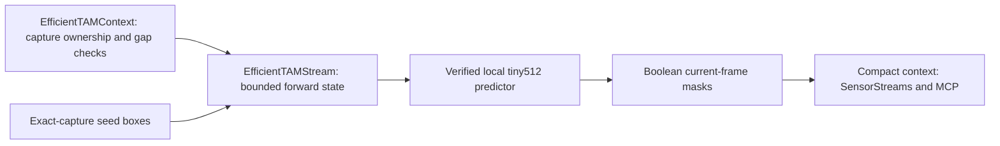

# EfficientTAM bounded streaming bridge

gamst's required [mask-tracking family #19](https://github.com/NomaDamas/Gamst/issues/19) needs a video path in addition to sampled SAM image segmentation. `EfficientTAMStream` provides bounded state management; `efficienttam.tiny512` is now a concrete isolated-worker profile with a verified local loader and capture-bound context adapter. `MaskTrackingPipeline` connects RF-DETR seed detection to this tracker for SensorStreams/MCP. **Trained-checkpoint quality, native full-clip parity and measured live performance remain unverified** and required in [#127](https://github.com/NomaDamas/Gamst/issues/127).

## Responsibility and boundaries



The bridge accepts one owned BGR uint8 image per `step`, with axes 32..2048 and at most 1,048,576 pixels. The initial call requires one to four pixel `xyxy` boxes on that image. Subsequent calls cannot add objects or correct old frames. Returns are owned boolean `N×H×W` masks in initial prompt order; IDs 1..N are session-local indices, not recognized identities. Thresholding uses native mask logits `>0`, not calibrated confidence. There is no automatic object detection, presence certainty, reidentification or box reuse after reset.

The outer integration must bind prompts to the exact captured frame and reset on timestamp/sequence gaps, source/epoch changes and dropped frames. This internal component receives no timestamps and therefore **cannot detect these discontinuities itself**. Geometry changes, policy drift, native errors, malformed output and a configurable session limit (default/maximum 1,000,000 frames) invalidate all state. Reset requires fresh initial boxes; close releases the predictor reference and is terminal. The caller must not mutate or concurrently use the supplied predictor.

## Pinned source and state proof

Source target: [EfficientTAM revision abcd061](https://github.com/yformer/EfficientTAM/tree/abcd061ebd3cc6e7527d152d75b890126aaa53f6), Apache-2.0 upstream code; checkpoint provenance/license remains to be verified by the native loader. The integration targets `efficienttam_ti_512x512.yaml`, evaluation mode, mask-memory count 7, temporal stride 1, maximum object pointers 16, past-only pointers and no pointer temporal encoding. Compilation, optimized VOS, hole filling and surrounding-memory clearing must be disabled by the loader. The bridge checks the attention/propagation policy, but does not attest package/source identity or disable an already compiled model.

The official `init_state(video_path)` loads a whole video. This bridge constructs the same state fields for the current image and runs only `propagate_in_video(start_frame_idx=current, max_frame_num_to_track=0, reverse=False)`. In this pinned implementation the endpoint is inclusive: zero means precisely the current frame. The generator is fully consumed and checked for exactly one result before state pruning.

At the end of frame *t*, each object retains the initial conditioning output and non-conditioning outputs *max(1,t−14)..t*. At *t+1*, mask attention requests at most six prior frames and object-pointer attention at most fifteen: all are retained. Absolute indices and `num_frames=t+1` are preserved; they must not be replaced by retained-image count. Prompt records remain at frame zero, temporary outputs must be empty, tracked-frame metadata keeps only the current frame, and image/backbone caches are cleared after propagation. Shared positional constants remain in state. No future image or lookahead is supplied.

This is a bound on retained state references, not a measured CPU/GPU memory ceiling. Native tensors, allocator caches, operator workspaces and weights still consume memory. Actual full-clip parity, long-run memory plateau and throughput require #127. The bridge does not claim realtime FPS or quality equivalence from substituted arithmetic tests.

Preprocessing follows the pinned JPEG loader's arithmetic on predecoded pixels: BGR→RGB, Pillow bicubic 512×512 resize, uint8 division in float64, conversion to float32, then ImageNet mean/std normalization. No JPEG re-encoding is introduced. Compare against the same predecoded pixels for native parity; different video/JPEG decoding can itself change masks.

## Validation and remaining integration

Run `python3 -m unittest discover -s tests -p test_efficienttam_stream.py -v` with NumPy, Pillow and Torch available. Tests exercise 1,000 frames/two objects, all prior-memory addresses needed by the fixed attention policy, cache/metadata bounds, malformed output and late generator errors, fresh-prompt requirements, input limits, policy drift, terminal close and exact preprocessing arithmetic. Model math is substituted. No EfficientTAM package or weights were installed for these tests.

The registered profile now supplies the verified loader, context adapter and worker integration described below. Tests of the internal predictor contract alone still do not establish actual checkpoint quality. Existing `sam3.py` remains the separate sampled image path.

## Local runtime and context profile

Model installation remains a separate explicit step. In a dedicated environment, the optional `.[efficienttam]` dependencies select Torch 2.8.0, TorchVision 0.23.0, Hydra 1.3.2, OmegaConf 2.3.0, NumPy, Pillow and tqdm. Do not install the upstream demo package into an existing environment: its Gradio/Hugging Face/demo dependencies are not needed by this path. Supply a checkout of the pinned revision and an official tiny512 checkpoint separately, with a recorded SHA256 and license/provenance. The loader has no download path.

```python
from humansense import ProcessProvider

config = {
    "source_dir": "/absolute/EfficientTAM",  # contains efficient_track_anything/
    "checkpoint_path": "/absolute/efficienttam_ti_512x512.pt",
    "checkpoint_sha256": "<64 lowercase hexadecimal characters>",
    "runtime_root": "/absolute/existing/task-directory",
    "device": "cpu",  # or explicit cuda; no silent fallback
    "max_gap_ms": 1000,
    "max_frames": 1000000,
}
spec = ProcessProvider.capability("efficienttam.tiny512", config)  # no model startup
worker = await ProcessProvider.open("/absolute/runtime/bin/python", "efficienttam.tiny512", config)
# Explicitly close worker in finally when done.
```

The worker verifies 32 pinned Python/config file hashes, snapshots only those files into its own temporary directory, and builds only the tiny512 video predictor with fixed overrides. It reads at most 256 MiB of checkpoint data, uses Torch's `weights_only=True`, requires the exact `{"model": state_dict}` wrapper, every tensor key/shape/dtype and finite values, then loads strictly. Fresh worker/module/Hydra state is required. CPU and CUDA are selectable; CPU execution was exercised, CUDA execution remains unverified. Runtime dependencies are trusted separately from upstream-source integrity. Closing removes only this worker's temporary snapshot; user source/checkpoint files and global caches are untouched.

Call `worker.process(frame)` for ongoing images. An unseeded or discontinuous stream returns `summary.status="needs_prompt"` and no observed objects. Supply `worker.process_regions(frame, region_evidence(...))` with one to four `track_id`, `label` and normalized `location.bbox` rows belonging to that exact capture. `region_evidence` is from `humansense.providers.region_appearance`; its capture hash/metadata bind pixels and source, not the correctness of the caller's boxes. A seed may follow `needs_prompt` on the exact same capture; other repeated or backwards captures are rejected. A new seed always starts new session-local track IDs.

The adapter checks capture sequence (original `capture_sequence` when supplied), increasing timestamps, ownership, coordinate/calibration identity, geometry and configured gap/session limits. Gaps clear prior masks/prompts and return `needs_prompt`; no stale box is automatically reused. Each nonempty current mask becomes an object with a normalized bounding box, 16×16 coverage bytes and exact foreground-pixel/area statistics. The lossy coverage grid is context, not a full-resolution mask or calibrated confidence. Empty masks appear only in bounded `summary.empty_tracks`, never as observed objects, so they cannot refresh memory's `last_seen`. Empty masks do not prove absence. `complete_snapshot=False` means the output is not a complete scene census; historical visibility expires according to the existing object-memory freshness policy unless explicitly invalidated.

`MaskTrackingPipeline.open(detector_python, detector_config, tracker_python, config)` owns both RF-DETR and EfficientTAM workers. Register its `spec` and factory with `SensorStreams` as with other providers. It requests detector boxes only when the tracker needs a seed, selects at most four in detector order, and reports omitted and subpixel/unseedable counts. Valid subpixel detections are skipped, not treated as a fatal worker error. If none are eligible, it stays unseeded and tries the next capture. It does not discover newly entering objects during an active track session; reset/reseed explicitly for a fresh scene. Errors/cancellation close both owned workers. Separate runtimes prevent dependency conflicts.

## Reproduction and evidence

Contract and managed-path checks:

```sh
python3 -m unittest discover -s tests -p 'test_efficienttam*.py' -v
```

These cover exact-frame seed rejection, same-frame prompt handshake, source/gap/geometry changes, session-local IDs, compact payload limits, empty-mask memory expiry, subpixel boxes, cancellation, worker protocol/reaping, strict checkpoint tensors and SensorStreams→MCP memory. The native profile also executed three CPU frames with an **untrained generated test checkpoint** through the real 17,866,018-parameter upstream graph and real isolated worker; reset returned `needs_prompt`. This verifies graph/loader wiring only. No trained weights were downloaded or installed, and empty masks from random parameters are not quality evidence. The generated checkpoint was a temporary test artifact removed after the run.

With an explicitly supplied trained checkpoint, replay ordered images:

For the separate untrained graph check, run `OMP_NUM_THREADS=2 MKL_NUM_THREADS=2 PYTHONPATH=. python examples/validate_efficienttam_fixture.py --source-dir /absolute/EfficientTAM --runtime-root /absolute/existing/task-directory --output /absolute/new-fixture-report.json`. It creates and removes only its own temporary random checkpoint. Use the next command with a trained checkpoint for actual replay; neither command alone establishes quality acceptance.

```sh
PYTHONPATH=. python examples/validate_efficienttam.py \
  --python /absolute/runtime/bin/python --source-dir /absolute/EfficientTAM \
  --checkpoint /absolute/efficienttam_ti_512x512.pt --sha256 CHECKPOINT_SHA256 \
  --runtime-root /absolute/existing/task-directory \
  --image /absolute/frame0.png --image /absolute/frame1.png --image /absolute/frame2.png \
  --box 0.1 0.1 0.5 0.5 --label cup --period-ms 40 --gap-at 2 \
  --output /absolute/new-report.json
```

The box is normalized xywh for frame zero only. The injected gap must return `needs_prompt`, never replay that box at frame two. The report includes input/checkpoint hashes, context and processing duration. Its timestamps are synthetic replay times; processing duration is not live capture-to-context latency. Real annotated masks, occlusion/re-entry quality, full-clip parity, long-stream CPU/GPU resource bounds and capture-to-context p50/p95 remain mandatory #127 work. This runner does not automatically certify those gates.
