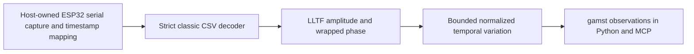

# ESP32 channel-state variation context



The host owns firmware, radio operation, serial framing and capture-clock mapping.
`ESP32CSI` owns decoding and deterministic channel-response DSP. No board, port or
radio starts on discovery. It reports a changing radio channel, not a verified
person, object, position, gesture or through-wall observation. Real hardware and
controlled-motion acceptance is required in [#121](https://github.com/NomaDamas/Gamst/issues/121)
under#31. TI radar remains a separate required implementation; through-wall
research remains#32.

## Selected firmware and wire profile

Primary wire source is the classic branch of
[Espressif's receiver](https://github.com/espressif/esp-csi/blob/8633d67152db2808f141cc1595970aa9cf406045/examples/get-started/csi_recv/main/app_main.c),
revision8633d67152db2808f141cc1595970aa9cf406045. Select original ESP32, gain control
disabled,20MHz/no secondary channel, no STBC. Legacy records must have128signed
CSI components; HT records must have256 with LLTF and HT-LTF enabled. HT MCS0..7
is accepted. The current upstream example defaults to HT40: the host must build
and record an explicit20MHz firmware configuration, not assume default firmware
matches. Record LLTF merge, channel filtering and scaling settings as part of the
firmware build. This adapter reads the LLTF prefix; it does not recover firmware
processing that was already applied to that prefix.

One InputFrame.data is one ASCII bytes CSV record of at most4096bytes, with the
exact classic25-column layout:

```text
type,id,mac,rssi,rate,sig_mode,mcs,bandwidth,smoothing,not_sounding,aggregation,stbc,fec_coding,sgi,noise_floor,ampdu_cnt,channel,secondary_channel,local_timestamp,ant,sig_len,rx_format,len,first_word,data
```

The row starts CSI_DATA. The final field is a quoted flat signed-byte integer
list. Nested lists, booleans, exponents, inconsistent lengths, unsupported radio
settings, logs, headers and multiple records are rejected. The selected source's
rx_format repeats sig_mode; it is not an RX-error status. Signed printf forms of
uint32 transmitter ID and receiver timestamp are normalized to unsigned values.
No log-prefix stripping, eval, arbitrary payload execution or serial opening is
performed. The transmitter MAC must match the explicit configured link.

C5/C6/C61 use a different format. S3/C3 gain-compensated values,40MHz and STBC
profiles are unsupported. Some configurations can produce deceptively similar
rows; byte validation cannot identify a physical chip or prove gain settings.
Correct firmware selection is a host declaration and remains hardware_verified=False.
Espressif firmware and the adapter use Apache-2.0; no model or optional ML package
is needed. The worker uses the Python standard library only.

## IQ and derived context

The [ESP-IDF CSI specification](https://docs.espressif.com/projects/esp-idf/en/stable/esp32/api-guides/wifi-driver/wifi-vendor-features.html#wi-fi-channel-state-information)
defines imaginary then real signed components, LLTF first, and classic20MHz
index order0..31,-32..-1. The decoder selects48nonpilot LLTF carriers: -26..-1 and
1..26 excluding±7/±21. DC and guard carriers are omitted. When first_word is set,
the first four bytes are invalid; carrier+1 is additionally removed, leaving47.
A mask change resets the temporal window rather than comparing different vectors.
HT-LTF data is validated for length/range but not used by this selected DSP path.

For each selected carrier return magnitude hypot(real,imag) in receiver integer
scale and wrapped phase atan2(imag,real) in radians; a zero complex coefficient
has phase null. These values are neither calibrated power nor calibrated phase.
No phase unwrapping, carrier-frequency-offset/sampling-offset compensation,
range/angle/Doppler inversion or metric velocity is performed.

Normalize each magnitude vector by its own RMS. Adjacent-vector RMS difference
and rolling per-carrier population variation are dimensionless. The rolling
variation is sqrt(mean over packets/carriers of squared deviation from each
carrier's window mean). Uniform amplitude scaling cancels; frequency-dependent
gain, multipath, interference and nonhuman motion can still change the value.
The configurable variation_threshold defaults to0.05 as an engineering parameter,
not a validated detector threshold. threshold_exceeded is returned only when
ready; otherwise null. It is a mathematical comparison, not a presence decision.
Output explicitly includes motion_verified=False, presence=null, range_m=null,
velocity_m_s=null and through_wall_object_verified=False.

## Capture clock, state and bounds

Input modality is csi. SensorMetadata.calibration_id must equal the configured
clock_calibration_id. InputFrame.timestamp_ms is a nonnegative integer mapped
capture timestamp up to2**53-1. It must not be fabricated from serial arrival time.
The32-bit receiver microsecond clock is retained in radio metadata. Device deltas
use modular arithmetic so ordinary wrap preserves continuity. Backward/restarted
counters start a new window; exact duplicate device timestamp/transmitter ID is
rejected. Host sequence uses capture_sequence when present, otherwise sequence.

Source, subject, sensor, stream epoch, calibration, channel/antenna/rate/radio
layout, carrier mask or sequence-mode changes reset history. Gaps in host or
transmitter sequence and device-time gaps above max_gap_ms reset it too.
Capture time may share a millisecond for sub-millisecond packets, but cannot move
backward. Accumulated host/device elapsed-time disagreement over2ms resets the
window; checking cumulative offset prevents a stuck host clock from appearing
valid through individually small deltas. This sanity check is not clock
calibration, so clock_calibration_verified remains false. Hardware clock reset
and ambiguous backwards jumps never become negative or gigantic velocities.

The requested window is100..5000ms, default1000. Keep at most256normalized vectors
of at most48values, and prune by device elapsed time. Ready requires at least8
samples, elapsed warmup reaching the requested window, and actual retained span
at least80% of that window. sample_limit_ever_hit records count truncation since
reset; requested/effective span and sample count stay explicit. Very high packet
rates may lack enough retained time coverage and remain unready. Zero channel
energy clears the window, emits unavailable variation/phase as appropriate, and
never implies no motion. Parsing/validation errors also clear history.

Per-packet work is bounded by256x48 feature values plus one bounded CSV row.
Current amplitude/phase and rolling summaries fit the standard observation byte
limit; no historical raw IQ is retained. Calls/reset/close are serialized. Close
clears history and permanently rejects input. There is no tail padding or
no-input inference. Native serial capture, packet queue and consumer cadence are
owned separately by the host and existing SensorStreams machinery.

## Explicit worker integration

```python
from humansense import ProcessProvider, SensorStreams

config = {'transmitter_mac': '1a:00:00:00:00:00',
          'clock_calibration_id': 'receiver-clock-v1',
          'window_ms': 1000, 'max_gap_ms': 250, 'variation_threshold': 0.05}
spec = ProcessProvider.capability('esp32.csi', config)
streams = SensorStreams(human)  # Existing consented HumanSense instance.
async def create():
    return await ProcessProvider.open('/explicit/env/bin/python', 'esp32.csi', config)
streams.register(spec, create)
await streams.open('receiver', 'csi', [spec.id])
# Explicit host reader extracts complete bounded CSI_DATA rows and maps clocks.
# await streams.submit(InputFrame(row_bytes, 'csi', mapped_capture_ms,
#     sensor=SensorMetadata('receiver', 'csi', seq,
#                           calibration_id='receiver-clock-v1')))
```

Capability csi.esp32.channel_variation emits csi.channel_variation with the
channel_response object. Existing get_observations/get_context Python/MCP tools
and context subscriptions expose it at user-selected cadence; queries never
advance the DSP. Host serial handling must discard only explicitly identified
non-CSI logs and surface malformed CSI rows/gaps rather than relabel them as valid
measurements. No serial acquisition or flashing helper is implicitly invoked.

## Evidence and open acceptance

```sh
python3 -m unittest discover -s tests -p test_csi.py -v
```

Tests use known complex values, carrier masks, signed/wrapped counters, normalized
gain invariance, changing spectral patterns, gaps/restarts/clock drift, malformed
records and bounded high-rate histories. A real owned Python worker executes the
actual parser and DSP, sends observations through SensorStreams/MCP and is reaped;
its CSV rows are synthetic. No board or live radio was used and no hardware
accuracy is established. Required#121 tracks actual firmware/serial ingestion,
held-out static/moving/interference cases, timestamp mapping, sensitivity and
false alarms, paced resource/latency, reconnect and real SDK/MCP capture evidence.
Family#31 and overall completion remain open, including TI radar. This is not a
replacement for specialized through-wall sensing or proof of VLM cost savings.
