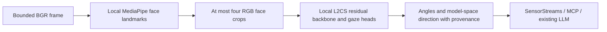

# Local gaze context



`L2CSGaze` owns one image-mode face provider and one CPU gaze model. The SDK owns
capture identity, timestamps, freshness and publication. No target LLM change is
required. Each submitted frame is independent; there is no temporal encoder,
smoothing, persistent face identity, calibrated target intersection or attention
classification. Worker isolation supplies the native-inference timeout boundary;
in-process close waits for an active native call.

The `l2cs.gaze` worker profile accepts `path`, `sha256`, `face_path`, `face_sha256`,
optional `arch` (`ResNet50` default or `ResNet18`) and `max_faces` (1..4). Discovery
imports neither Torch nor MediaPipe. Both absolute local files must match SHA256,
with gaze limited to256MiB and face to64MiB, before native imports. The loader uses
`torch.load(..., weights_only=True, map_location='cpu')` on verified bytes, strict
state-dictionary keys, no pretrained backbone download, evaluation mode and
inference mode. A compatible checkpoint must be supplied explicitly. No model is
installed by this feature.

The architecture/preprocessing follows the upstream
[L2CS implementation at a4d8f7f](https://github.com/Ahmednull/L2CS-Net/tree/a4d8f7fa5436a2b2b9f088471623b552a85811bd):
standard torchvision residual blocks, two90-bin linear heads and the unused
finetune layer retained for strict checkpoint compatibility. The loader uses the
matching torchvision ResNet feature backbone with its ImageNet classifier removed.
RGB crops are resized to224×224, converted through PIL to448×448, then normalized
with the ImageNet means/standard deviations. It does not instantiate the upstream
RetinaFace pipeline. The face boxes come from MediaPipe landmarks, **a different
crop distribution requiring separate accuracy validation**.

For head logits, a stable softmax produces the expected bin index; angle in
degrees is `4 * expected_index - 180`. All90 logits must be finite, magnitude at
most1e6. The checkpoint's `fc_yaw_gaze` head is the first output; the
`fc_pitch_gaze` head is second. Upstream Pipeline variable names label the first
as pitch and second as yaw; this adapter names them by the actual checkpoint
heads and records the model-space convention explicitly. With `y = yaw` and
`p = pitch` in radians, direction is
`(-cos(p)*sin(y), -sin(p), -cos(p)*cos(y))`. This matches the upstream vector/drawing
convention; it is not a calibrated camera ray. Zero/zero points along negative z.
Mirror status and camera calibration are unavailable until separately measured.

Outputs are bounded `faces` plus `summary`. Each face includes frame-local index,
normalized bbox, status, yaw/pitch degrees and unit direction. Crops smaller than
16pixels on either axis, or missing boxes, produce null estimates and an
`unavailable_crop` status. No faces means no gaze invocation. Face-detector scores
and softmax peaks are not substituted for gaze confidence; confidence and gaze
target remain unavailable. Repeated similar faces cannot be treated as the same
person. Input is uint8 BGR, at most1920×1080 pixels and3840×2160 dimensions. Raw
images, landmarks and logits never enter the emitted context.

## Selected runtime and explicit execution

Use an isolated environment with `torch==2.8.0`, `torchvision==0.23.0` and
`mediapipe==0.10.35`, plus compatible NumPy, OpenCV and Pillow. Torch/TorchVision
and MediaPipe versions are checked at load. Remaining dependency versions must
be recorded during actual validation. Code licenses are MIT (L2CS) and Apache2.0
(MediaPipe); checkpoint/data licenses require separate verification. The upstream
linked Gaze360 checkpoint is ResNet50; accepting ResNet18 architecture does not
claim a validated trained ResNet18 artifact exists.

After explicitly acquiring the checkpoints, run:

```sh
PYTHONPATH=. python examples/validate_gaze.py \
  --python /path/to/selected-runtime/bin/python \
  --gaze /absolute/L2CSNet_gaze360.pkl --gaze-sha256 GAZE_SHA256 \
  --face /absolute/face_landmarker.task --face-sha256 FACE_SHA256 \
  --image /path/to/consented-image.jpg --output gaze-smoke.json
```

The command creates a new report without overwriting existing evidence, recording
selected model hashes, input hash, capability version, startup/first process time
and context from a real child. It is a single-image smoke test, not a throughput,
accuracy or realtime guarantee. For continuous use, register
`ProcessProvider.capability('l2cs.gaze', config)` with `SensorStreams` and a factory
calling `await ProcessProvider.open(python, 'l2cs.gaze', config)`, then submit the
camera's timestamped `InputFrame` objects. Existing MCP observation queries use
capability ID `vision.l2cs.gaze` and retain capture provenance.

## Evidence and remaining gates

`python3 -m unittest discover -s tests -p test_gaze.py -v` verifies head order,
softmax/geometry, RGB copies, crop association/abstention, input/result limits,
lifecycle, artifact integrity and managed MCP publication. When Torch/TorchVision
are already installed, a synthetic-state test runs actual ResNet18 preprocessing,
backbone and heads; the classifier weights are zeros and no trained checkpoint is
loaded. This demonstrates native wiring, not gaze accuracy or actual model support.

The local macOS native test passed with Torch2.8.0/TorchVision0.23.0/OpenCV4.13.0.92/
Pillow12.2.0. It also emitted an AVFAudioReceiver duplicate-class warning from
installed PyAV/OpenCV dylibs. No global package was altered; a clean isolated
runtime must be validated before deployment. MediaPipe is not installed locally,
so that test substitutes the face provider and does not prove end-to-end inference.

[Actual validation #93](https://github.com/NomaDamas/Gamst/issues/93) remains required
under [family #20](https://github.com/NomaDamas/Gamst/issues/20): real checkpoint
loading, angular ground truth, crop parity, mirror/axis calibration, multi-face
and absent-face replay, sustained resource/latency measurements, and exact runtime
provenance. Neither cheap/fast/SOTA behavior nor target identification is claimed
by these implementation tests. The broader perception acceptance plan remains open.
