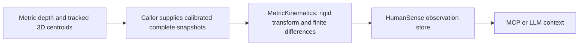

# Metric track context



`MetricKinematics` computes metric motion from already-associated 3D positions.
The caller owns depth reconstruction, camera calibration, synchronization and track
identity. The provider owns bounded finite-difference state and context validation.
It does not run a depth model, establish identity, infer contact/support, measure
force, or turn relative monocular depth into meters. Required family #38 remains
open for those integrations and real scene validation.

Import from `humansense.providers.kinematics`. Python standard library only;
no dependency installation, checkpoint, device activation or download occurs.
The SDK implementation uses Apache-2.0. This is a **local structured-input**
processor: do not select it as a pixel `ProcessProvider` or submit its dictionaries
to `SensorStreams`' video transport. Publish returned observations explicitly.

## Input and calibration

Construct with `calibration_id`, `input_frame`, `output_frame`, optional proper
orthonormal 3x3 `rotation`, `translation_m` and `max_gap_ms` (default 1000;
1..10000). Transform is `p_out = rotation @ p_in + translation_m`. A nonidentity
transform requires distinct frame names. The configuration is hashed into the
capability version; do not mutate provider configuration after construction.

Call `process(InputFrame(data, 'video', timestamp_ms, sensor=metadata))`. Metadata
must have matching input coordinate frame and calibration ID. Data must be:

```python
{
    'units': 'm',
    'tracker_id': 'calibrated-depth-tracker',
    'tracker_version': 'v1',
    'objects': [{'track_id': 'object-1', 'position_m': [1.0, 0.0, 2.0]}],
}
```

Each input is a **complete snapshot**, 0..32 unique tracks, <=16KiB strict JSON.
Coordinates and translation are bounded to +/-10000 meters per input axis.
Capture timestamps are integer milliseconds, not inference completion times.
Use one stationary output coordinate system and a fixed transform for an instance.
A moving camera needs upstream ego-motion compensation into that stationary
system; this processor has no time-varying pose input. Declared calibration is
not independently verified. Sensor calibration/frame changes require a new
configured instance; mismatches reject and clear history.

## Time, gaps and output

The first sample warms up. The second gives velocity `(p2-p1)/(t2-t1)` and speed.
Velocity represents the interval average, with interval and midpoint reported.
The third gives acceleration from velocity differences divided by the difference
between their interval midpoints, correctly accounting for unequal sample gaps.
Acceleration is an interval estimate, not an instantaneous force measurement.
Approach is `(previous_range-current_range)/dt`: positive means decreasing range
to the **output coordinate origin**, not necessarily to a camera or person.
No smoothing or uncertainty estimate is applied; noisy depth and identity switches
can produce large derivatives. Absence of a derivative is `None`, not zero.

Only the previous snapshot's positions, velocities and interval starts are stored.
Missing tracks lose history immediately; reused IDs are not re-identified.
Sequence skips, a gap above `max_gap_ms`, changes of subject/source/sensor/epoch/
tracker, or a switch between capture and delivery sequence modes cause warmup.
When available, `capture_sequence` is authoritative; otherwise `sequence` is used.
Nonincreasing capture times/sequences reject. Any invalid input clears all history.
At most 32 track states remain allocated until the next call/reset/close; idle
state is not a claim of current location. `reset`, `process`, and idempotent
`close` are serialized with a lock. Output includes provenance, explicit units,
`calibration_verified=False`, and no contact/force claims.

## SDK publication

```python
from humansense import HumanSense
from humansense.providers.kinematics import MetricKinematics

provider = MetricKinematics(calibration_id='cal1', input_frame='world', output_frame='world')
# frame is the structured InputFrame described above, from your calibrated pipeline.
value = provider.process(frame)
async with HumanSense(consent=True) as human:
    human.register_capability(provider.spec)
    await human.push_observation(provider.spec.id, value, sensor=frame.sensor,
                                 timestamp_ms=frame.timestamp_ms, subject_id=frame.subject_id)
    context = await human.get_context()
provider.close()
```

Keep the SDK session and provider open across frames in a live application.
The publication sensor describes the input capture; `geometry.coordinate_frame`
describes transformed output coordinates. Consumers must retain that distinction.
The resulting `vision.kinematics` observation is available through MCP
`get_observations` and the usual context API. Delivery cadence remains host-selected.

Validation: `python3 -m unittest discover -s tests -p test_kinematics.py -v` runs
actual arithmetic against analytic trajectories, transformations, reset/boundary
cases and SDK/MCP publication. This is synthetic geometry evidence, not calibrated
depth/track execution, real-scene accuracy, latency acceptance or learned physical
concept inference. Those remain required before family #38 can close.
