# Object appearance and historical memory

```mermaid
flowchart LR
    Capture[Owned timestamped BGR capture] --> Detector[RF-DETR worker in its selected runtime]
    Detector --> Binding[Boxes plus exact capture hash and provenance]
    Capture --> Binding
    Binding --> Encoder[DINOv3 region worker in separate runtime]
    Encoder --> Gallery[Bounded prior-crop gallery]
    Gallery --> Context[Historical candidates and current detections]
    Context --> SDK[SensorStreams observation]
    SDK --> Memory[Explicit remember_objects]
    Memory --> MCP[MCP get_object_memory]
```



`ObjectAppearancePipeline` owns two workers and processes their results sequentially
against the same copied capture. It adds crop appearance to existing RF-DETR track
observations. A candidate's label, timestamp, capture sequence and normalized box
are historical evidence. Similarity never merges identities or proves the object's
current location. The SDK's `remember_objects` retains observations after an object
leaves the latest complete detection snapshot. MCP can then report it as
`previously_seen`, with `current_location=None`.

The two runtimes are deliberate: [RF-DETR1.12.1](https://github.com/roboflow/rf-detr/blob/1.12.1/pyproject.toml)
requires Transformers5.x, while the selected [DINOv3 adapter](visual-retrieval.md)
pins4.57.6. Do not combine their optional dependency extras in one environment or
bypass version checks. Each environment needs the same gamst checkout and its own
explicit local model files. No dependencies/weights were installed for this change.

## Pipeline and evidence

`ObjectAppearancePipeline.capability(detector_config, region_config)` declares
`vision.object_appearance`; `await ObjectAppearancePipeline.open(detector_python,
detector_config, embedding_python, region_config)` constructs it. Register that
capability and async factory in SensorStreams. Detector config follows
`rfdetr.nano`; region config follows `dinov3.regions`: absolute local `path` and
`sha256`, optional `capacity`1..1024 (default128), `retention_ms`1..86400000
(default600000), `max_regions`1..8 (default8), `top_k`1..2 (default2).
The composite version hashes both declared capabilities. Model hashes/versions
therefore scope comparison state; changing detector provenance clears the gallery.

Input is uint8 BGR, at least32 pixels per axis, at most2MP within3840×2160, with a
declared normalized image coordinate frame. Before awaiting detection, the pipeline
owns a pixel copy. Detector input is a separate copy; the region worker receives
the preserved pixels plus capture SHA256, shape, timestamp, subject and complete
sensor metadata. `process_regions(frame, evidence)` rejects mismatches before
encoding any crop. The evidence helper binds trusted caller-supplied detection
results; a hash is not cryptographic proof that a detector actually ran. The owned
pipeline is the concrete path that runs detection on the bound capture.

The detector and region runtimes exchange only bounded observations plus the owned
input image over local pipes. No raw image or embedding vector is published to the
LLM. The new ProcessProvider `process_regions` operation validates its result against
the selected capability. A region worker rejects ordinary `process` without bound
region evidence; use the composite pipeline for ordinary SensorStreams ingestion.

## Crop and gallery semantics

At most64 supplied detector objects are validated, then the configured first1..8
are processed. RF-DETR supplies them in score order. Excess objects are explicitly
omitted and `complete_snapshot=False`, so memory must not assume missing objects
have disappeared. Crops use outward floor/ceil integer bounds clipped to the image.
Crops smaller than16 pixels per side, over1MiPixel or beyond4:1 aspect remain
`unavailable_crop` observations. Other crops use DINOv3's fixed224×224 RGB path.
Labels are capped at64 characters with explicit truncation flags, including
historical labels. Track IDs/labels/boxes are detector evidence, not ground truth.

Only prior captures are searched; two lookalikes in the same frame are never
mistakenly entered as one another's historical observations. All similarity scores
(including negative values) are candidates, not probabilities; no acceptance
threshold is applied. Reference IDs name observations, never physical objects.
The gallery stores copied normalized384-dimensional features and bounded metadata;
images/crops are not retained. Capacity evicts oldest entries. Capture-time and
monotonic-time expiry are checked on processing; idle allocated state is cleared
on the next call, reset or close. This is bounded working memory, not permanent
storage. Historical candidate boxes remain in the source image coordinate frame,
not world coordinates or current positions.

Sampled sequence gaps reset detector continuity but preserve appearance history.
Subject/source/sensor/epoch/coordinate/calibration changes reset both workers;
non-increasing capture order is rejected. Failure or cancellation closes both
workers, including partial construction. Close waits for active processing and
attempts both workers even if one close fails. Explicit reset clears both model
continuity and gallery. Native worker timeouts apply per request, not as one total
budget for the two-step pipeline.

## Explicit observation-memory ingestion

After each published pipeline record, call:

```python
await human.remember_objects(
    record['id'],
    complete_snapshot=record['observation']['value']['summary']['complete_snapshot'],
)
```

Use the exact returned/stored record, never an unrelated latest frame. This is an
explicit application decision; the new provider does not silently populate all
memory. `get_object_memory` returns stored evidence and visibility. Memory has its
own existing retention/capacity, session provenance and user clear/delete controls.
Stream close invalidates live visibility; data deletion clears derived memory.
Embedding similarities do not reconnect detector track IDs across resets or epochs.

## Repeatable local smoke after installation resumes

```sh
PYTHONPATH=. python examples/validate_object_appearance.py \
  --detector-python /detector/runtime/bin/python \
  --embedding-python /embedding/runtime/bin/python \
  --detector /absolute/rf-detr-nano.pth --detector-sha256 DETECTOR_SHA256 \
  --embedding /absolute/model.safetensors --embedding-sha256 EMBEDDING_SHA256 \
  --image /path/object-visible.jpg --image /path/object-absent.jpg \
  --image /path/object-returned.jpg --output object-memory-smoke.json
```

Use already installed isolated runtimes and freeze their dependencies separately.
The parent requires NumPy/Pillow. The runner opens no devices, bounds image bytes
and headers before decoding, preserves encoded orientation without EXIF rotation,
uses replay wall timestamps and exclusively creates an evidence report. It records
input hashes, selected model/config/runtime, published observations and memory.
It is an ordered-image smoke, not sustained throughput or retrieval accuracy proof.

## Acceptance still required

Tests cover exact-capture mismatch rejection, crop bounds/abstention, failure
atomicity, same-frame exclusion, repeated labels, ownership, expiry, sampling gaps,
local worker wire execution, cancellation/close, partial startup cleanup and MCP
memory after disappearance. Native encoders/detectors are doubles; the actual pipe
worker test is transport evidence, not trained inference. [#101](https://github.com/NomaDamas/Gamst/issues/101)
remains open for actual detector/crop/DINOv3 integration, lookalike and viewpoint
accuracy, evidence-grounded LLM tasks and sustained runtime/resource validation;
[#99](https://github.com/NomaDamas/Gamst/issues/99) covers the actual DINOv3 model.
No identity guarantee, present-location inference, realtime FPS, VLM-cost saving
or full family/goal completion is claimed.
