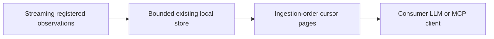

# Cursor replay for slower Context consumers



`HumanSense.get_observation_page` and the same-named MCP tool replay **whole
retained registered observations**, oldest ingestion first. A consumer can keep
its chosen delivery interval and later read intermediate event records even when
the latest snapshot contains no event. The existing newest-first
`get_observations` API remains unchanged. This query does not start sensors,
change delivery cadence, invoke a model, or create an additional evidence store.

```python
page = await human.get_observation_page(events_only=True, limit=20)
for record in page['items']:
    consume(record)  # Preserve the whole record to resolve event/sample indices.
cursor = page['next_cursor']
# Later, use the same subject/capability/source/sensor/events_only filters:
page = await human.get_observation_page(events_only=True, cursor=cursor, limit=20)
```

Arguments: subject_id (default local-user,1..128characters), optional
capability_id/source_id/sensor_id, events_only (default false), cursor, limit
(1..100, default20), max_bytes (1024..262144, default65536). No rolling capture-time
window applies: pages cover the existing retention bounds in ingestion order.
`events_only=true` selects registered observation values with a nonempty `events`
array. It is not the legacy observation.event/get_events API and does not verify
the semantics of an arbitrary registered provider's event labels.

Each response has items, returned_count, has_more, next_cursor,
blocked_record_bytes, entry_byte_budget, order, scope, events_only,
retention_changed_since_cursor and upstream_completeness. The byte budget sums
ASCII-escaped whole record JSON sizes, excluding list/envelope overhead; it is
an entry budget, not an exact wire-size bound. Existing MCP message bounds still
apply. Records are never cut apart, so original provenance and event indices
remain intact.

When has_more is true, fetch another page with next_cursor. When false, keep that
cursor and poll later: newly ingested records are returned even if their capture
timestamps equal or precede previously returned timestamps. Cursor progress uses
monotonic ingestion positions, not time or SQLite rowid. Capture timestamps are
preserved verbatim; this is historical evidence, not a claim of present freshness
or clock synchronization. Processed nonmatching records are skipped by the fixed
filters. Changing filters requires a fresh cursorless query.

If the first matching record exceeds max_bytes, items is empty, has_more is
true and blocked_record_bytes reports its required entry size. The cursor does
not advance past that record. Increase max_bytes up to its documented maximum;
if the record still exceeds the maximum, use the application's existing bounded
inspection/export policy. Repeatedly requesting the same small budget will not
resolve the block. If a later record would exceed the page budget, earlier whole
records are returned and that record remains next.

Cursors are signed, stateless and scoped to the exact filters and open Store
instance. Clients must treat them as opaque. Limit/max_bytes may change on retry.
They are not authorization credentials: subject/source filtering is not access
control, and the existing local MCP trust boundary remains unchanged. No
per-client session or acknowledgment state accumulates in the SDK.

Any delete_data/store.delete call, including a subject-specific or no-op delete,
invalidates all current store cursors conservatively. Close/reopen also invalidates
old cursors, while retained records and ingestion positions remain in SQLite.
An invalid cursor raises; restart without a cursor and deduplicate externally
by record ID if appropriate. Pausing collection does not invalidate history or
cursors. Configuration resets alone do not promise durable consumer progress.

Retention is still bounded by the existing record count, UTF-8 payload bytes and
capture-time expiry. `retention_changed_since_cursor=true` means some store
capacity eviction, expiry or oversized-write rejection occurred since that
cursor. It is a conservative **global** warning, possibly for another subject or
already-read records; it does not count missing matching events. The first page
returns null for this field because no baseline exists. Preserve warnings in
consumer state even if a later page reports false. `upstream_completeness` is
always unverified: frames dropped before storage, provider misses, exceptions
and events absent between observations cannot be reconstructed by pagination.
This is bounded retained replay, not lossless streaming or durable acknowledgments.

The store adds an AUTOINCREMENT record_offsets table with one row per retained
record. Existing databases are backfilled in original insertion order without
rewriting observation payloads. Eviction, pruning and deletion remove matching
offset rows; the constant-sized SQLite sequence counter prevents offset reuse.
Use the established single-owner Store/runtime contract; concurrent external
SQLite writers or older SDK processes must not modify the same live database.
Reopen the store to migrate records produced by an older implementation.

Tests cover existing-database migration, equal/backdated timestamps, append after
catch-up, filter/tamper rejection, byte blocking/retry, retention/deletion/reopen,
bounded offset metadata, and actual trajectory event records retrieved through
MCP after later event-free snapshots. #176 covers this software slice; physical
and trained-model quality, broader memory capabilities and real cost/latency
gates remain open. No trained-model installation is required.
