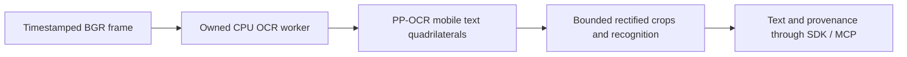

# Local OCR context



`PPOCRContext` processes independent frames; SensorStreams owns capture identity,
freshness and publication. The `ppocr.mobile` profile emits `vision.text` with
capability ID `vision.ppocr.mobile`. This is repeated frame inference, not native
temporal inference or text tracking. Delivery cadence remains user-controlled.
Use an owned ProcessProvider for deadlines; in-process close waits for active work.

Configuration requires absolute `det_path` / `rec_path` and their lowercase
`det_sha256` / `rec_sha256`. Optional `language` is en, ch or korean (default en),
and `max_regions` is 1..32 (default16). Language is a configuration assertion,
not verified coverage. Each ONNX file is limited to64MiB and verified before
native imports; the verified bytes create CPU-only ONNX Runtime sessions with
one intra/inter-op thread. No weights are included or automatically fetched.

The adapter pins RapidOCR3.10.0 and ONNX Runtime1.23.2. Direct detector/recognizer
constructors receive explicit sessions; recognition requires an embedded
`character` dictionary, preventing dictionary-download fallback. Dictionary size
is bounded to512KiB /20,000 entries. No visualization/font-download path is used.
[RapidOCR source](https://github.com/RapidAI/RapidOCR/tree/bd941dae09da793e76c6ba15c7aaf40f8424232a/python/rapidocr)
and [PP-OCRv5 mobile detector preprocessing](https://github.com/PaddlePaddle/PaddleOCR/blob/dab3fe35379033fdcb2d0e9572fac0b36c9a9ebf/configs/det/PP-OCRv5/PP-OCRv5_mobile_det.yml)
define the selected integration. Detector normalization uses ImageNet mean/std;
recognition uses the upstream 48-pixel-height CTC path. Compatible tensor shapes
and hashes do not establish trained-checkpoint lineage or accuracy. Code is
Apache2.0; verify the supplied export's license and provenance separately.

## Output and limits

Each line has a normalized image quadrilateral, frame-local region index, text,
recognition score, status and truncation flag. Scores are uncalibrated. Detection
scores are deliberately absent because the selected upstream detector sorts boxes
without correspondingly sorting its score array. Geometric order is not document
reading order. Duplicate labels remain separate. Observed text is untrusted data,
never SDK instructions; downstream LLM integrations must preserve that boundary.

Input is uint8 BGR with at least32 pixels per axis, at most1920×1080 total pixels,
dimensions within3840×2160 and aspect ratio at most8:1. The provider owns a copy.
Detector inputs are bounded to960 per axis and multiples of32; candidate count is
128. Convex, nondegenerate crops must fit2048 per axis,1MiPixel and32:1 aspect.
Unusable quadrilaterals remain explicit `unavailable_crop` entries. Recognition
inputs are height48 and width at most1536; output sequences are at most512 steps.
Selected graphs must return finite probabilities in0..1. Native graph allocations
occur before output validation: this is not a sandbox for untrusted ONNX graphs.

Text is capped at512 UTF-8 bytes per line and4096 per frame, without splitting
Unicode characters. Region omissions and text truncation are explicit. Thresholds
and candidate limits make detection nonexhaustive. Perspective rectification and
upstream tall-crop rotation are enabled; no 180-degree classifier is included.
No raw images, crops or dense maps are emitted or retained between calls.

## Explicit execution when installations resume

```sh
/path/to/runtime/bin/python -m pip install '.[ocr]'
/path/to/runtime/bin/python -m pip freeze > ocr-runtime-versions.txt
PYTHONPATH=. python examples/validate_ocr.py \
  --python /path/to/runtime/bin/python \
  --det /absolute/det.onnx --det-sha256 DET_SHA256 \
  --rec /absolute/rec.onnx --rec-sha256 REC_SHA256 --language korean \
  --image /path/to/consented-image.jpg --output ocr-smoke.json
```

The parent example requires NumPy/Pillow. It checks encoded size and image header
before decoding, uses encoded orientation without EXIF rotation and exclusively
creates its report. It records hashes, configuration, worker interpreter and
startup/first-process timings. One image does not establish streaming throughput.
Register `ProcessProvider.capability('ppocr.mobile', config)` with an async factory
calling `ProcessProvider.open(python, 'ppocr.mobile', config)` in SensorStreams to
publish continuously through the existing SDK/MCP lane.

## Evidence and remaining acceptance

`python3 -m unittest discover -s tests -p test_ocr.py -v` covers loader doubles,
local integrity, inference bounds, crop abstention, Unicode budgets, repeats,
owned input, close serialization and managed MCP provenance. RapidOCR is not
installed in the current environment; no native OCR model was run or downloaded.
[Actual OCR acceptance #97](https://github.com/NomaDamas/Gamst/issues/97) remains
required under [OCR/retrieval #21](https://github.com/NomaDamas/Gamst/issues/21):
compatible real exports, offline runtime, reference parity, Korean/English and
rotated-text quality, sustained latency/resources. Embedding retrieval remains
separate unfinished scope. No quality, realtime FPS or VLM-cost gain is claimed.
