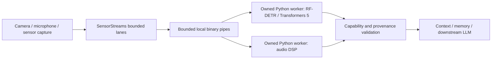

# Separate inference environments

Additional concrete profiles: `nemotron3.diarization`, `talknet.local`,
`esp32.csi`, `ti.radar` and `yoloe.local`. See their provider documents for runtime requirements
and mandatory real-model/device acceptance; CSI and radar decoding use only the
standard library and do not start capture hardware.



The SDK owns capture timestamps, queues, stream epochs and context storage. Each `ProcessProvider` owns exactly one explicitly started child interpreter and provider instance. The worker owns native model state and dependency imports. This isolates incompatible Python libraries without asking an LLM to receive raw media or understand the transport protocol. It is local process isolation, not an untrusted-code sandbox or network service.

Executable worker profiles include `rfdetr.nano`, `audio.prosody`, `emotion2vec.seed.onnx`, `webrtc.aec3` (context-only), `opencv.flow`, `opencv.fill`, `openpiv.flow`, `yamnet.events`, `silero.activity`, `qwen3.asr`, `qwen3.asr.endpoint`, MediaPipe `body`/`hand`/`face` (both frame and `.video` variants), `l2cs.gaze`, `depth_anything_v2.small`, `ppocr.mobile`, `dinov3.retrieval` and `dinov3.regions`. MediaPipe profile names have the `mediapipe.` prefix. These dispatch to concrete providers; executable code does not establish trained-model/device acceptance. Refer to each provider document and its open validation issue. Other inventory entries retain their individual implementation status. Core import and profile discovery use only the standard library; no child, model, capture device or download starts during discovery. The selected environment must already contain the SDK and the relevant optional dependencies. For example, use a separate virtualenv with `humansense-sdk[detection]` for RF-DETR's Transformers 5 requirements, keeping Transformers 4 in another environment. Install the SDK source/editable checkout into each environment during development; a production application need not depend on its working directory.

```python
from humansense import ProcessProvider, SensorStreams

config = dict(path='/models/rf-detr-nano.pth', sha256=CHECKPOINT_SHA256, device='mps')
spec = ProcessProvider.capability('rfdetr.nano', config)

async def create_detector():
    return await ProcessProvider.open(
        '/opt/detection-venv/bin/python', 'rfdetr.nano', config,
        startup_timeout=120, inference_timeout=30)

streams = SensorStreams(human)
streams.register(spec, create_detector)
await streams.open('camera', 'device0', [spec.id])
# Submit the same InputFrame/SensorMetadata values as for the local provider.
# HumanSense/stream shutdown closes the owned worker.
```

The worker startup handshake must match the selected capability, including model/checkpoint version, mode, units, window and state flags. SensorStreams also checks a provider's declared `CapabilitySpec` against registration, preventing a factory configured for a different window or checkpoint from silently emitting mislabeled context. Configuration is bounded JSON; Python code and shell commands cannot be passed through profile configuration. The executable itself is an explicitly trusted application choice.

## Input and output boundaries

Input uses length-prefixed JSON metadata plus an optional binary sensor payload. The metadata cap is 128 KiB and the binary cap is 16 MiB. NumPy-compatible arrays preserve shape, channels, byte order and values; allowed scalar types are uint8, int16, float32 and float64, with one to three dimensions. Noncontiguous arrays are copied into C order. PCM bytes and small bounded JSON sensor packets are supported. Large Python PCM lists should be converted to numeric arrays or PCM bytes rather than JSON. SensorStreams' default packet cap remains 4 MiB unless explicitly configured.

There is no pickle deserialization. Response frames cannot carry a binary payload. Both worker and parent validate returned observations against the same bounded capability schema before context storage. Request IDs prevent accepting another request's response. Native stdout is redirected away from the private protocol descriptor, including low-level writes from native libraries. Native diagnostics are discarded by this transport; error responses expose only an exception class and actionable environment/configuration guidance, never arbitrary exception text or raw input. This is a deliberate observability limit, not a claim that native errors are fully diagnosed.

Encoding is serialized inside each provider's request lock so overlapping callers do not each allocate another encoded sensor packet while waiting. There is no hidden inference queue in the worker. SensorStreams continues to provide bounded queues and independent lanes; a stalled worker cannot block a different provider's event-loop progress.

## Lifecycle and failures

Startup handshake and inference have separate configurable timeouts (0.01–600 s). The handshake timeout begins after the OS returns the child handle; it is not a hard limit on OS process creation itself. Timeouts, malformed protocol, worker exceptions and cancellation of an active request close the pipes, terminate only the child created by that provider, and reap it. If that owned child does not exit within one second, it is killed and reaped. The SDK never signals unrelated processes. Cancellation during subprocess creation also waits for the spawn result and reaps its owned child. Repeated cancellation cannot bypass cleanup. Closing is idempotent; model close is attempted with a two-second bound before process teardown.

Failures invalidate that provider instance. There is no automatic replay or restart: call `await streams.clear(source_id, sensor_id)` and reopen that stream with a fresh provider factory. This prevents a late response from being reinterpreted as current context. SensorStreams invalidates affected visibility and rotates the provider epoch when it resets state after a gap. Other sensor lanes continue normally. Invalid input that fails encoding before any bytes are sent does not corrupt worker state.

Local process isolation cannot guarantee a model's latency or native memory footprint. Loading has its own cost, cold first inference may exceed the observation freshness window, and IPC adds copies. Use actual device measurements for cadence selection; the transport is not evidence of VLM cost reduction or guaranteed realtime throughput.

## Reproduction and evidence

```sh
python -S -c "import humansense; print('stdlib-only core import')"
python -m unittest discover -s tests -p test_process_provider.py -v
PYTHONPATH=. python examples/validate_rfdetr.py \
  --checkpoint /models/rf-detr-nano.pth --sha256 CHECKPOINT_SHA256 \
  --image /fixtures/dog.jpg --device mps \
  --worker-python /opt/detection-venv/bin/python --output isolated-evidence.json
```

The tests exercise real subprocess creation, pipe framing, native stdout separation, startup/request timeouts, repeated cancellation, spawn cancellation, protocol/contract rejection, independent lanes, and real audio DSP when NumPy is installed. Fake native backends used for deterministic stalls are identified in the tests; they do not prove model execution. The RF-DETR command executes the actual local model in the selected environment and records parent interpreter/dependency provenance and whether Torch/RF-DETR were imported into the parent. P11 #13 remains open for the full approved model/license/execution matrix and all remaining incompatible runtime profiles.

Actual macOS arm64 MPS execution on 2026-11-14 used the same checkpoint and photograph hashes documented in [detector evidence](vision-detection.md). The parent environment retained Transformers 4.57.6; the selected worker environment had Transformers 5.20.2 and RF-DETR 1.12.1. Neither Torch nor RF-DETR appeared in the parent's imported modules. The replay detected bicycle/dog/car candidates and preserved unseen object memories after the blank frame. Startup took 18.03 s; per-frame submit-to-stored-observation times were 1098.63, 83.27, 76.06 and 51.76 ms. The first observation was correctly marked stale against the 1000 ms freshness bound, while the remaining three were fresh. This proves the selected dependency-isolation path and preserves cold-start limitations; it is not a controlled performance comparison.


## End-of-input over owned pipes

`await provider.finish()` sends a serialized `finish` request without raw payload, using the same inference timeout and response limits as processing. The worker invokes the concrete provider's optional zero-argument finish method; a provider without one returns None. Non-null output must pass the declared capability contract in both worker and parent. Unexpected/raw/oversized output, errors, cancellation or timeout invalidate the worker and tear down only its explicitly owned child. No implicit restart occurs.

`await streams.finish(source_id, sensor_id)` uses this method to drain and finalize an isolated provider before closing it. Closing alone remains abort/dispose and does not flush. Direct callers must serialize meaningful end-of-input with their publication lifecycle; the protocol does not invent captured samples or timestamps. A direct finish request does not itself close the worker; the concrete provider determines whether it has any remaining final output. Managed stream finish is terminal and disposes the worker.

Parent and worker SDK versions must agree on this operation. An older worker that rejects finish fails closed with an actionable worker error; no silent close-as-final fallback is used. Current profiles without a concrete finish method emit no extra observation. Qwen local loader and endpoint worker profiles are implemented separately; actual checkpoint/runtime acceptance remains open in #68/#76. The finish operation itself does not establish model installation or inference quality.

`python3 -m unittest discover -s tests -p test_process_provider.py -v` runs actual owned Python child processes with labeled fixture providers. It verifies finish roundtrip, absent finalizers, malformed success replies rejected in the parent, worker-side output checks, timeout teardown and managed final publication/child disposal. Fixtures establish IPC/lifecycle behavior, not model inference. No model weights or environments are installed by these tests.

## Cooperative teardown and Python child-watcher limitation

After closing its owned input/output pipes, `ProcessProvider` gives the worker up
to 100 ms to exit and lets `asyncio` reap it. An acknowledged close, input EOF,
or worker-side contract failure can therefore preserve exit status without an
unnecessary termination signal. A stalled child still receives terminate,
followed by kill if it has not exited after another second. Cleanup is awaited
before transport disposal. These bounds exclude OS scheduling delays and the
final wait after kill; cancellation cleanup can outlast the inference deadline.
The additional grace period is a teardown cost, not an inference latency claim.

Python 3.10.11 on macOS 15.6.1 uses `ThreadedChildWatcher`. Its watcher calls
`waitpid`, while `Popen.send_signal` first calls `poll`, which can also reap the
same child. A controlled diagnostic that delayed the watcher until after an
exited child's `terminate()` reproduced `Popen.returncode == 0` followed by
`asyncio.returncode == 255` and the `Unknown child process` warning. This proves
that runtime race exists; it does not prove every historical warning had that
cause. See the upstream [CPython issue](https://github.com/python/cpython/issues/89137)
and [Python 3.10.11 subprocess implementation](https://github.com/python/cpython/blob/v3.10.11/Lib/subprocess.py).

The grace period avoids signalling on the tested cooperative paths, but cannot
eliminate a runtime race when a child exits at the escalation boundary. The SDK
does not suppress warnings, replace a host's global child watcher, manually reap
asyncio-owned children, or bypass process-handle safeguards with raw PID signals.
A runtime upgrade is not claimed as a verified cure. Issue #90 remains open for
cross-runtime evidence and the residual forced-termination race. Tests use real
Python children for normal close, EOF, error exit, timeout/cancellation and a
SIGTERM-ignoring fixture that requires kill; no model weights are involved.

## Exact-capture region processing

`await provider.process_regions(frame, evidence)` sends a serialized image packet
plus bounded detector evidence to `dinov3.regions`. The worker verifies the complete
capture binding before crop inference and validates the result on both sides. The
operation shares normal inference deadlines, request IDs and owned-child teardown.
Unsupported profiles fail closed. It is a local pipe operation, not a raw-image MCP
tool. [ObjectAppearancePipeline](object-appearance-memory.md) owns separate detector
and embedding workers and joins the exact same copied capture, allowing incompatible
model dependency environments. Normal stream publication still contains only bounded
context. Parent and worker checkouts must both support this operation.

## Private SAM separation media

The opt-in [SAM separation media contract](sam-audio-media.md) reserves a closed two-waveform response for `sam_audio.text_temporal.local`, with parent-owned TTL/ownership and explicit local retrieval. Existing JSON profiles retain their no-binary-response rule. This is transport software only: production SAM native construction remains unavailable until #201 is implemented; API/MCP Context remains metadata-only.
