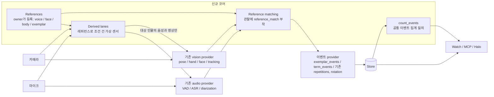

# 일반화: 등록 레퍼런스(References)와 대상 지정 인식

상태: 설계 문서입니다. 아직 구현하지 않았고, 측정한 값도 없습니다.
이 문서는 [recipe-pose-and-voice.md](recipe-pose-and-voice.md)를 대체하는 상위 설계입니다.
그 문서의 두 레시피는 이 문서의 일반 기능 위에 얹는 **사용 예** 두 개가 됩니다.

## 0. 요구사항

- "내가 지정한 특정 인물이 어떤 행동을 몇 번 했는지"와 "특정인의 목소리를 추출하는 것"은
  이번 레시피만의 기능이 아니라 GAMST의 **범용 기능**이어야 합니다.
- 모델은 SOTA를 씁니다. 법적 검토는 owner가 허가를 받았습니다(2026-11-25).
  - 그래서 Sapiens2(biometric 조항)와 w2v-BERT 2.0 SV를 기본값 후보로 다시 올립니다(저자 repo는 CC BY-NC-SA 4.0으로 확인됨, 8절 참고).
  - 라이선스 조건은 `third-party.md`와 `licenses/`에 기록합니다.

## 1. 지금 GAMST에 없는 것

코드에서 확인한 내용입니다.

- `subject_id`는 스트림 소유자입니다(기본값 `"local-user"`). 화면 속의 특정 인물을 뜻하지 않습니다.
- `track_id`와 `ContextMemory.entity_id`는 스트림 안에서만 이어지는 익명 ID입니다.
  사람이 화면에서 나갔다가 다시 들어오면 새 ID가 붙습니다.
- 정책상 신원 추론을 하지 않습니다. 여러 docstring이 이를 명시합니다.
  - `pose.py`: "No identity … face/speaker association is inferred"
  - `diarization.md`: "not a speaker identity system"
  - `memory.py`: "Similarity is never automatic identity proof"
- 분리된 오디오(`separation_media.py`)는 비공개 일회성 페어입니다. 다른 provider의 입력으로
  다시 들어가지 않습니다.
- 카운트는 provider마다 따로 갖고 있습니다(`RepetitionCounter.count`, 회전 turns). 아무 이벤트나
  세어 주는 공통 질의는 없습니다.

## 2. 아키텍처 변화 요약



| 구분 | 무엇 | 위치 | 성격 |
|---|---|---|---|
| **추가** | References 저장소 | `gamst/references.py` | 코어 |
| **추가** | Reference matching 출력 규약 | `capabilities.py` 확장, 새 provider 2개 | 코어와 provider |
| **추가** | Derived lanes(레퍼런스로 조건 건 가상 센서) | `streams.py` 확장, 새 provider 2개 | 코어와 provider |
| **추가** | 범용 이벤트 provider 2개 | `providers/exemplar_events.py`, `providers/term_events.py` | provider |
| **추가** | `count_events` 질의 | `engine.py`, `mcp.py` | 코어 |
| **수정** | 전사 레코드에 단어 시점 | `transcripts.py`(선택 필드 `words`) | 코어(하위 호환) |
| **수정** | 신원 정책 | 위 docstring과 docs: "등록 레퍼런스와 동의가 있을 때만 대상 일치를 낸다" | 정책 |
| **수정** | Watch 조건 | `watch.py`: `reference_id` 경로 허용(기존 `path` 문법으로 됨, 검증만 추가) | 코어 |
| **수정** | 레시피 | `recipes/__init__.py`: `view`, 부품별 `check`, `enroll` → References | 레시피 |
| **수정** | Halo | `rotation_live.Hud`를 화면 틀과 카드로 분리 | 데모 |
| 변경 없음 | 캡처 시계, SensorStreams lane, Store, retention/`delete_data`, CallController, 기존 provider | — | — |

## 3. 신규 코어 1: References

owner가 명시적으로 등록하는 "이것을 찾아라"의 일반형입니다. 사람에만 쓰는 기능이 아닙니다.

```python
ref = human.references.create(
    owner="user", kind="voice", label="streamer-A",
    source=dict(audio=[clip1, clip2, clip3]),          # 원본은 임베딩 계산 후 폐기
    consent=dict(subject="streamer-A", basis="owner-attested", expires_ms=...),
)
# kind: voice | face | body | pose_exemplar | motion_exemplar | object_visual | term
```

- **저장**: 원본 미디어는 저장하지 않고 임베딩과 특징 벡터만 저장합니다. 함께 저장하는 것:
  - 모델 ID와 가중치 SHA. 모델이 바뀌면 레퍼런스는 무효가 되고 재계산해야 합니다.
  - 생성자, 동의 기록, 만료 시각.
- **삭제와 보존**: 기존 `delete_data`와 retention 경로를 그대로 탑니다. 레퍼런스를 지우면
  그 레퍼런스로 만든 일치 결과도 지울 수 있어야 합니다.
- **권한**: Watch와 같은 owner 모델을 씁니다. MCP 클라이언트(에이전트)는 레퍼런스 생성을
  *제안*만 할 수 있고, 생성은 owner만 합니다.
- **범용성**: 같은 저장소가 다음을 모두 담습니다.
  - 목소리, 얼굴, 몸 외형(재식별)
  - 시연 자세와 동작
  - YOLOE 시각 프롬프트 같은 물체 예시
  - 키워드 목록(`term`)

## 4. 신규 코어 2: Reference matching

모든 provider가 같은 모양으로 "이 엔티티가 레퍼런스 R과 일치하는가"를 냅니다.

```json
"reference_match": {"reference_id": "ref_…", "score": 0.81, "threshold": 0.62,
                    "decision": "match", "model": "w2v-bert2-sv@sha…"}
```

- `decision`은 `match`, `no_match`, `uncertain` 중 하나이고, 임계값을 함께 남깁니다.
  "점수가 임계값을 넘었다"는 기록이지 신원 증명이 아니라는 기존 원칙을 유지합니다.
- `CapabilitySpec.interpretation`에 `'reference_match'`를 추가합니다. 지금은 `measurement`,
  `estimate`, `classification`, `semantic_description` 네 가지뿐입니다.
- 일치 provider는 두 개입니다.
  - `audio.speaker_match`: 발화 구간 임베딩과 voice 레퍼런스를 비교합니다. 화자분리 슬롯이
    있으면 슬롯 단위로 합칩니다.
  - `vision.person_match`: 트랙마다 얼굴 임베딩과 몸 재식별 임베딩을 계산해서 face/body
    레퍼런스와 비교합니다. 그 결과로 익명 `track_id`가 화면을 나갔다 들어와도 같은
    `reference_id`로 다시 묶입니다.
- 시청각 결합: 기존 TalkNet(능동 화자)과 시간축을 쓰면 "화면의 그 사람이 말하는 중"을
  `reference_id` 하나로 합칠 수 있습니다. 새 모델은 필요 없고 조인만 하면 됩니다.

## 5. 신규 코어 3: Derived lanes(대상 지정 가상 센서) — "특정인의 목소리 추출"의 일반형

레퍼런스로 조건을 건 출력을 **새 센서 스트림**으로 다시 넣습니다.

| derived lane | 입력 | 출력 | 그 뒤에 그대로 붙는 기존 provider |
|---|---|---|---|
| `audio.target_speech/<ref>` | 마이크 혼합음 + voice 레퍼런스 | 그 사람 목소리만 남긴 16 kHz 스트림 | ASR, 단어 시점, prosody, speaking_rate, emotion2vec, vocal_expression, term_events |
| `vision.target_person/<ref>` | 카메라 + face/body 레퍼런스 | 그 사람 트랙의 크롭과 마스크 스트림 | pose, hand, face, gaze, head_orientation, exemplar_events, repetition |

- 구현: `SensorStreams`에서 provider 출력을 다른 lane의 입력으로 보내는 경로를 추가합니다.
  derived lane의 `SensorMetadata`에는 원본 lane의 캡처 시계와 sequence, 그리고
  `derived_from = {capability, reference_id}`를 실어서 시간축을 하나로 유지합니다.
- 효과: 기존 provider를 하나도 고치지 않고 "그 사람만" 보는 인식이 됩니다. 이게 일반화의 핵심입니다.
  예를 들어 그 사람의 말속도, 감정, 머리 방향, 반복 동작을 전부 같은 방식으로 얻습니다.
- 기존 SAM-Audio 분리는 텍스트와 시간 구간을 프롬프트로 씁니다. voice 레퍼런스를 프롬프트로
  쓰는 목표 화자 추출(TSE) 모델을 백엔드로 추가합니다. 모델 선택은 아래 6절에 있습니다.

## 6. 범용 이벤트 provider와 공통 카운트

### 6.1 이벤트 provider

- `temporal.exemplar_events`: 아무 고정 길이 채널 스트림이나 받습니다(포즈 키포인트, 손 랜드마크,
  IMU, 오디오 특징, 물체 궤적).
  - 그 스트림을 `pose_exemplar` 또는 `motion_exemplar` 레퍼런스와 비교합니다.
  - hold 모드(히스테리시스)와 sequence 모드(subsequence DTW)가 있습니다.
  - 기존 `temporal.repetitions`(주기 카운터)의 짝이고, 입력 규약도 `RepetitionCounter`와 같습니다.
  - 학습된 exemplar 백엔드(ESCounts)를 옵션으로 붙일 수 있게 둡니다.
- `speech.term_events`: 아무 전사 스트림(단어 시점 포함)을 받아서 `term` 레퍼런스와 맞춥니다.
  한국어 정규화(띄어쓰기, 조사)도 여기서 합니다.

### 6.2 공통 카운트

새 코어 질의 `count_events`를 추가합니다.

```python
await human.count_events(capability_id="speech.term_events", event="term.spoken",
                         where={"term": "대박", "reference_match.reference_id": ref.id,
                                "reference_match.decision": "match"},
                         window="2h", group_by="term")
```

- 카운트는 provider가 갖지 않고 Store의 이벤트를 세어서 냅니다. 그래서 어떤 이벤트든
  (회전 끝, 반복, 자세, 단어, 물체 이벤트) 같은 방식으로 셀 수 있습니다.
- MCP 도구로도 노출합니다. LLM은 직접 세지 않고, 근거 이벤트 ID 목록과 함께 개수를 받습니다.

## 7. 두 레시피는 이렇게 조합만 합니다

| 레시피 | References | 체인 |
|---|---|---|
| `person-action-count` (구 pose-count) | `face`/`body` 1개, `pose_exemplar` 또는 `motion_exemplar` 1개 | 카메라 → `vision.person_match` → `vision.target_person/<ref>` → 포즈(SOTA) → `exemplar_events` → `count_events` |
| `person-term-count` (구 voice-keyword) | `voice` 1개, `term` 1개 | 마이크 → `audio.target_speech/<ref>` → ASR + 단어 시점 → `term_events` → `audio.speaker_match`로 재확인 → `count_events` |

recipe JSON의 4단계는 이렇게 대응합니다.
- find: 일치 provider
- follow: derived lane
- count: 이벤트 provider와 `count_events`

`enroll`은 References를 만드는 단계입니다. Halo 카드는 `count_events` 결과와 근거 이벤트를 그립니다.

## 8. SOTA 모델 선택 (법적 검토 허가 반영)

근거는 [notes/](research/speaker-pose-sota-2026-11/notes/)에 있습니다. 특히 `verification.md`,
`target_speaker_extraction.md`, `person_identity.md`를 보세요. 수치는 모두 인용값이고, 직접 잰 값은 없습니다.

| 역할 | SOTA 선택 | 수치(인용) | 코드 · 가중치 라이선스 | 비고 |
|---|---|---|---|---|
| 2D 전신 포즈 | **Sapiens2-1B**(호스팅 GPU), 최고 정확도는 5B | 308 키포인트 80.4 / 82.3 mAP(Meta 자체 테스트) | Sapiens2 License(biometric 금지 조항 → owner 법적 허가) | 지연 수치 미공개. TorchScript 내보내기 스크립트는 있고 ONNX는 없음. DETR-R101 사람 검출기가 필요 |
| 화자 임베딩 | **w2v-BERT 2.0 + LoRA-MFA**(WeSpeaker `--w2vbert2_mfa`) | 저자 체크포인트 Vox1-O/E/H 0.14 / 0.31 / 0.73% | 기반 모델 MIT. 저자 repo **CC BY-NC-SA 4.0**. VoxBlink2로 학습한 가중치는 비상업, VoxCeleb으로만 학습한 가중치는 CC BY 4.0 | 상업 배포에는 VoxCeleb 전용 가중치를 씀 |
| 한국어 ASR과 단어 시점 | **Qwen3-ASR-1.7B + Qwen3-ForcedAligner-0.6B** | FLEURS-ko CER 2.57, 한국어 AAS 37.2 ms | Apache-2.0, 게이트 없음 | 공식 예제는 CUDA뿐이고 MPS는 문서에 없음. 실제 파라미터 2.35B + 0.92B, VRAM 약 7–8 GB 추정(미측정) |
| 목표 화자 추출 | 정확도 SOTA **USEF-TFGridNet** / 상업 가능 **WeSep BSRNN** | USEF: WSJ0-2mix SI-SDRi 23.3, WHAM! 17.6 dB. WeSep 수치는 미확인 | USEF 가중치 **CC BY-NC 4.0**, 오프라인 전용 / WeSep Apache-2.0 | 공개된 causal(스트리밍) 체크포인트는 없음 → 자체 학습 필요. 한국어 TSE 평가는 없음 |
| 얼굴 일치 | 정확도 SOTA TopoFR(97.84, 라이선스 없음) / **LVFace-B** | IJB-C TAR@1e-4 97.70 | MIT(코드와 가중치) | InsightFace 사전학습 모델은 **비상업 연구 전용**이라 제외 |
| 몸 재식별 | **SOLIDER Swin-B** | MSMT17 mAP 77.1, Market 93.9 | Apache-2.0 | 도메인이 바뀌면 성능이 크게 떨어짐 → 세션마다 갤러리를 갱신 |
| 다중 추적 | **MOTIP**(정확도) / 기존 OC-SORT(실시간) | DanceTrack HOTA 67.5, SportsMOT 71.9 | Apache-2.0 | BoxMOT는 AGPL이라 제외. 마스크가 필요하면 기존 SAM 3.1/EfficientTAM 사용 |
| exemplar 카운팅 | 학습 없는 exemplar 매칭 + **ESCounts**(학습 백엔드) | RepCount 1-shot 0.210 / 0.589 | MIT, RepCount 체크포인트 공개 | 오래된 스택(torch 1.10/CUDA 11.1) → 별도 worker 프로세스로 격리. PAMS는 코드가 공개되지 않아 쓸 수 없음 |

**owner 확인이 필요한 점:** 법적 허가로 해결되는 것은 Sapiens2의 biometric 조항 해석입니다.
**CC BY-NC 계열**(USEF-TSE, VoxBlink2로 학습한 w2v-BERT, InsightFace)은 해석 문제가 아니라
상업 이용 자체를 금지합니다. 그래서 GAMST 기본값에는 상업 이용이 가능한 가중치를 두고,
NC 가중치는 사용자가 직접 받는 opt-in으로만 두는 것을 제안합니다.

목표 화자 추출에는 대안 경로도 있습니다. GAMST에 이미 있는 SAM-Audio는 voice 레퍼런스를
프롬프트로 받지 못하지만, 혼합음 안의 시간 구간(span)을 프롬프트로 받습니다. 그래서
`audio.speaker_match`가 찾은 대상 구간을 SAM-Audio span 프롬프트로 넘기면, 새 모델 없이
기존 부품만으로 추출할 수 있습니다. 테스트하지 않았고, 측정으로 비교해야 합니다.

## 9. 위험

- 신원 정책이 바뀝니다. 기본값은 끔으로 두고, 레퍼런스가 있을 때만 일치를 냅니다.
  일치 결과에는 항상 점수와 임계값을 붙이고, 동의와 만료를 강제합니다.
- SOTA 모델은 무거워서 실시간이 아닐 수 있습니다(Sapiens2, w2v-BERT).
  - "실시간 lane + 호스팅 재채점" 2단 구조가 필요할 수 있습니다. 이것은 측정한 뒤에 정합니다.
  - 호스팅 비용은 시작하기 전에 보고합니다.
- 한국어 SV, 한국어 키워드, 스트리머 제스처에는 공개 벤치마크가 없습니다. 그래서 측정 게이트는
  owner가 직접 센 테이크로만 통과시킵니다.

## 10. 구현 순서와 PR 단위

1. 코어 PR: References, `reference_match` interpretation, `count_events`, 전사 `words`, 정책 문구.
   기존 테스트가 그대로 통과해야 합니다.
2. 코어 PR: Derived lanes(SensorStreams 출력을 다른 lane의 입력으로 보내는 경로, provenance 포함).
3. provider PR: `audio.speaker_match`와 `audio.target_speech`, 그리고 Qwen 단어 시점.
4. provider PR: `vision.person_match`와 `vision.target_person`, 그리고 Sapiens2 포즈.
5. provider PR: `exemplar_events`와 `term_events`.
6. 레시피와 Halo PR: 두 레시피, 화면 틀과 카드 분리, skills. 정답 테이크로 측정한 값을 `measured`에 기록합니다.
