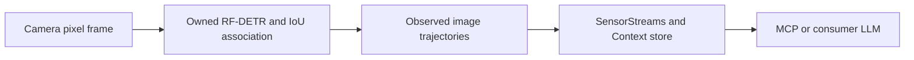

# Streaming RF-DETR trajectories



`rfdetr.trajectories` connects actual RF-DETR inference and its existing
class-constrained IoU associations to image trajectories. The worker owns both
stages and accepts pixel frames directly; callers do not rebuild coordinate
snapshots. This is frame inference with stateful tracking/history, not an
incremental transformer. All processing uses the selected local runtime and
explicit checkpoint. Nothing downloads or installs on discovery/startup.

```python
worker = await ProcessProvider.open(existing_python, 'rfdetr.trajectories', {
    'path': existing_checkpoint, 'sha256': checkpoint_sha256,
    'device': 'cpu', 'camera_motion': 'stationary',
    'max_gap_ms': 1000, 'max_samples': 8,
})
streams = SensorStreams(human, max_packet_bytes=16*1024*1024)
streams.register(worker.spec, lambda: worker)
await streams.open('camera', 'rgb', [worker.spec.id])
# Submit original InputFrame BGR pixels with capture timestamp, increasing
# sensor sequence, and explicit coordinate_frame. SensorStreams sets its epoch.
await streams.submit(frame)
await streams.drain()
context = await human.get_context()
```

Imports: `HumanSense`, `ProcessProvider`, `SensorStreams`, `SensorMetadata` from
`humansense`, and `InputFrame` from `humansense.plugins`. Use one worker per open
stream. Registration/opening failure requires caller cleanup with
`await worker.close()`; after successful registration, stream clear and host
pause/delete/close dispose the owned worker. Reopening requires a fresh worker.
Explicit standalone use of `RFDETRTrajectories` from
`humansense.providers.detection_trajectories` is synchronous and caller-owned.

The selected environment must already have the existing validated RF-DETR
1.12.1 runtime and trusted local checkpoint. Loading uses the existing
`RFDETRObjects.from_local` hash validation and eager inference path; this feature
does not introduce a new model, checkpoint format or quality validation.
Configuration is exact: path/hash required; device cpu/cuda/mps, camera_motion
unknown/stationary, max_gap_ms1..10000 and max_samples2..8 are optional. Defaults
are cpu, unknown,1000,8. Optional `event_rules` enables [bounded image event candidates](image-events.md).
Configuration and checkpoint/runtime version bind the
capability version. Fixed detector settings are threshold0.5, IoU0.3,
ambiguity margin0.1 and max8objects. No association probability is calibrated.

Every frame is copied before inference. Input is plain NumPy uint8 HWC BGR,
16..4096 pixels per dimension, <=16MiB. The example explicitly raises the
SensorStreams packet cap from its default4MiB to16MiB (1080p BGR is6,220,800B).
Its default64MiB queue budget remains independently enforced; shared lanes and
queue capacity consume that budget. Evidence SHA256 covers the domain tag
`gamst.rfdetr.trajectory.uint8.HWC.BGR.v1` plus a NUL byte, three big-endian
unsigned32-bit shape dimensions, and C-order BGR bytes. `evidence_verified=true`
means this digest was computed on the copied inference input, not that model
labels or associations are correct. The application owns evidence retention and
retrieval; the worker does not store images or expose them in Context.

Outputs include current `detections`, observed path `objects`, and `geometry`.
Each path retains original capture-time centroids/evidence references. Join its
track_id to the current detections array for label/bbox/attributes; those fields
are stored only once to keep worst-case escaped Unicode labels within the bounded
Context payload. Detection score and association labels
(new/matched/uncertain_new) are distinct from null association confidence.
Positions and velocities remain normalized image units, not meters. See
[trajectory semantics](image-trajectories.md) for observation/segment behavior.

Camera motion defaults to unknown, which resets both stages on every frame.
Stationary is an explicit caller assumption, not automatic pan/cut detection.
For a pan, cut, zoom or changed calibration, reset or reopen before the next
frame; do not leave a false stationary declaration in place. Source/subject,
epoch, calibration, channels, image shape, coordinate frame or sequence-kind
changes reset both stages automatically. Capture gaps and invalid input/output
also reset both stages. Duplicate/backward capture time or sequence reject and
clear state. Missing/ambiguous associations never interpolate positions.

If more than eight valid detections remain, returned detections are explicitly
partial, `objects=[]`, `complete_snapshot=false`, and trajectory_status is
`incomplete_detection_snapshot`. Both histories reset; the next complete frame
warms up. This prevents a truncated scene from generating false disappearance
or continuity. `complete_snapshot=true` means complete detector output at its
configured threshold, not complete perception of the physical scene.

Tests exercise the real detector adapter, association, worker protocol,
SensorStreams and Context/MCP with deterministic predictor fixtures. They do
not run trained checkpoint inference or establish sports accuracy. #172 covers
this integration; #134 remains open for faster/occlusion-aware association,
camera compensation, event packs, calibrated geometry and real annotated clips.
#57/#135 cost/quality/latency gates remain open; no VLM savings claim follows from
this integration alone. No additional model weights are installed in this phase.
