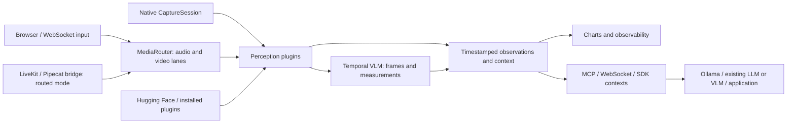

# Streaming and plugin architecture

gamst is a context runtime, not a fixed companion app or a single emotion
model. Capture owns device I/O; model plugins own inference; the runtime owns
bounded routing, provenance and context; the consuming app owns its decisions.



## Design references

These are architectural references and protocol integrations, not copied source
or claims of endorsement:

- [Pipecat pipelines and frame processing](https://docs.pipecat.ai/pipecat/learn/pipeline):
  separate frames, processors, transports and lifecycle. Here, `InputFrame`,
  perception plugins and transport adapters have distinct responsibilities.
- [Hugging Face pipelines](https://huggingface.co/docs/transformers/main_classes/pipelines):
  adapt task-specific models through a common inference interface. The optional
  adapter currently supports image and audio classification.
- [Ollama streaming](https://docs.ollama.com/api/streaming) and
  [chat API](https://docs.ollama.com/api/chat): consume NDJSON text deltas without
  waiting for the whole reply. The native adapter handles completion and errors.
- [Ollama compatibility API](https://docs.ollama.com/api/openai-compatibility):
  an installed vision model can also use the existing local VLM adapter through
  `http://127.0.0.1:11434/v1/chat/completions`.
- [Python package entry points](https://packaging.python.org/en/latest/specifications/entry-points/):
  independently distributed plugins expose an explicitly selected factory.

## Three kinds of streaming

1. **Media input:** WebSocket requests carry PCM or JPEG packets. Audio and video
   have independent bounded lanes, so a slow vision model does not block audio
   ingress. Native capture retains its existing device-specific bounded queues.
2. **Observation/context output:** `human.signals()` emits individual records;
   `human.contexts(interval=.25)` and the WebSocket context subscription deliver
   snapshots. Delivery cadence is distinct from each model's inference latency.
3. **Model response:** `OllamaChat.stream()` yields incremental text. It is an SDK
   interface; the dashboard Companion reply currently remains a complete response.

Existing `InputBridge`, `LiveKitBridge` and `PipecatBridge` accept `routed=True`
to use these same lanes after their PCM conversion and clock mapping. Their
framework-native boundaries remain caller-supplied; see [media bridges](integrations.md).

Input ACK means accepted into a queue, **not inference completed**. Video keeps
one pending frame by default; audio keeps four blocks. Overload drops the oldest
pending packet. Audio sequence gaps reset audio plugin buffers before the affected
segment, preventing a transcript from joining across a missing interval. Router
metrics report accepted, processed, dropped, discontinuities, errors, queue depth
and processing time. Per-plugin ASR/VLM queues report their own metrics separately.

One source and subject owns each modality lane at a time. A conflicting source is
rejected; stop the owning stream before changing source/subject. This prevents
stateful ASR/VAD plugins from accidentally mixing speakers. It is not a multi-user
media server. Use separate runtimes for simultaneous independent subjects. Native
capture and streamed media should not be started on the same modality together.

Pause, reset, deletion and close clear pending input; connection shutdown releases
its own lanes. In-flight native/threaded inference cannot always be interrupted,
but its stale result is discarded. Raw media stays in bounded memory buffers.
There is no WebRTC/RTP transport or lossless archive in this implementation.

## WebSocket input contract

Connect to `ws://127.0.0.1:8765`. Browser origins need explicit server configuration;
the default accepts local non-browser clients. These custom methods are separate
from standard MCP JSON-RPC tools. Each media request requires an ID.

```json
{"jsonrpc":"2.0","id":1,"method":"humansense/stream/start","params":{"consent":true}}
{"jsonrpc":"2.0","id":2,"method":"humansense/media","params":{"modality":"audio","samples":[0.0,0.1,-0.1],"sample_rate":16000,"sequence":0}}
{"jsonrpc":"2.0","id":3,"method":"humansense/media","params":{"modality":"video","jpeg":"BASE64_JPEG","sequence":0}}
{"jsonrpc":"2.0","id":4,"method":"humansense/subscribe","params":{"types":["context","signal"]}}
{"jsonrpc":"2.0","id":5,"method":"humansense/stream/status","params":{}}
{"jsonrpc":"2.0","id":6,"method":"humansense/stream/stop","params":{}}
```

`sequence` is independently increasing per modality. Optional `timestamp_ms` is
Unix wall-clock milliseconds, aligned to the server clock; omission uses receipt
time. Audio is normalized mono PCM with a sample rate of 8–96 kHz and at most
96,000 samples per packet. Video is base64 JPEG, at most 1,000,000 encoded
characters and 1920×1080 decoded pixels. Prefer 640×360 at 4 FPS initially. Raw
media cannot be retrieved through MCP. `get_stream_status`, `list_plugins`,
`get_vlm_status`, `configure_vlm` and `get_context` operate on the shared runtime.

Try [the file-based streaming example](../examples/stream_media.py), which does
not open physical devices. Slow long-running MCP calls should use a separate
WebSocket connection from media ingress; requests on one socket are sequential.

## Plugin contract and distribution

A plugin defines `name`, `modalities`, async `process(InputFrame)`, and optional
`reset()` / `close()`. Heavy models should be wrapped in `QueuedPlugin`. Optional
`PluginManifest` records API version, model version, supported inputs and outputs.
No new thread or process is required for lightweight scalar processors.

```python
from humansense.extensions import PluginManifest, classification, signal

class MyClassifier:
    name = "my_classifier"
    modalities = ("video",)
    manifest = PluginManifest(name, "1.0", modalities, ("classification.scene",))

    async def process(self, frame):
        scores = await your_model.classify(frame.data)  # supply your own model
        value = classification(scores, exclusive=False)
        return [signal(frame, "classification.scene", value, self.name, "1.0")]
```

Register a package entry point in the plugin's own `pyproject.toml`:

```toml
[project.entry-points."catch_your_mind.plugins"]
my_classifier = "my_package:MyClassifier"
```

`discover_plugins()` lists installed metadata without importing plugin code.
`load_plugin("my_classifier", **options)` explicitly executes the selected
factory. Plugins are trusted Python packages, not sandboxed extensions. Keep
model downloads and licensing in the plugin's explicit setup step.

## Hugging Face local classifiers

Install optional dependencies with `python -m pip install -e ".[huggingface]"`.
Supply an existing model directory; `from_local` does not download Hub models or
run remote model code. Label semantics and model choice remain application-owned.

```python
from humansense.providers.huggingface import HuggingFaceClassifier
from humansense.realtime import QueuedPlugin

plugin = HuggingFaceClassifier.from_local(
    path="./my-local-model", modality="video",
    name="classification.expression", revision="YOUR_PINNED_REVISION")
human.register(QueuedPlugin(human, plugin, capacity=1))
```

Alternatively supply an already constructed Transformers pipeline to the adapter.
For audio, use `modality="audio"`; choose an input block duration suitable for that
model. Audio classifiers can opt into bounded rolling windows using `window_seconds`
and `hop_seconds`; the default analyzes individual blocks. See [voice analysis](voice-analysis.md).
Input resampling requirements belong to the chosen pipeline.

Load plugins into the local dashboard with an explicit JSON file:

```json
[{"provider":"huggingface","capacity":1,"options":{
  "path":"./my-local-model","modality":"video",
  "name":"classification.expression","revision":"YOUR_PINNED_REVISION"
}}]
```

Run `python scripts/run_local.py --plugins-config plugins.json`, or use
`python -m humansense.dashboard --plugins-config plugins.json` with your other
model flags. `provider` may also name an installed third-party entry point.

## Classification observability

`classification.*` observations carry `labels`, `score_kind` and `exclusive`,
plus the runtime's timestamp, model provenance and evidence ID. The highest-scoring 32 labels are retained by the Hugging Face adapter;
custom classification signals may contain up to 32 labels. Both the local dashboard and public browser preview use the same
chart renderer: top-category bars, a relative-score donut and up to 60 time samples.
Scalar sensors get individual trend plots; full category values remain in context.
The donut shows each category's share of the sum of scores, not a conversion into
calibrated probabilities. Lower-ranked categories appear as a remainder segment.

The bundled face plugin supplies facial movement scores. An emotion classifier
can supply its own categories through the same interface; no emotion classifier
is installed automatically. Different classifiers stay in separate charts rather
than merging incompatible scales. Public preview currently runs MediaPipe and
microphone energy in the browser; Python/Hugging Face/Ollama run in the local SDK.

## Ollama token streaming

Install `python -m pip install -e ".[providers]"`. Ollama and the chosen model must
already be available; this package does not pull models or launch Ollama.

```python
from humansense.providers.ollama import OllamaChat

backend = OllamaChat("YOUR_INSTALLED_MODEL")
context = await human.get_context()
async for token in backend.stream(
    [{"role": "user", "content": "Summarize what is observable."}], context=context):
    print(token, end="", flush=True)
```

[The complete example](../examples/context_to_ollama.py) consumes the running
session's context without starting capture. Requests default to loopback, reject
redirects, bypass environment proxies, and close HTTP when cancelled. Remote
endpoints require explicit `allow_remote=True` and HTTPS. Supplying images to an
Ollama message is explicit; the context adapter never adds raw media implicitly.

## Validation scope

Core tests cover modality isolation, backpressure, sequence gaps, lifecycle
cleanup, consent, WebSocket routing, classifier validation, metadata discovery,
NDJSON deltas and cancellation. UI tests exercise proportions, dominant labels,
bounded chart histories and shared assets. A real local Qwen VLM fixture test
covers temporal frames → numerical observations → MCP context. Hugging Face and
Ollama adapter contracts are fixture-tested; model accuracy and end-to-end use of
an installed Hugging Face classifier or Ollama daemon are not yet certified.

## Capture completion and device cleanup

`CaptureSession.status()` reports a background camera/processing error immediately.
`running=false` means capture is stopping, not that the native handle is already
released. `cleanup_pending` distinguishes that interval. The session retains one
owned cleanup task per generation; concurrent `stop()` calls join it instead of
releasing a handle twice. Background cleanup exceptions remain in `errors` and
are consumed even if no caller is waiting.

`await session.wait()` waits for the capture loops and device release/provider
reset before raising capture or cleanup errors. `await session.stop()` and async
context exit also join cleanup. Cancelling a wait stops that session; cancelling
a wait/stop repeatedly does not abandon its cleanup. `CancelledError` is raised
after cleanup finishes, while any cleanup failures remain in session status.
Native threaded device I/O cannot be interrupted by asyncio: cleanup can wait
for a blocked read/release, and there is no guaranteed shutdown deadline. The
camera I/O lock keeps release serialized with an already-running read.

A restart joins previous cleanup before acquiring new handles or clearing old
errors. Successful cleanup permits restart; failed release/reset prevents reuse
of the same session and its error remains observable. Construct a new session
only after the application has resolved the underlying device failure. Do not
race fresh device startup against stop/pause; in-flight native startup handle
ownership is tracked separately in [#213](https://github.com/NomaDamas/Gamst/issues/213). No physical capture
quality or platform driver guarantee follows from the fake-device tests.

Call `wait()`/`stop()` from the application owner, not inside a capture delivery
callback. A capture task cannot join itself: `wait()` rejects that use, and
`stop()` schedules cleanup then raises an explicit error instead of deadlocking.
