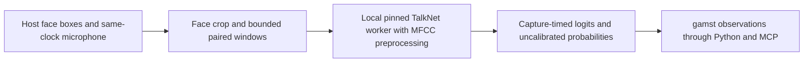

# Windowed TalkNet active-speaker context



The host owns face detection/tracking, capture clocks and camera/microphone input.
`TalkNetWindows` owns bounded pairing; `TalkNetContext` owns fixed MFCC processing
and independent whole-window inference. This supplies audiovisual activity scores
for a declared face track. It does not identify a person, associate Nemotron
speaker slots, align ASR words or prove that audible speech belongs to that face.
Actual trained-model, live synchronization and quality acceptance remain required
in [#118](https://github.com/NomaDamas/Gamst/issues/118), under#26.

## Local model and source contract

Select the [official TalkNet source revision](https://github.com/TaoRuijie/TalkNet-ASD/tree/6d6821479af485e251c4991487e40573b42181b4)
`6d6821479af485e251c4991487e40573b42181b4`. Supply these unchanged files from its
model directory in an explicit local source_dir:

- audioEncoder.py:3851bytes, SHA256 `d4334100ba4e3921dc2011eb56e4d0eb1fd8b69cce16235cb14c47a05d89c6c3`.
- visualEncoder.py:6193bytes, SHA256 `5a33ee41194666eeccb48590f72ea1e59b52f40e19dca31390dd7b67d9f22d15`.
- attentionLayer.py:1356bytes, SHA256 `5c0451f2dfd5a52c086ba3e5957d57987962ea979ccfae42360be2b2668aeaa7`.
- talkNetModel.py:2349bytes, SHA256 `df788d96833f67178821f31abdb789fd3aa2a5144fd258d5437c7fbc43a69611`.

All source bytes and the explicit local checkpoint (max128MiB) are snapshotted
and SHA256-verified before execution/loading. Code executes in a unique temporary
module namespace; only the three pinned absolute model imports are rewritten.
No sys.path change, arbitrary local import, training wrapper, optimizer, hub,
remote loader or model download is used. Native dependency imports still execute
in the selected process; this is not an OS/network sandbox.

The checkpoint hash is supplied by the caller. Matching that hash establishes
byte integrity, not authenticity or that weights were trained. The loader accepts
only the complete upstream wrapper state: exact model.* tensors plus lossAV.FC,
lossA.FC and lossV.FC weights/biases. It validates every key, shape, dtype and
finite value, then strictly loads the model and AV head. Auxiliary training heads
are checked but not used for inference. Missing, extra or module.-prefixed keys
are rejected instead of partially loading random parameters. torch.load is called
once with weights_only=True and map_location=cpu. No unsafe fallback is allowed.

Selected runtime: Torch2.8.0 (local build suffix accepted), NumPy>=1.24 and
SciPy>=1.10 via the optional talknet extra. Face crop preparation additionally
uses the existing vision/OpenCV extra. Explicit CPU/CUDA float32 only; unavailable
CUDA fails. The trained official checkpoint/runtime combination remains
unverified. Local development exercised Torch2.8.0, NumPy2.2.6, SciPy1.15.3 and
OpenCV4.13.0. No new local packages or trained model weights were installed.
TalkNet code is MIT; checkpoint redistribution/license provenance remains
unverified. MFCC math follows python_speech_features0.6, whose MIT notice is
[retained](licenses/python-speech-features-MIT.txt); the SDK adapter is Apache-2.0.

## Preprocessing and temporal limits

`mfcc()` accepts only an exact paired PCM16 window of N*640+240 samples for
N=25,50,75,100,125or150 video frames. It preserves PCM16 magnitude: float64
preemphasis0.97 with a fresh first sample at each window,400sample rectangular
analysis windows/160sample hop,512point FFT power,26 triangular mel filters over
0..8kHz, orthonormal typeII DCT/13coefficients, lifter22 and log-energy replacement
of coefficient0. Zero energies use float64 epsilon. Output is float32(4N,13).
There is no normalization, Hann window, resampling or invented tail padding.
The additional240samples are15ms of real audio; host10ms blocks may wait20ms.

`prepare_talknet_face(bgr, pixel_xyxy)` takes a bounded uint8 BGR image (32..2048
pixels per side, max2,097,152pixels) and an in-frame box at least8pixels per side.
It follows the demo's instantaneous center/maximum-side geometry with cropScale0.4,
asymmetric vertical context and110-valued border, resizes to224x224 using bilinear
interpolation, converts to grayscale and copies the central112x112. It allocates
only the requested padded crop (under about25MiB at the maximum), not a padded
whole frame. Call it with an explicit detector/tracker box; it does not select a
face or supply a track ID. Malformed/absent boxes must trigger the assembler's
face-absence path rather than reuse a stale crop.

The offline demo smooths detections using a centered13-frame median and encodes
crops through XVID. This codec-free instantaneous path does neither. Adding that
median would require six future video frames (240ms) or a separately evaluated
causal policy. Exact pixel/model parity with the published offline pipeline is
therefore not claimed. Crop, jitter, occlusion and performance acceptance remain
in#118 even though the executable geometry helper is implemented.

TalkNet's cross/self attention sees the entire supplied window. The provider is
explicitly streaming_mode=window, with window_ms=N*40 and extra lookahead_ms=15;
it carries no recurrent acoustic/visual cache. Returned scores cover all N
frames, including earlier frames that waited for the rest of the window.
Overlapping windows can give different scores for the same capture interval.
Do not sum them as independent observations, call them final turns or interpret
all scores as current at publication time. The official multi-duration ensemble
is not run; window_ensemble=False is explicit.

## Scores, lifecycle and provenance

Capability video.talknet.active_speaker emits video.active_speaker with one
association object. Each score has a40ms capture interval, non_speaking_logit,
speaking_logit and speaking_probability from the two-class softmax. The official
demo uses the raw speaking-class logit; it is not interchangeable with a
probability threshold. No thresholded speaking truth is emitted. Probability
calibration, quality, identity, synchronization and ASR attribution are explicitly
unverified; diarization_slot is null. Hash-verified loading sets only
artifact_hashes_verified. checkpoint_authenticity_verified remains false.

The inner packet retains capture session, declared clock, face track and both
source/sequence ranges. SensorStreams owns a separate outer runtime epoch.
`talknet_stream_frame()` checks assembler provenance then releases only the outer
epoch to that runtime; it does not modify media or inner capture evidence.
Assembler output sequence now increases for its entire lifetime across resets.
When replacing the assembler instance, reopen its SDK stream. The provider checks
inner/outer subject, capture-end timestamp, sample rate, channels and selected
window size, and includes both capture and runtime ownership in order validation.
Repeated/backward windows are rejected. Errors/reset clear the order guard;
close releases model references permanently. Native calls are serialized.

Window/media/output sizes are bounded, but native temporary memory and execution
time are not bounded by those checks. Use ProcessProvider's owned worker and
explicit inference timeout. No online latency, throughput or tiny-memory promise
follows from the selected parameter count or a synthetic graph test.

## SDK and MCP path

```python
from humansense import ProcessProvider, SensorStreams, TalkNetWindows, talknet_stream_frame
from humansense.providers.talknet import prepare_talknet_face

config = {'source_dir': '/local/TalkNet-ASD/model',
          'checkpoint_path': '/local/pretrain_AVA.model',
          'checkpoint_sha256': '<explicit-trusted-local-sha256>',
          'window_frames': 25, 'device': 'cpu'}
spec = ProcessProvider.capability('talknet.local', config)
streams = SensorStreams(human)  # Existing consented HumanSense instance.
async def create():
    return await ProcessProvider.open('/explicit/env/bin/python', 'talknet.local', config)
streams.register(spec, create)
await streams.open('audiovisual', 'face-audio', [spec.id])
windows = TalkNetWindows(clock_id='device-monotonic')
# Prepare face_frame.data with prepare_talknet_face(bgr, bbox_pixels).
# In each host capture callback, submit packets returned by either lane:
for paired in windows.push_audio(audio_frame, clock_id='device-monotonic'):
    await streams.submit(talknet_stream_frame(paired))
for paired in windows.push_face(face_frame, track_id='track-1', clock_id='device-monotonic'):
    await streams.submit(talknet_stream_frame(paired))
# At end: await streams.drain(); await streams.finish('audiovisual', 'face-audio')
# windows.close() discards any incomplete final paired window without padding.
```

The existing get_observations/get_context Python and MCP tools expose validated
classification output; raw packets stay in owned local worker pipes. Input
capture and context delivery cadence remain independent and user-controlled.
No automatic camera/microphone startup or interruption of other playback/ASR lanes
is introduced. Actual acoustic full-duplex behavior remains separately gated.

## Evidence and remaining gates

```sh
python3 -m unittest discover -s tests -p test_talknet.py -v
python3 -m unittest discover -s tests -p test_audiovisual.py -v
```

The golden MFCC fixture records source hashes from
[python_speech_features0.6](https://github.com/jameslyons/python_speech_features/tree/40c590269b57c64a8c1f1ddaaff2162008d1850c).
Executing that source against all six window lengths and five deterministic
signals gave30 full-window comparisons, max absolute float32 error1.80831e-6;
fixture tests use rtol2e-6/atol2e-5. Crop geometry runs against real OpenCV.
Loader tests use actual Torch serialization with small synthetic modules/weights.
An actual owned worker/SensorStreams/MCP test uses deterministic logits and checks
capture-session reset while the runtime stream stays open and the child is reaped.

A separate development smoke check constructed the exact pinned upstream graph,
strictly loaded a synthetic untrained full checkpoint, and produced finite25x2
logits for a one-second paired input. Model plus AV head has15,743,965parameters.
That verifies one graph/loader execution shape; it is neither trained-model
acceptance nor a performance/accuracy benchmark. No trained checkpoint was fetched.
Required#118 still covers official trained weight authenticity/license, matched
native preprocessing/output parity, real synchronized two-speaker/overlap/off-screen
fixtures, crop jitter, clock skew, frame AP/precision/recall, sustained resource/
latency and live SDK/MCP evidence. No published SOTA, VLM-cost or quality-preservation
claim is established here. Overall completion remains unproven.
