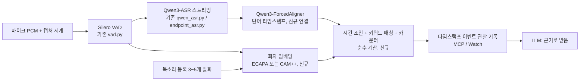

# 특정 인물의 특정 단어 카운팅, 그리고 학습 없는 자세 반복 카운팅: 검토

상태: 검토 문서입니다. 아직 구현하지 않았고, 측정한 값도 없습니다.
GitHub 스타 수는 2026-11-25에 `gh api repos/<repo>`로 조회한 값입니다.
"확인 안 함"이라고 표시한 항목은 직접 검증하지 않은 내용입니다.

> **2026-11-25 갱신:** SOTA 딥리서치 결과([report.md](research/speaker-pose-sota-2026-11/report.md))에 따라
> 모델 선택을 바꿨습니다. 아래의 MediaPipe 기본값과 SpeechBrain ECAPA 1순위는 **대체되었습니다**.
> 새 선택은 포즈 RTMW-x(Sapiens2는 라이선스 검토 후 호스팅 옵션), 화자 ReDimNet2-B6(경량은 CAM++),
> ASR은 Qwen3-ASR-1.7B와 ForcedAligner입니다. 레시피 아키텍처는
> [recipe-pose-and-voice.md](recipe-pose-and-voice.md)를 보세요.

## 결론

1. **특정 인물이 특정 단어를 말한 횟수 세기**는 GAMST의 개념과 같습니다. 무거운 모델 앞에
   가벼운 모델과 계산을 두고, 그 결과를 시간 정보가 붙은 짧은 근거로 모델에 넘깁니다.
   VAD와 ASR은 이미 GAMST에 있습니다. 새로 필요한 부분은 두 가지입니다.
   - 목소리 등록(enroll)과 화자 검증: 오픈소스 임베딩 모델 위에 코사인 비교를 얹습니다.
   - 단어 시점과 화자 구간을 시간으로 맞붙여 세는 카운터: 순수 계산입니다.
2. **자세 반복 카운팅**도 가중치 학습 없이 됩니다. 단, 동작의 종류에 따라 경로가 다릅니다.
   - 주기적으로 반복하는 동작은 이미 됩니다. MediaPipe 포즈와 `RepetitionCounter`를 쓰고,
     측정치도 있습니다.
   - "이 자세"를 몇 번 했는지(예: 감스트 샷건 자세)는 시연 1회를 등록하고 정규화한 관절
     특징과 비교하는 방식으로 됩니다. 이 provider는 아직 없습니다.
   - "학습 안 함"은 가중치를 학습하지 않는다는 뜻입니다. 시연 1회를 등록하는 단계는 필요합니다.
3. 5k 스타가 넘는 검증된 오픈소스는 **특징 추출기**까지만 있습니다(포즈, 화자 임베딩, ASR).
   "등록한 자세나 목소리를 몇 번 했는지 세어 주는" 5k+ 프로젝트는 찾지 못했습니다.
   세는 부분은 GAMST 안의 얇은 계산 레이어로 두는 것이 맞습니다.

## Q1. 왜 이것이 GAMST의 개념과 같고 의미가 있는가

### 무거운 모델만으로는 왜 안 되는가

| 방식 | 문제 |
|---|---|
| 오디오 LLM/VLM을 초 단위로 계속 호출 | 비용과 지연이 시간에 비례해서 늘어납니다. 호출마다 문맥이 끊겨서 누적 횟수를 모델이 계속 들고 있어야 합니다. |
| 오디오를 모아서 한 번에 질의 | 몇 시간짜리 오디오에서 "A가 '대박'을 몇 번 말했나"를 세게 하면, 출력 횟수가 근거와 함께 검증되지 않습니다. 언제 말했는지도 남지 않습니다. 정확도는 측정하지 않았습니다(확인 안 함). |
| LLM이 목소리로 사람을 구분 | 등록한 목소리와 비교하는 기능은 범용 LLM이 보장하지 않습니다. 화자 검증은 EER로 측정하는 별도 과제입니다. |

### GAMST 방식

LLM이 받는 것은 다음처럼 크기가 정해진 근거입니다.
`{speaker: "등록인물A", keyword: "대박", count: 14, last_ms: ..., events: [{start_ms, end_ms, sim: 0.71, text: "..."}]}`
이렇게 하면 LLM은 판단과 설명을 맡고, 세는 일은 하지 않습니다. 이 구조는 기존
`RepetitionCounter`와 Coin Halo 회전 카운팅과 같습니다.

### 기존 모듈과의 대응

| 단계 | GAMST 현재 상태 | 비고 |
|---|---|---|
| VAD | `gamst/providers/vad.py` (Silero) | 있음 |
| 스트리밍 ASR | `qwen_asr.py`, `endpoint_asr.py`, `moonshine_asr.py`(영어만) | 있음. 한국어는 Qwen3-ASR 경로를 씁니다. |
| 단어 타임스탬프 | 없음 | Qwen3-ForcedAligner-0.6B가 한국어를 포함한 11개 언어를 지원한다고 모델 카드에 적혀 있습니다. 한국어 단어 분절에는 soynlp가 필요하다는 카드도 있습니다(확인 안 함). |
| 화자분리 | `diarization.py` (Nemotron-3, 익명 슬롯 8개) | "누구인지"는 모릅니다. 겹침 구간을 나누는 데만 씁니다. |
| 화자 검증(등록 인물인지) | 없음 | 신규 |
| 키워드 카운터 | 없음 | 신규. 계산만 합니다. |

### 위험과 대응

- **짧은 단어는 임베딩이 불안정합니다.** 단어 하나(0.3~0.8초)로는 화자 판별이 약합니다.
  그래서 판별은 단어 단위가 아니라 단어를 포함한 VAD 세그먼트(1.5초 이상)에서 하고,
  그 세그먼트 안의 단어들이 그 판정을 물려받게 합니다.
- **여러 사람이 동시에 말하는 구간**: 화자분리 슬롯이 둘 이상 활성인 구간에는
  `status: overlapped` 표시를 붙이고, 카운트를 분리해서 보고합니다.
- **방송 BGM, 게임 소리**: 등록 발화와 실제 환경이 다르면 유사도가 떨어집니다. 임계값은
  owner의 실제 녹음으로 보정해야 합니다.
- **신조어와 고유명사**: ASR이 해당 단어를 다른 표기로 적을 수 있습니다. 키워드마다
  표기 변형 목록을 owner가 선언합니다(Watch 선언 안). 자모 편집거리로 근사 매칭하는
  옵션도 둡니다.
- **동의**: 목소리 등록은 생체 정보입니다. 등록 임베딩은 로컬에만 저장하고, 원본 오디오는
  저장하지 않는 것을 기본으로 합니다.

### 측정 계획(구현 PR의 게이트)

- 화자 검증: owner의 실제 녹음에서 등록 인물과 다른 인물 세그먼트의 EER, 그리고 임계값별
  정밀도와 재현율.
- 키워드 카운트: 사람이 직접 센 정답 테이크에서 카운트 오차(MAE)와 이벤트 시점 오차.
- 지연: 발화 끝에서 이벤트가 나올 때까지 걸린 시간(p50, p95).

## Q2. 학습 없이 특정 동작이나 자세 반복 세기

### 동작을 세 종류로 나눕니다

| 종류 | 예 | 방법 | GAMST 상태 |
|---|---|---|---|
| A. 주기 반복 동작 | 스쿼트, 연속 패스, 샷건 펌프질 | 포즈 랜드마크 채널에서 자기상관으로 주기를 추정하고 피크를 셉니다 | **있음**: `pose.py`, `landmarker_video.py`, `repetition.py` |
| B. 특정 자세 진입 횟수 | 감스트 샷건 자세를 몇 번 잡았나 | 시연 1회를 등록하고, 정규화한 관절각 벡터와의 유사도에 히스테리시스를 걸어 진입할 때마다 1회로 셉니다 | **없음**: 신규 provider 1개 |
| C. 비주기 동작 시퀀스 | 패스 모션 전체(준비→팔 뻗기→복귀) | 시연 시퀀스 1개를 등록하고, 슬라이딩 윈도 DTW 거리가 임계값 아래로 내려가는 구간을 셉니다 | **없음**: B와 같은 provider에 시퀀스 모드로 넣습니다 |

A의 기존 측정치는 RepCountA test 151개에서 원본 속도 MAE 0.429, OBO 0.437이고, 1 Hz에서는
OBO 0.172입니다(`docs/capabilities.md`). OBO 0.437은 ±1 이내로 맞춘 영상이 43.7%라는 뜻이므로
높은 수치가 아닙니다. B와 C의 등록 방식이 특정 동작에 대해 이보다 나은지는 측정해야 합니다.

### B와 C의 특징(학습 없음, 계산만)

- 입력은 MediaPipe 33개 랜드마크입니다. world 좌표가 있으면 world 좌표를 씁니다.
- 정규화: 골반 중심을 원점으로 옮기고, 어깨 폭으로 스케일을 맞추고, 몸통 방향을 기준으로
  회전을 맞춥니다. 이렇게 하면 카메라 위치와 체격의 영향이 줄어듭니다.
- 특징: 관절각 약 12개(팔꿈치, 어깨, 무릎, 엉덩이, 손목-어깨 상대 위치), 그리고
  visibility로 마스킹한 거리를 씁니다.
- 판정: 등록 벡터와의 가중 거리에 진입 임계값과 이탈 임계값(히스테리시스)을 두고, 최소
  유지 시간을 넘긴 경우에만 1회로 셉니다. 이벤트는 `{start_ms, end_ms, distance}` 형태입니다.
- 손 모양이 중요한 자세(예: 손가락 총)는 `hand_context.py`의 손 랜드마크를 같은 방식으로
  추가합니다.
- 이 방식은 특정 종목이나 물체에 대한 코드 경로가 아니라 범용 모듈입니다. 자세 정의는
  owner의 등록 데이터로만 들어갑니다.

### 포즈 모델 선택(SOTA 검토)

| 후보 | 스타 | 라이선스 | 판단 |
|---|---|---|---|
| [google-ai-edge/mediapipe](https://github.com/google-ai-edge/mediapipe) Pose Landmarker | 37,840 | Apache-2.0 | **기본으로 유지합니다.** 이미 연결되어 있고, CPU에서 실시간으로 돌고, 3D world 좌표를 줍니다. 정확도는 RTMPose보다 낮다는 보고가 있습니다. |
| [open-mmlab/mmpose](https://github.com/open-mmlab/mmpose) RTMPose / RTMW | 8,080 | Apache-2.0 | **정확도를 올리는 교체 후보입니다.** RTMW-l은 COCO-WholeBody에서 70.2 mAP를 냈습니다(논문). 다만 마지막 push가 2025-08입니다. |
| [facebookresearch/sapiens](https://github.com/facebookresearch/sapiens) | 5,440 | GitHub 표기는 NOASSERTION | 강건하지만 무겁습니다. 상업 이용 조건을 확인해야 합니다(확인 안 함). 실시간 앞단에는 맞지 않습니다. |
| [ultralytics/ultralytics](https://github.com/ultralytics/ultralytics) YOLO-pose, AIGym | 63,723 | AGPL-3.0 | AIGym은 관절 3개의 각도 임계값으로 셉니다. 라이선스가 GAMST(Apache-2.0)와 충돌하므로 제외합니다. |
| [CMU openpose](https://github.com/CMU-Perceptual-Computing-Lab/openpose) | 34,614 | GitHub 표기는 NOASSERTION(비상업 라이선스로 알려짐) | 제외합니다. |

정리하면, 카운팅에서는 mAP보다 프레임 간 지터와 실시간성이 더 중요합니다. 그래서 MediaPipe를
기본으로 두고, 측정에서 지터 때문에 오카운트가 확인될 때만 RTMPose를 교체 옵션으로 붙입니다.
"이게 SOTA라서 바꾼다"가 아니라 측정치를 근거로 교체를 결정합니다.

반복 카운팅 연구 모델(ESCounts, PoseRAC, CVPR 2026의 D2-STX와 Count What Repeats)은
지도 학습이 필요하거나 스타 수가 적거나, 코드 공개 여부를 확인하지 못했습니다. 그래서
기본 경로에서는 제외합니다.

## 오픈소스 후보(오디오)

| 역할 | 후보 | 스타 | 라이선스 | 판단 |
|---|---|---|---|---|
| 화자 임베딩 | [speechbrain/speechbrain](https://github.com/speechbrain/speechbrain) ECAPA-TDNN | 11,951 | Apache-2.0 | **1순위.** 가장 많이 쓰이는 기준선이고 torch 경로입니다. |
| 화자 임베딩(ONNX, CPU) | [k2-fsa/sherpa-onnx](https://github.com/k2-fsa/sherpa-onnx) speaker embedding (3D-Speaker CAM++/ERes2Net, WeSpeaker 모델) | 16,215 | Apache-2.0 | **경량 대안.** torch 없이 CPU에서 돕니다. 오픈 어휘 KWS도 있지만 한국어 모델이 있는지는 확인하지 않았습니다. |
| 화자 임베딩 | [pyannote/pyannote-audio](https://github.com/pyannote/pyannote-audio) | 10,841 | MIT | 대안입니다. 일부 모델은 HF 게이트가 걸려 있습니다(확인 안 함). |
| VAD | [snakers4/silero-vad](https://github.com/snakers4/silero-vad) | 10,762 | MIT | 이미 GAMST에 있습니다. |
| ASR + 단어 시점 | [QwenLM/Qwen3-ASR](https://github.com/QwenLM/Qwen3-ASR) + Qwen3-ForcedAligner-0.6B | 3,940 | Apache-2.0 | 5k 미만이지만 이미 GAMST의 한국어 ASR 경로입니다. 단어 시점만 추가합니다. |
| ASR + 단어 시점(대안) | [SYSTRAN/faster-whisper](https://github.com/SYSTRAN/faster-whisper) / [m-bain/whisperX](https://github.com/m-bain/whisperX) | 26,998 / 25,658 | MIT / BSD-2 | Qwen 경로가 측정에서 부족할 때 쓰는 대안입니다. |

성능 수치에 대해 덧붙입니다. 최근 최고 단일 모델 결과는 w2v-BERT 2.0에 LoRA를 붙인 모델로,
Vox1-O EER 0.12%입니다(arXiv 2510.04213). 하지만 무겁고 스타 수가 적어서 앞단에는 맞지
않습니다. 그리고 VoxCeleb 밖의 도메인에서는 순위가 바뀐다는 2026년 비교 연구가 있습니다
(ResNet이 가장 낫고 WavLM이 크게 떨어짐). 그래서 VoxCeleb 수치보다 owner의 실제 녹음에서
측정한 EER로 선택합니다.

## 호스팅

모든 후보가 로컬 CPU에서 돌 수 있는 크기입니다(Qwen3-ASR-0.6B와 ForcedAligner-0.6B는 GPU가
있으면 더 좋습니다). 호스팅이 필요하면 기존 provider worker 경로(`gamst/provider_worker.py`,
`gamst/process_provider.py`)를 그대로 쓰면 되고, 새 런타임은 만들지 않습니다. 비용이 드는 호스팅은 시작하기 전에
보고합니다.

## 구현 범위 제안(최소 개발)

1. `speaker_verify.py`: 오픈소스 임베딩 모델 로딩(SHA 고정), 등록, 세그먼트 코사인 유사도.
   실제 모델을 돌리는 테스트와, 의존성이 없을 때 skip하는 테스트를 둡니다.
2. 단어 시점: Qwen3-ForcedAligner를 연결하고 `transcripts.py` 레코드에 `words`를 선택 필드로 추가합니다.
3. `keyword_count.py`: 단어 이벤트, 화자 판정, 키워드 선언을 시간으로 조인하는 순수 계산
   카운터입니다. Watch로 노출합니다.
4. `pose_exemplar.py`: 자세와 시퀀스를 등록하고, 정규화 특징, 히스테리시스와 DTW로 셉니다. 순수 계산입니다.
5. 측정: owner가 직접 센 정답 테이크 2개(음성 1개, 자세 1개)로 위 지표를 표에 기록합니다.

## 출처

- [Qwen3-ASR Technical Report](https://arxiv.org/html/2601.21337)
- [Qwen3-ForcedAligner-0.6B 모델 카드](https://huggingface.co/Qwen/Qwen3-ForcedAligner-0.6B-hf)
- [w2v-BERT 2.0 speaker verification (arXiv 2510.04213)](https://arxiv.org/abs/2510.04213)
- [ECAPA/ResNet/WavLM 도메인 외 비교 (UvA, 2026)](https://dare.uva.nl/id/1662ec7f-fd85-4e50-9067-91f846403f85)
- [RTMW](https://arxiv.org/abs/2407.08634), [RTMPose](https://arxiv.org/pdf/2303.07399)
- [Every Shot Counts (ESCounts)](https://arxiv.org/pdf/2403.18074)
- [D2-STX (CVPR 2026 supplemental)](https://openaccess.thecvf.com/content/CVPR2026F/supplemental/Wang_D2-STX_Decoupling_Spatial-Temporal_CVPRF_2026_supplemental.pdf)
