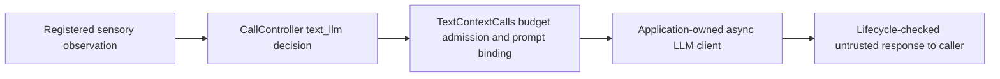

# Explicit text Context calls



`TextContextCalls` connects an explicitly admitted `text_llm` route to the
application's existing asynchronous completion client. It serializes the full
derived observation, so a text LLM can reason over detector/trajectory/audio
metadata without receiving pixels or sound. Construction does not load a model,
open a network connection or call the client. No queue, routing timer or retry is
created. The existing specialized `ChatCompletionsBackend` remains a text/scalar
analysis backend; this adapter does not claim that backend accepts arbitrary
structured sensory observations.

```python
from humansense import TextContextCalls

# Implement completion(request) with your chosen async client.
# It receives provider/model_revision aliases and two text messages.
# Return exactly {'text': nonempty_answer, 'usage': None}, or declared token usage.
async with TextContextCalls(human, 'main', completion,
        provider='my.client', model_revision='pinned.model.revision', timeout=30) as calls:
    result = await calls.execute(request_id, original_registered_record,
        'What changed in the observed scene?', maximum_charge=verified_ceiling)
    if result.get('accepted'):
        render_answer(result['text'])
```

`human` must already own the registered controller `main`. Obtain request_id by
submitting a registered observation with query=True and needs_visual=False under
an enabled CallPolicy; context_only policy never authorizes a model call. The
record must exactly match retained request evidence and current runtime/source
provenance. See [call controller](call-controller.md) for source registration,
policy, reservations and verified late settlement. Choosing a textual route is
an application decision about evidence sufficiency, not proof that vision is
unnecessary. Small-VLM execution has its separate
[local worker adapter](smolvlm-calls.md).

Only pending text_llm requests are accepted. Blocked/stale/unknown-ceiling budget
admission returns the controller's blocked result without calling completion.
A changed record or wrong route raises. One operation may be in flight; additional
execute calls raise immediately. No backend invocation occurs on construction or
MCP status reads. Questions must be nonempty and <=4096 UTF-8 bytes. Records are
bounded to131072 ASCII-escaped JSON bytes; the complete nested request has a
262144-byte bound. Untrusted OCR/transcript/descriptive text is serialized as
observation data in a user message, never promoted to a system role. The fixed
system message asks for evidence-based uncertainty; this is not a guarantee
against prompt injection or incorrect answers.

The completion coroutine receives its own copied dictionary:

```python
{
    'provider': 'my.client', 'model_revision': 'pinned.model.revision',
    'messages': [{'role': 'system', 'content': '...'},
                 {'role': 'user', 'content': '{"question":...,"observation_record":...}'}],
}
```

Provider/revision are caller-declared bounded aliases (1..128 identifier
characters), not independently verified endpoint/model identity. The recorded
prompt SHA256 covers this exact canonical request handed to the client, including
the aliases. The SDK cannot prove a callback transmitted it unchanged or prevent
client-side prompt transformations, hidden retries, logging or external actions.
The application owns endpoint/authentication, remote-data permission, real model
revision, client lifetime and complete billing. Do not introduce hidden retries;
if the chosen client retries internally, its quote and verified settlement must
cover every attempt. Per-provider attempt instrumentation remains separate work.

Return exactly text and usage. Text must be nonempty and <=8192 UTF-8 bytes;
the response JSON is bounded to65536 bytes. Usage is null or exactly:

```python
{'input_tokens': 100, 'output_tokens': 20, 'cached_input_tokens': 10}
```

Counts are declared integers0..10**12 and cached input cannot exceed input.
They are unverified telemetry, not prices or payment receipts. A completed
response includes source record ID/hash, prompt hash, provider/revision and
`interpretation=untrusted_text_response`, `quality_validated=false`,
`usage_verified=false`. It is returned only to the explicit caller, not inserted
into sensory memory as a new observation. Controller/MCP diagnostics retain
bounded provenance/hashes, not question/response bodies. Text completion never
satisfies outstanding visual semantic-audit coverage.

All dispatched calls settle initially as unknown, including success, failure,
timeout and cancellation. `actual_cost=None` retains the reservation liability
and financial slot until the application calls controller.settle with verified
charge components. Never convert token counts to a guessed whole charge, refund
a cancelled remote request, or exclude retries/media/local compute from actual
accounting. Unknown cost may block later calls; this is deliberate admission
behavior, not evidence that the request was free.

The application owns the adapter's async context/lifetime. Host pause/reset,
consent revocation, deletion or close invalidate late replies and preserve bills;
they do not close the application's remote client. Adapter close cancels its owned
operation, not the caller's surrounding task, and cannot be invoked by its own
completion coroutine. Close/execution on one event loop assumes normal cooperative
async cancellation. Timeout is0.01..300seconds; late responses are rejected even
if a callback catches cancellation and returns. A blocking callback or one that
suppresses cancellation indefinitely cannot be forcibly stopped by this SDK:
close/timeout cleanup may wait for it. Configure transport deadlines and use a
cooperative client. No hard process isolation or remote cancellation guarantee is
claimed; the SDK does not kill application processes.

Tests invoke real async client coroutines over structured observations and
exercise budget/evidence rejection, prompt mutation isolation, billing, timeout,
cancellation, host lifecycle discard, self-close protection and MCP redaction.
They do not call a remote provider or establish model quality. #178 is this client
execution software slice; #154/#161 still require strong-VLM execution and wider
attempt/evaluation integration. #57/#135 real quality/cost/latency gates remain
open. No trained-model installation is performed.
