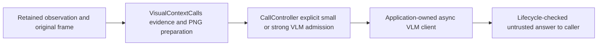

# Explicit visual Context calls



`VisualContextCalls` completes the optional small_vlm/strong_vlm execution path
using the application's existing async client. It does not own a camera, model,
remote endpoint, retry loop or user delivery cadence. This is single-frame
on-demand inference, not a claim of native stateful model streaming or full duplex.
Continuous input and context delivery remain independent SDK facilities.

```python
from humansense import VisualContextCalls, smolvlm_frame_sha256

# Use smolvlm_frame_sha256(frame.data) when submitting visual_reference.
# The versioned shape-bound digest is shared with the local SmolVLM adapter.
async with VisualContextCalls(human, 'main', completion,
        provider='chosen.client', model_revision='pinned.revision') as calls:
    result = await calls.execute(request_id, original_record, original_frame,
        'Explain the conflicting observation.', maximum_charge=verified_ceiling)
    if result.get('accepted'):
        render_answer(result['text'])
```

Register the controller and submit the exact registered sensory observation with
an eligible visual decision and matching visual_reference first; see
[call controller](call-controller.md). Merely calling this adapter cannot upgrade
a text-only decision. Choosing small versus strong and actual model identity are
application responsibilities; the SDK cannot infer remote model capability from
its caller-declared alias. There is no implicit fallback or second invocation.

The input must be a video InputFrame with plain numpy uint8 HWC BGR pixels, each
dimension32..2160 and at most1920*1080 pixels, matching the full retained sensor,
subject and original capture timestamp. Pixel copying and shape/format-bound
SHA256 validation happen before any asynchronous client work. Matching raw bytes
with a different shape is insufficient. Optional numpy/OpenCV vision dependencies
must already be installed; construction does not import OpenCV or download assets.

The adapter encodes the exact pixels as lossless PNG (no resize/crop), capped at
8MiB. The entire ASCII-escaped JSON request is capped at12MiB. Record/question
bounds are the same as [TextContextCalls](text-context-calls.md). PNG encoding,
copying and hashing are bounded synchronous preparation on the calling loop;
there is no hard realtime latency guarantee. Measure preparation and whole-call
latency on the target device, and supply smaller retained source frames when
appropriate. Encoding still occurs before budget rejection, but a denied request
never invokes the client. Its compute cost belongs in whole-pipeline evaluation.

The completion coroutine receives a private dictionary with provider,
model_revision and the same two text messages as TextContextCalls, plus:

```python
'images': [{
    'mime_type': 'image/png',
    'data_base64': '...',
    'sha256': 'SHA256 of encoded PNG bytes',
    'source_frame_sha256': 'versioned shape-bound source pixel digest',
    'capture_ms': 1234,
    'shape': [480, 640, 3],
}]
```

PNG stores normal image color channels; shape refers to the original BGR array.
The client maps this request into its provider-specific image API. The request
hash covers the exact image bytes/base64, source digest, metadata, question,
observation and declared provider/model aliases handed to the client. This is
not proof that a callback actually transmitted them unchanged or invoked the
claimed model. Endpoint credentials, remote image consent, transport deadlines,
client lifetime, hidden client retries and verified complete billing belong to
the application. Never treat remote delivery or model correctness as verified
merely because a callback returned text.

Return exactly `{'text': nonempty_text, 'usage': None}` or the bounded declared
token-usage shape documented for TextContextCalls. The same budget, timeout,
one-operation/no-queue, cancellation cleanup, self-close guard and receipt-order
contracts apply. A cooperative callback is required; arbitrary Python code or a
remote service cannot be forcibly stopped. Host pause/reset/revoke/delete/close
invalidates late replies but does not own the application's client lifetime.

Accepted output includes `interpretation='untrusted_visual_response'`, original
capture timestamp, image/source hashes and `quality_validated=false`. It is
returned only to the caller, never inserted as a new sensory observation. Unlike
text-only completion, successful visual completion acknowledges controller visual
semantic coverage at the original capture time. This records successful execution
of the caller-selected visual audit, not proof of correct recognition. Empty or
malformed output, timeout, failure and invalidated replies cannot satisfy it.
MCP status retains bounded hashes/provenance rather than PNG or answer bodies.

`actual_cost=None` means this adapter does not compute a price. Earlier verified
receipts remain authoritative; otherwise dispatched calls retain unknown financial
liability until verified settlement. Token usage alone is not a whole charge.

#182 proves the software path with actual PNG round trips and async fixture
clients, not a cloud deployment or trained-model benchmark. #154/#161 wider
attempt integration and #57/#135 real quality/cost/latency gates remain open.
No new model weights are installed. Halo is outside this implementation.
