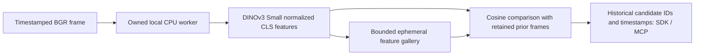

# Bounded visual appearance history



`DINOv3Retrieval` provides whole-frame appearance candidates from prior observations.
SensorStreams owns capture and publication; this provider owns a bounded gallery.
It is frame inference with stateful history, not a native temporal encoder. It does
not detect individual objects, prove identity, infer the present location of a
previously seen object, or perform text-to-image search. Object crop retrieval and
its observation-memory association remain required work in [#101](https://github.com/NomaDamas/Gamst/issues/101) under #21/#39.

The `dinov3.retrieval` profile exposes `vision.dinov3.retrieval` with output name
`vision.appearance_candidates`. Configuration requires absolute local `path` and
lowercase `sha256`. `capacity` is1..1024 (default128), `retention_ms`1..86400000
(default600000), and `top_k`1..20 (default5). Capability version includes all these
parameters and the model hash; the fixed preprocessing is versioned by the adapter.

## Model and preprocessing

The loader accepts at most128MiB of explicitly supplied HF Small safetensors,
verifies the bytes before imports and loads the same buffer with strict state keys.
No Hub request, AutoClass, pickle or model download is used. The selected runtime
pins Torch2.8.0, TorchVision0.23.0 and Transformers4.57.6 on CPU float32/eval/inference.
Its fixed ViT-S/16 has384 hidden units,1536 MLP units,12 layers,6 heads,4 register
tokens and ungated GELU. The image path converts owned BGR to RGB and applies the
pinned fast processor: float rescaling, bilinear antialiased224×224 resize, then
ImageNet normalization, without center crop. Non-square images are stretched.
The384-dimensional final normalized CLS representation is L2-normalized for cosine
comparison. Zero/nonfinite/out-of-bounds descriptors are rejected.

Primary references: [Transformers4.57.6 configuration](https://github.com/huggingface/transformers/blob/v4.57.6/src/transformers/models/dinov3_vit/configuration_dinov3_vit.py),
[matching fast processor](https://github.com/huggingface/transformers/blob/v4.57.6/src/transformers/models/dinov3_vit/image_processing_dinov3_vit_fast.py),
and [Small configuration in the conversion script](https://github.com/huggingface/transformers/blob/029045ca8723f55bef78fccbf24b808d4a0bd1df/src/transformers/models/dinov3_vit/convert_dinov3_vit_to_hf.py).
The conversion reference is newer than the selected runtime: state-key compatibility
must be checked against the actual supplied HF artifact; no key rewriting is done.
The [official model](https://huggingface.co/facebook/dinov3-vits16-pretrain-lvd1689m)
requires authorized access. Direct configuration access returned401 in this task.
Access was not bypassed. Verify the DINOv3 model license and exact artifact lineage;
SDK licensing does not grant model access or redistribution rights.

## History semantics and bounds

Input is uint8 BGR,32 pixels minimum per axis, at most2MP within3840×2160 and at
most4:1 aspect. Each successful call searches **prior** entries, then inserts a
new reference ID. All results are similarity candidates, including negative scores;
there is no learned acceptance threshold or identity probability. Equal scores sort
newest first. Repeated appearances remain distinct observations. IDs identify the
retained observation, not an object, and do not retrieve raw images.

History is separate per provider instance. Subject/source/sensor/stream epoch or
coordinate/calibration changes clear the previous gallery. Timestamps and sequences
must increase within the same owner; sequence gaps are allowed, preserving useful
history when capture is sampled. SensorStreams honors `reset_on_gap=False` for
ordinary sequence gaps or queue drops; process/publication/endpoint errors still
force a reset and a new provider epoch before subsequent work. Direct invalid
input or failed inference does not mutate history. Retention uses both capture-time age and elapsed monotonic time, pruned on
the next successful process call. Idle entries may remain allocated until the next
call, explicit reset or close, but capacity always bounds memory. Capacity eviction
removes oldest entries after querying. At maximum capacity raw float64 descriptors
occupy about3MiB plus bounded Python metadata. No frames/crops are retained.

`reset()` clears all references. `close()` clears references and releases the model;
both serialize against active inference. SensorStreams clear closes the provider.
Use an owned ProcessProvider to enforce native inference deadlines. A candidate's
historical timestamp does not establish current visibility; output explicitly says
current location is unknown and identity is unconfirmed. No historical text or
object label is invented from the embedding.

## Explicit execution after installation resumes

```sh
/path/to/runtime/bin/python -m pip install '.[retrieval]'
/path/to/runtime/bin/python -m pip freeze > retrieval-runtime-versions.txt
PYTHONPATH=. python examples/validate_retrieval.py \
  --python /path/to/runtime/bin/python \
  --checkpoint /absolute/model.safetensors --sha256 CHECKPOINT_SHA256 \
  --image /path/first.jpg --image /path/later.jpg --output retrieval-smoke.json
```

The parent needs NumPy/Pillow. The runner bounds encoded bytes/header dimensions
before decoding, processes1..32 images in explicit order, and exclusively creates a
hash/timing/context report. Its timestamps are replay wall time, not original capture.
This is a smoke runner, not a sustained benchmark. For live use, register
`ProcessProvider.capability('dinov3.retrieval', config)` and an async factory calling
`ProcessProvider.open(python, 'dinov3.retrieval', config)` with SensorStreams.

## Acceptance status

Focused tests cover score ordering/negative scores, owned RGB input, gallery
capacity/expiry/ownership/clear, failure atomicity, close serialization, loader doubles
and managed MCP publication. No real checkpoint was installed or run. The current
global Transformers installation is incompatible with its installed HF Hub version;
no checks were bypassed or globals changed. [Required actual validation #99](https://github.com/NomaDamas/Gamst/issues/99)
covers authorized artifact acquisition, exact reference parity, lookalikes and
viewpoint/lighting changes, retrieval quality and sustained latency/resources.
The broader [OCR/retrieval family #21](https://github.com/NomaDamas/Gamst/issues/21)
and complete SDK plan remain open. No VLM savings, realtime throughput, calibrated
identity or trained-model quality claim follows from synthetic tests.
