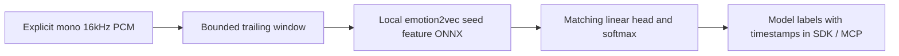

# Windowed vocal-expression context



The host owns capture, speaker separation and delivery cadence. `Emotion2VecContext`
owns trailing audio state and local feature/head inference. This is windowed
classification, not native recurrent streaming or verified internal emotion.
Actual model export/inference/quality acceptance remains required in
[#111](https://github.com/NomaDamas/Gamst/issues/111), under family #25.

## Selected model and source contract

Official candidate: [emotion2vec_plus_seed revision7be9a30](https://huggingface.co/emotion2vec/emotion2vec_plus_seed/tree/7be9a30d52bdc793cc24e6f7d25358d6648927c1).
The official model.pt LFS metadata declares1,118,245,358bytes and SHA256
`327e861049c7105a3f8589edfd16543a7cdc0c1926f1b64de975d98e0650cdd3`.
The name seed does **not** establish a tiny runtime. No checkpoint was downloaded
or installed during this implementation. The model-card weight license is
`other/model-license`, linked to a repository rather than a fixed license file;
weight redistribution/commercial compatibility is unverified. FunASR's MIT code
license is separate. The adapter is Apache-2.0 and ONNXRuntime MIT.

[FunASR1.4.26's pinned export](https://github.com/modelscope/FunASR/blob/cdd82b5cbfd05015f8fb2b167d61f25142c3a9e8/funasr/models/emotion2vec/export_meta.py)
returns frame features and includes whole-input normalization, rather than
classification scores. Its [native inference](https://github.com/modelscope/FunASR/blob/cdd82b5cbfd05015f8fb2b167d61f25142c3a9e8/funasr/models/emotion2vec/model.py)
means features over time, applies the classifier head and softmax. The SDK follows
that decomposition with a bounded local graph and matching external head; it
never imports FunASR, selects AutoModel, fetches weights or executes remote code.
The explicit [local preparation tool](#local-preparation-command) constructs this
pair. Its actual trained export and upstream parity still require#111; an
unprepared official checkpoint cannot be loaded directly by the ORT consumer.

## Local preparation command

Preparation is a separate, potentially multi-GiB-memory process, never part of
the streaming callback. In an explicitly selected environment with the SDK and
`vocal-expression-export` extra already installed, run:

```sh
/explicit/export-env/bin/python -m humansense.emotion2vec_export \
  --checkpoint /local/emotion2vec_plus_seed/model.pt \
  --config /local/emotion2vec_plus_seed/config.yaml \
  --tokens /local/emotion2vec_plus_seed/tokens.txt \
  --output-dir /prepared/seed-v1
```

The parent output directory must exist; `seed-v1` must not. Inputs must be the
exact official revision above. The command never fetches models, uses AutoModel,
installs packages, overwrites outputs or removes partial files. The explicit
preparation environment imports FunASR, whose package initializer recursively
imports optional modules and changes process-local `HYDRA_FULL_ERROR`. Dependency
imports are not sandboxed by this tool; use an OS/network-isolated preparation
process if network denial is required. No FunASR import reaches the live SDK/ORT
worker. The exporter has no native-operation deadline; supervise this explicit
process externally. It does not modify the host SDK environment.

Selected candidate runtime: Torch2.8.0, FunASR1.4.26, ONNX1.18.0,
ONNXRuntime1.23.2, OmegaConf2.3.0 and PyYAML6.0.3. Exact installed versions,
including NumPy, Python and platform are recorded. A local Torch build suffix
such as `+cpu` is accepted and recorded. This is a specified candidate environment,
**not an already validated dependency installation or trained export**. No new
package or weight installation was performed for this implementation.

1. Read and hash each local file once before parsing or deserializing it. The
   official config SHA256 is
   `50674ec187406b4f1208925594ceaf1f28f16a22333b5f2ac5b3d0cbffdd670e`;
   token SHA256 is
   `654625c18ef0f0583441a3b811c20904f2cf30febb716f32e14810b8e6bb715c`.
   These pins matter because upstream architecture construction evaluates the
   config's convolution expression. Checkpoint loading is CPU `weights_only=True`;
   unsupported serialized objects cause failure, without pickle fallback or
   allowlisting. The large checkpoint is snapshotted in memory, not reopened
   after hash verification.
2. Construct the exact9-class model and require one compatible finite source
   tensor for **every** destination parameter and persistent buffer. Recognize
   `state_dict`, `model_state_dict` and `model` wrappers, plus raw,
   `d2v_model.`, `module.` and `module.d2v_model.` keys. Ambiguity, missing keys,
   shape/dtype differences and nonfinite values fail before loading. Record the
   complete mapping and unused selected-state keys (for example training/EMA
   entries); do not silently retain initialized weights. Actual checkpoint layout
   compatibility remains to be established#111.
3. Extract the matching head and export normalized features with batch1,
   dynamic samples/frames, opset17 and `dynamo=False`. Embed the source/contract
   metadata and reject external tensor references, including nested tensors.
   ONNX checking and actual CPU ORT execution are mandatory at preparation time.
   [PyTorch2.8 documents tracing limitations](https://docs.pytorch.org/docs/2.8/onnx.html);
   dynamic axis declarations alone do not prove varying lengths work.
4. Compare native `layer_norm` inference, the export normalization wrapper and
   CPU ORT features. Compare the consumer's float64 head probabilities against
   native float32 projection/softmax. Use deterministic noise at16000,31984,
   32000 and64000samples, plus silence, constant input and a440Hz tone. Features
   require `atol=2e-4, rtol=2e-4`; probabilities require `atol=2e-5, rtol=0`.
   No threshold-relaxation switch exists. Report each input hash, frame count
   and maximum observed errors. These seven synthetic cases catch selected
   normalization/shape/export regressions; they do not prove all audio or all
   possible window lengths, real speech quality or live performance.

Success creates `seed.onnx`, `head.json` and **last** `report.json`, with graph/head
SHA256s to pass to the consumer. Only a completed `status="passed"` report marks
a ready pair. Failure leaves `failure.json` when possible and retains any partial
outputs; use a different new output directory for a retry. The command exits
nonzero on failure. Abrupt process termination may leave no failure report; the
absence of a complete success report always means incomplete preparation.
Nothing is accepted merely because an ONNX file exists. The report is local
evidence, not a signature or third-party attestation. The consumer still reports
`export_parity_verified=False` because it does not authenticate preparation reports.

Tests exercise real Torch tensor matching/normalization/head arithmetic when
Torch is already available, plus hash/no-overwrite/failure behavior and the
orchestration with explicit model/ONNX doubles. They do not invoke the trained
FunASR model or native ONNX export. Actual export, bilingual real speech,
license, paced runtime/memory and SDK/MCP acceptance remain required#111.

## Local artifacts and loader

Optional environment `humansense-sdk[vocal-expression]` selects
`onnxruntime==1.23.2` and NumPy. Pass explicit local model/head paths and SHA256s.
Discovery is standard-library-only. The loader reads each file once into bounded
bytes, verifies its hash before native loading, and uses a CPU session with one
intra-op and one inter-op thread. No filesystem external tensor loading is offered;
the model must be a self-contained ONNX artifact <=512MiB.

Required graph IO is float32 `input[1,samples]` with dynamic sample dimension and
float32 `output[1,frames,768]`. Runtime features must have1..256frames, finite
values and absolute magnitude<=1e6. The input waveform is **not normalized again**
in Python: normalization must be in the exported graph. Include metadata:

- `gamst.export_contract`: `emotion2vec_seed_features_v1`
- `gamst.source_checkpoint_sha256`: the pinned source hash above

Head JSON (<=512KiB) contains exactly `source_checkpoint_sha256`, `labels`,
`weight` (9x768) and `bias` (9); finite bounded numbers only, magnitude<=1e6.
Labels are exactly `angry, disgusted, fearful, happy, neutral, other, sad,
surprised, unknown` in that order, corresponding to the official tokens including
`<unk>`. Compute feature means/projection/softmax in float64 for stable local
arithmetic. Bitwise equivalence to float32 upstream is not claimed.

Hashes prove the selected artifact bytes match the caller's hashes. Checkpoint
metadata is a **declaration**, not proof that the graph/head were exported together
or preserve the source model. Context explicitly reports
`source_provenance='artifact-metadata-declaration'` and `export_parity_verified=False`.
Actual upstream/export/head and quantization parity must be validated in#111.
Native graph allocations are not bounded merely by file/input size; use trusted
prepared artifacts and the owned worker. Measure native memory during acceptance.

## Streaming semantics

Input: mono normalized float32 or int16 NumPy array (plain vector or Nx1), or
little-endian PCM16 bytes;16kHz only. Blocks are16..16000samples and multiples of16
(whole1..1000milliseconds). No resampling or partial-block padding. Sensor metadata
is mandatory, with at most one channel name. Timestamp is integer **capture end**
ms; block duration must fit before that end. The source must supply an exact
whole-millisecond capture timeline rather than callback arrival times.

Window1000..4000ms (default2000), hop100..window_ms (default500).
Before a complete window exists, return None. Afterward emit at most one latest
trailing window per input call once at least hop_ms of new audio has arrived.
Hop is a **minimum interval between emissions**, not a promise to emit every hop
inside a large incoming block; intermediate opportunities coalesce at block ends.
No hidden queue or partial/final flush exists. Capture and LLM delivery cadence
remain separately controlled by the host.

Keep at most64000float32samples (256000bytes), plus bounded concatenation/call
copies and native model memory. No neural state survives between windows. Owner,
subject, epoch, channel names, calibration/frame or sequence-mode changes clear
audio state. Capture sequence is used when present, otherwise delivery sequence.
Sequence skips and any capture-time discontinuity clear the window; nonincreasing
time/sequence rejects. Invalid PCM or model outputs also clear state. Reset and
close serialize with inference; close drops buffered PCM and predictor/session
references. Direct calls have no hard native timeout; use ProcessProvider.

Windows with RMS<1e-4 emit `insufficient_energy` and empty scores without invoking
the model. This heuristic is not VAD. Other windows emit all9probabilities with
start/end/window/hop provenance. `last_block_clipped` describes only the last
input block, not the whole window. Both int16 saturation rails are checked.
`inner_emotion_verified` and `speaker_identity_verified` remain false. Scores do
not establish feelings, intentions, truthfulness, identity or language quality.

## SDK / MCP

```python
from humansense import ProcessProvider, SensorStreams
config = dict(model_path='/prepared/seed.onnx', head_path='/prepared/head.json',
              model_sha256=MODEL_SHA256, head_sha256=HEAD_SHA256,
              window_ms=2000, hop_ms=500)
spec = ProcessProvider.capability('emotion2vec.seed.onnx', config)
async def create():
    return await ProcessProvider.open('/explicit/ort-env/bin/python',
        'emotion2vec.seed.onnx', config, startup_timeout=120, inference_timeout=10)
streams = SensorStreams(human)
streams.register(spec, create)
await streams.open('microphone', 'mono', [spec.id])
# Submit matching16kHz mono InputFrames; normal SDK/MCP observation APIs expose scores.
```

For direct calls use `Emotion2VecContext.from_local(...)` from
`humansense.providers.vocal_expression` and register/publish its spec/result with
capture provenance. Current tests (`python3 -m unittest discover -s tests -p
test_vocal_expression.py -v`) validate window state, hash/IO/head contracts,
actual NumPy linear-head arithmetic and managed SDK/MCP with predictor/session
doubles. They do **not** execute trained ONNX features or validate Korean/English
classification. No actual model quality, live latency or low-cost claim is made.
Required#111 retains actual export, real model/runtime and paced real speech;
family#25 also retains its speaking-rate/prosody requirements.
