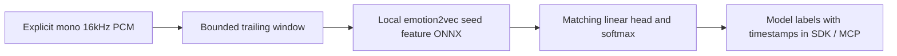

# Windowed vocal-expression context



The host owns capture, speaker separation and delivery cadence. `Emotion2VecContext`
owns trailing audio state and local feature/head inference. This is windowed
classification, not native recurrent streaming or verified internal emotion.
Actual model export/inference/quality acceptance remains required in
[#111](https://github.com/NomaDamas/Gamst/issues/111), under family #25.

## Selected model and source contract

Official candidate: [emotion2vec_plus_seed revision7be9a30](https://huggingface.co/emotion2vec/emotion2vec_plus_seed/tree/7be9a30d52bdc793cc24e6f7d25358d6648927c1).
The official model.pt LFS metadata declares1,118,245,358bytes and SHA256
`327e861049c7105a3f8589edfd16543a7cdc0c1926f1b64de975d98e0650cdd3`.
The name seed does **not** establish a tiny runtime. No checkpoint was downloaded
or installed during this implementation. The model-card weight license is
`other/model-license`, linked to a repository rather than a fixed license file;
weight redistribution/commercial compatibility is unverified. FunASR's MIT code
license is separate. The adapter is Apache-2.0 and ONNXRuntime MIT.

[FunASR1.4.26's pinned export](https://github.com/modelscope/FunASR/blob/cdd82b5cbfd05015f8fb2b167d61f25142c3a9e8/funasr/models/emotion2vec/export_meta.py)
returns frame features and includes whole-input normalization, rather than
classification scores. Its [native inference](https://github.com/modelscope/FunASR/blob/cdd82b5cbfd05015f8fb2b167d61f25142c3a9e8/funasr/models/emotion2vec/model.py)
means features over time, applies the classifier head and softmax. The SDK follows
that decomposition with a bounded local graph and matching external head; it
never imports FunASR, selects AutoModel, fetches weights or executes remote code.
A reproducible export/preparation tool and upstream parity are still required#111;
there is no claim that an unprepared official checkpoint can be loaded directly.

## Local artifacts and loader

Optional environment `humansense-sdk[vocal-expression]` selects
`onnxruntime==1.23.2` and NumPy. Pass explicit local model/head paths and SHA256s.
Discovery is standard-library-only. The loader reads each file once into bounded
bytes, verifies its hash before native loading, and uses a CPU session with one
intra-op and one inter-op thread. No filesystem external tensor loading is offered;
the model must be a self-contained ONNX artifact <=512MiB.

Required graph IO is float32 `input[1,samples]` with dynamic sample dimension and
float32 `output[1,frames,768]`. Runtime features must have1..256frames, finite
values and absolute magnitude<=1e6. The input waveform is **not normalized again**
in Python: normalization must be in the exported graph. Include metadata:

- `gamst.export_contract`: `emotion2vec_seed_features_v1`
- `gamst.source_checkpoint_sha256`: the pinned source hash above

Head JSON (<=512KiB) contains exactly `source_checkpoint_sha256`, `labels`,
`weight` (9x768) and `bias` (9); finite bounded numbers only, magnitude<=1e6.
Labels are exactly `angry, disgusted, fearful, happy, neutral, other, sad,
surprised, unknown` in that order, corresponding to the official tokens including
`<unk>`. Compute feature means/projection/softmax in float64 for stable local
arithmetic. Bitwise equivalence to float32 upstream is not claimed.

Hashes prove the selected artifact bytes match the caller's hashes. Checkpoint
metadata is a **declaration**, not proof that the graph/head were exported together
or preserve the source model. Context explicitly reports
`source_provenance='artifact-metadata-declaration'` and `export_parity_verified=False`.
Actual upstream/export/head and quantization parity must be validated in#111.
Native graph allocations are not bounded merely by file/input size; use trusted
prepared artifacts and the owned worker. Measure native memory during acceptance.

## Streaming semantics

Input: mono normalized float32 or int16 NumPy array (plain vector or Nx1), or
little-endian PCM16 bytes;16kHz only. Blocks are16..16000samples and multiples of16
(whole1..1000milliseconds). No resampling or partial-block padding. Sensor metadata
is mandatory, with at most one channel name. Timestamp is integer **capture end**
ms; block duration must fit before that end. The source must supply an exact
whole-millisecond capture timeline rather than callback arrival times.

Window1000..4000ms (default2000), hop100..window_ms (default500).
Before a complete window exists, return None. Afterward emit at most one latest
trailing window per input call once at least hop_ms of new audio has arrived.
Hop is a **minimum interval between emissions**, not a promise to emit every hop
inside a large incoming block; intermediate opportunities coalesce at block ends.
No hidden queue or partial/final flush exists. Capture and LLM delivery cadence
remain separately controlled by the host.

Keep at most64000float32samples (256000bytes), plus bounded concatenation/call
copies and native model memory. No neural state survives between windows. Owner,
subject, epoch, channel names, calibration/frame or sequence-mode changes clear
audio state. Capture sequence is used when present, otherwise delivery sequence.
Sequence skips and any capture-time discontinuity clear the window; nonincreasing
time/sequence rejects. Invalid PCM or model outputs also clear state. Reset and
close serialize with inference; close drops buffered PCM and predictor/session
references. Direct calls have no hard native timeout; use ProcessProvider.

Windows with RMS<1e-4 emit `insufficient_energy` and empty scores without invoking
the model. This heuristic is not VAD. Other windows emit all9probabilities with
start/end/window/hop provenance. `last_block_clipped` describes only the last
input block, not the whole window. Both int16 saturation rails are checked.
`inner_emotion_verified` and `speaker_identity_verified` remain false. Scores do
not establish feelings, intentions, truthfulness, identity or language quality.

## SDK / MCP

```python
from humansense import ProcessProvider, SensorStreams
config = dict(model_path='/prepared/seed.onnx', head_path='/prepared/head.json',
              model_sha256=MODEL_SHA256, head_sha256=HEAD_SHA256,
              window_ms=2000, hop_ms=500)
spec = ProcessProvider.capability('emotion2vec.seed.onnx', config)
async def create():
    return await ProcessProvider.open('/explicit/ort-env/bin/python',
        'emotion2vec.seed.onnx', config, startup_timeout=120, inference_timeout=10)
streams = SensorStreams(human)
streams.register(spec, create)
await streams.open('microphone', 'mono', [spec.id])
# Submit matching16kHz mono InputFrames; normal SDK/MCP observation APIs expose scores.
```

For direct calls use `Emotion2VecContext.from_local(...)` from
`humansense.providers.vocal_expression` and register/publish its spec/result with
capture provenance. Current tests (`python3 -m unittest discover -s tests -p
test_vocal_expression.py -v`) validate window state, hash/IO/head contracts,
actual NumPy linear-head arithmetic and managed SDK/MCP with predictor/session
doubles. They do **not** execute trained ONNX features or validate Korean/English
classification. No actual model quality, live latency or low-cost claim is made.
Required#111 covers export tooling, real model/runtime and paced real speech;
family#25 also retains its speaking-rate/prosody requirements.
