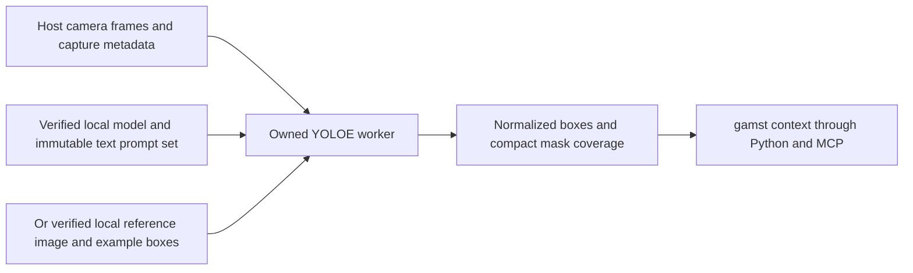

# Prompted YOLOE context



The host owns camera capture and selects the prompt set. The worker owns one
YOLOE model and its fixed prompt embeddings. It returns class candidates, boxes
and bounded mask context; an example of an object is not verified identity.
This is frame inference, with zero lookahead and no recurrent video model or
tracker. Required real native-model and quality acceptance remains open in
[#125](https://github.com/NomaDamas/Gamst/issues/125), under#18. The implementation
and synthetic tests do not establish actual model accuracy or streaming FPS.

## Native runtime and local assets

The API is pinned to Ultralytics8.4.212,
[revision24f58a21f979eb90d502ac0f9400bf07c7429f6b](https://github.com/ultralytics/ultralytics/tree/24f58a21f979eb90d502ac0f9400bf07c7429f6b),
Torch2.8.0 and TorchVision0.23.0, CPU or CUDA, FP32. The `yoloe` optional extra
describes these dependencies; nothing installs automatically. The actual
installed Ultralytics/CLIP runtime has not been exercised in the development
environment. Provision a separate runtime later, after reviewing native and
weight licenses. Current development downloads no trained weights or packages.

Text mode additionally requires an explicit local MobileCLIP TorchScript encoder
and the installed `clip==1.0` distribution from
[ultralytics/CLIP commit7ffa84b3bfa40c42ecc1c77147a855e69cb2dd40](https://github.com/ultralytics/CLIP/tree/7ffa84b3bfa40c42ecc1c77147a855e69cb2dd40).
Its installation metadata must include that VCS commit in `direct_url.json`;
an unrelated package named clip or a wheel without this provenance is rejected.
The package supplies its tokenizer/BPE data. Missing tokenizer dependencies fail
instead of installing. Text longer than77CLIP tokens is rejected, not truncated.

Use a promptable unfused YOLOE segmentation checkpoint with512-dimensional
embeddings and at most80million parameters. Prompt-free/LRPC, fused and
non-segmentation models are rejected. Candidate smaller families are YOLOE-11s
with `mobileclip:blt` or YOLOE-26n with `mobileclip2:b`; exact compatible artifacts
and their quality must still pass#125. A matching family declaration and shape
are necessary but do not prove encoder/checkpoint compatibility.

The [official YOLOE interface](https://docs.ultralytics.com/models/yoloe/) can fetch
a text encoder or install CLIP on a default text-prompt call. This adapter avoids
that path: it tokenizes through the explicit local CLIP package, evaluates the
explicit local TorchScript encoder, applies the loaded head's `get_tpe` RepRTA
transform, then calls `set_classes` with those embeddings already supplied.
It never calls default `get_text_pe`, `build_text_model` or `clip.load`.

Exemplar mode needs no text encoder. It accepts an explicit local RGB PNG,
pixel-coordinate xyxy boxes and class indices. The reference is decoded into
owned BGR memory, and passed to YOLOE's visual-prompt API on the first capture.
After successful prediction, the model reuses its visual embeddings and the
worker releases the reference image. Upstream names such as object0 are mapped
to the caller's ordered labels; the names are not inferred identity.

## Offline ownership and integrity

The native loader is restricted to a fresh `ProcessProvider` child with no prior
Ultralytics import. It checks package versions, reads bounded local assets and
checks SHA256 before native loading. Checkpoints are copied into an instance-owned
temporary directory beneath the explicitly supplied existing `runtime_root`.
The text encoder/reference is loaded from the verified byte snapshot, avoiding
a second unverified read. Limits are256MiB for the checkpoint,512MiB for the
encoder and4MiB for the reference PNG. These are file bounds, not certified peak
native RAM/VRAM limits. Captures and model work also require measured resource
acceptance. Native model tensor allocation is a trusted-artifact boundary.

Before Ultralytics import the child sets `YOLO_AUTOINSTALL=False`,
`YOLO_OFFLINE=True`, `ULTRALYTICS_SAFE_LOAD=True` and an owned `YOLO_CONFIG_DIR`.
It disables settings integrations and guards Python socket connect/DNS/send
paths for the child's lifetime. These guards prevent accidental Python downloads
and telemetry; they are not a sandbox for hostile checkpoints or native code.
The pinned Torch restricted-loader capability is required; no downgrade to the
unrestricted checkpoint loader is accepted. TorchScript itself is executable
trusted local code. Caller hashes establish integrity, not publisher authenticity.

Close/failure removes only the generated runtime directory. User checkpoints,
reference files, shared caches and settings are untouched. The worker process
owns library globals and native memory; use normal stream/process shutdown.
Do not call this native loader from a shared application interpreter. Discovery
imports only standard-library code and neither reads artifacts nor starts a worker.

The adapter uses Apache-2.0. Ultralytics is AGPL-3.0 or separately commercially
licensed; CLIP, MobileCLIP and the selected checkpoint retain their own licenses.
Installing this adapter does not relicense those dependencies or weights.

## Input, output and limits

Each frame is a plain uint8 BGR NumPy array with dimensions32..2048 and at most
1048576pixels. InputFrame must contain an integer capture timestamp0..2**53-1,
sensor metadata and declared image coordinates. The provider owns a copy before
native processing. Same-owner timestamps/sequences must increase; changes of
source/subject/epoch/coordinate declaration start a new capture guard. Errors
and reset clear the guard. Prompt embeddings remain immutable across reset;
close/reopen with a new configuration to change prompts. Close is permanent.

Prompt labels are1..16 ordered NFC strings,1..128characters each, without control
characters, duplicates or edge whitespace. Exemplar mode permits1..32nonempty
in-image boxes; class IDs are sequential0..N-1 and every label must be represented.
Several boxes can belong to the same class. A prompt hash binds normalized labels,
model SHA, encoder or reference SHA, example geometry, runtime and inference size.
Paths themselves are not prompt semantics. The capability version also binds
confidence threshold and detection limit.

Inference size is320,480 or640, with confidence threshold(default0.25), class-
agnostic NMS IoU0.7 and at most16detections. No saving, crops, visualization,
augmentation or video-source opening is requested. Retained masks must be restored
to original image dimensions (`retina_masks=True`). Full-resolution masks stay
in the worker. Context contains:

- Caller prompt label/class ID and native score, not a calibrated probability.
- Box x/y/width/height in normalized image coordinates.
- A16x16row-major mask coverage grid encoded as512hex characters. Each byte is
  round(255 × foreground pixels / cell pixels) on integer floor partitions of
  the original image. This is lossy occupancy, not a full mask or confidence map.
- Exact foreground-pixel count, area fraction and original dimensions.
- Model/prompt hashes, mode, capture time, coordinate frame, returned count and
  whether the native detection cap was reached. `complete_scene=False` always;
  missing detections do not prove absence. There is no temporal identity/track ID.

`artifact_integrity_verified` is true only for the native verified-loader path
in normal worker use. `model_quality_verified` and `identity_verified` remain
false. Synthetic backend tests leave integrity false and prove only contracts.

## Configuration

```python
from humansense import ProcessProvider, SensorStreams

config = dict(
    checkpoint_path="/owned/models/yoloe-11s-seg.pt",
    checkpoint_sha256=checkpoint_sha256,
    runtime_root="/owned/gamst-runtime",  # Must already exist; no shared cache.
    mode="text", labels=["cup", "glass"],
    encoder_path="/owned/models/mobileclip_blt.ts",
    encoder_sha256=encoder_sha256, encoder_family="mobileclip:blt",
    device="cpu", imgsz=640, threshold=0.25, max_objects=16,
)
spec = ProcessProvider.capability("yoloe.local", config)
streams = SensorStreams(human)  # Existing consented HumanSense instance.
async def create():
    return await ProcessProvider.open(worker_python, "yoloe.local", config)
streams.register(spec, create)
await streams.open("camera1", "video", [spec.id])
# Submit capture-timed BGR InputFrames with matching SensorMetadata source IDs
# and image coordinate frame; use normal drain/finish/close lifecycle.
```

For exemplar mode replace the three encoder fields with `reference_path`,
`reference_sha256`, `boxes=[[x0,y0,x1,y1], ...]` and `class_ids=[0, ...]`, and set
`mode="exemplar"`. Reference PNGs must be RGB, with the same dimension/pixel bounds
as input images. Pixel boxes refer to this reference, not future camera frames.

## Verification status

`python3 -m unittest discover -s tests -p test_yoloe.py -v` covers prompt ownership,
class mapping, geometry, exact coverage partitions, malformed output, capture
guards, asset SHA/bounds, dependency-light discovery, actual child network guards,
native API argument conversion with test doubles, and owned worker→SensorStreams→MCP
with an explicitly substituted test backend. It does not execute an installed
YOLOE checkpoint, text encoder or visual encoder. Required native startup,
upstream embedding/mask parity, licensed artifact provenance, held-out open-world
accuracy and sustained capture-to-context p50/p95/resource tests remain in#125.
No speed, cost savings or preserved-quality gate is certified by these tests.
